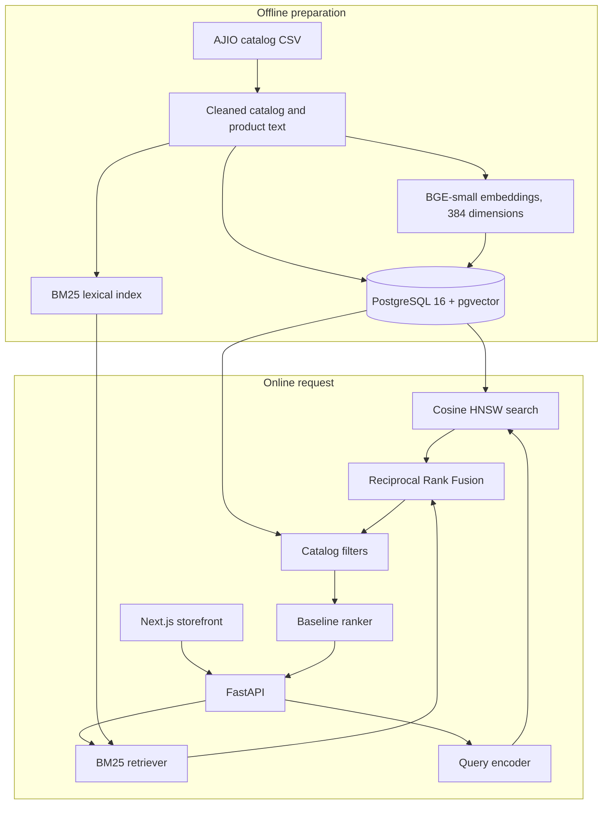

# ProductIQ

ProductIQ is a fashion search and recommendation system over a historical AJIO clothing catalog of **367,172 products**. A shopper types a natural-language query. The system retrieves candidates with lexical and semantic search, fuses those lists, ranks them, and returns products through a small HTTP API. A Next.js storefront renders the results.

The catalog is a fixed, searchable extract. ProductIQ does not track live stock, current prices, or checkout.

## Architecture

Preparation of the catalog and answering a query are separate paths. Embeddings and the lexical index are built once. A search encodes only the query.



**Offline.** The raw catalog is cleaned into a processed Parquet table. Each product gets a text representation, a 384-dimensional embedding from `BAAI/bge-small-en-v1.5`, and a place in a BM25 index. An explicit load writes product rows and vectors into PostgreSQL. Vectors live in `products.embedding` as `vector(384)`, with a cosine HNSW index. The API image does not contain the catalog or the embedding file. Those artifacts are mounted when the service starts.

**Online.** `POST /api/v1/search` does not scan the catalog in the application process.

1. The query is turned into lexical tokens and a BGE embedding.
2. BM25 reads the persisted lexical index. pgvector runs a cosine search over the HNSW index.
3. Reciprocal Rank Fusion merges the two ranked lists.
4. Active constraints, such as category gender, are applied in PostgreSQL.
5. A baseline ranker orders the fused pool. Learning-to-rank with LightGBM exists for offline experiments and is not the HTTP ranking path.
6. The response contains `product_id` and `rank` only. The storefront loads brand, description, image, and category from `GET /api/v1/products/{id}`.

Recommendations follow the same catalog. A seed product id returns similar products. The seed is excluded from that list.

Readiness distinguishes a three-product demo fixture from the full 367,172-row catalog. `/api/v1/ready` reports `fixture`, `full`, `partial`, or `empty`. Importing the API does not open PostgreSQL or load the catalog. Serving starts only when `PRODUCTIQ_ENABLE_PRODUCTION_SERVING=1`.

## Capabilities

- Natural-language product search across the AJIO extract
- Hybrid retrieval: BM25, dense cosine search, and Reciprocal Rank Fusion
- Gender and other catalog filters on the retrieved pool
- Product detail with brand, description, image URL, product URL, category, and product type
- Similar-product recommendations from a seed id
- Health and readiness checks that report which catalog is loaded
- A Next.js storefront for search, product pages, and recommendations

Search and recommendation payloads do not include a separate title or a public price. Cards use the product description as the title.

## Stack

| Layer | Choice |
| --- | --- |
| Language | Python 3.13 |
| API | FastAPI, Pydantic v2, Uvicorn |
| Storefront | Next.js App Router, React, TypeScript |
| Database | PostgreSQL 16, pgvector, SQLAlchemy, psycopg |
| Lexical retrieval | BM25 over a persisted inverted index |
| Semantic retrieval | `BAAI/bge-small-en-v1.5`, 384 dimensions, cosine HNSW |
| Fusion | Reciprocal Rank Fusion |
| Ranking | Baseline ranker on the fused candidate pool |
| Runtime | Docker Compose for Postgres and the API |

## Repository layout

```text
src/productiq/          API, retrieval, ranking, recommendations, database
frontend/               Next.js storefront
tests/                  Python test suite
docs/architecture/      Design notes for each subsystem
notebooks/              Data-engineering and serving notebooks
resources/processed/    Catalog Parquet, embeddings, BM25 index
resources/raw/          Source AJIO catalog extract
docker-compose.yml      Postgres, API, and explicit catalog load
```

| Package | Responsibility |
| --- | --- |
| `productiq.api` | HTTP application, lifespan, production service wiring |
| `productiq.retrieval` | BM25, semantic search, RRF, vector index load |
| `productiq.ranking` | Baseline ranking and offline learning-to-rank experiments |
| `productiq.recommendation` | Similar-product generation |
| `productiq.database` | Schema, catalog load, PostgreSQL access |
| `productiq.serving` | Search, product, and recommendation services |
| `productiq.representation` | Canonical product text used for indexing and embeddings |

## API

| Method | Path | Purpose |
| --- | --- | --- |
| `GET` | `/api/v1/health` | Process is up |
| `GET` | `/api/v1/ready` | Serving configuration and catalog mode |
| `POST` | `/api/v1/search` | Ranked product ids for a query |
| `GET` | `/api/v1/products/{id}` | Display fields for one product |
| `POST` | `/api/v1/recommendations` | Similar products for a seed id |

Search example:

```bash
curl -s -X POST http://127.0.0.1:8000/api/v1/search \
  -H "Content-Type: application/json" \
  -d "{\"query\":\"navy cotton shirt\",\"top_k\":5}"
```

A ready full catalog reports `full reference catalog loaded (367172 products, 367172 embeddings)`.

## Run locally

Requirements: Docker, Python 3.13, and Node.js for the storefront.

```bash
python -m venv .venv
.venv\Scripts\activate
pip install -e ".[dev]"
copy .env.example .env
```

Set `POSTGRES_PASSWORD` and `DATABASE_URL` in `.env`. Inside Compose the database host is `postgres`. Do not commit `.env`.

Start Postgres, load a catalog, then start the API:

```bash
docker compose up -d postgres
docker compose --profile load run --rm catalog-load
docker compose up -d productiq-api
```

The load command above inserts a labeled three-product demo so the API can be exercised quickly. It does not load the 367,172-row catalog. To load the full extract, run the same loader with `--mode full` and the official checksum check. That load is explicit, restartable, and is not part of API startup. Full-catalog steps and artifact paths are documented in [Docker serving integration](docs/architecture/docker-serving-integration.md).

The API publishes `${PRODUCTIQ_API_PORT:-8000}` on the host. Point the storefront at that origin:

```bash
cd frontend
npm install
copy .env.example .env.local
npm run dev
```

Set `NEXT_PUBLIC_PRODUCTIQ_API_URL` in `frontend/.env.local` before `npm run dev` or `npm run build`. The value is inlined at build time. With `APP_ENV=development`, the API allows `http://localhost:3000` and `http://127.0.0.1:3000`. Any other browser origin needs `PRODUCTIQ_CORS_ALLOWED_ORIGINS`. Leave credentialed CORS off.

The first API start downloads `BAAI/bge-small-en-v1.5` into `HF_HOME`.

## Configuration

Settings are typed in `src/productiq/config/settings.py` and read with `get_settings()`. Names that matter for a local or deployed stack:

- `APP_ENV`, `LOG_LEVEL`
- `DATABASE_URL`, `POSTGRES_DB`, `POSTGRES_USER`, `POSTGRES_PASSWORD`
- `PRODUCTIQ_ENABLE_PRODUCTION_SERVING`
- `PRODUCTIQ_CATALOG_LOAD_MODE`
- `PRODUCTIQ_PROCESSED_CATALOG_PATH`, `PRODUCTIQ_BM25_ARTIFACT_PATH`, `PRODUCTIQ_EMBEDDINGS_ARTIFACT_PATH`
- `PRODUCTIQ_CORS_ALLOWED_ORIGINS`, `PRODUCTIQ_CORS_ALLOW_CREDENTIALS`
- `PRODUCTIQ_API_PORT`, `HF_HOME`
- `NEXT_PUBLIC_PRODUCTIQ_API_URL` on the storefront

`.env.example` lists safe placeholders. Secret values stay in `.env` and `frontend/.env.local`, both gitignored.

## Tests

```bash
pytest
pytest --cov=productiq --cov-report=term-missing
```

Pytest uses `pythonpath = ["src"]`. Shared isolation is in `tests/conftest.py`. Docker contract tests do not require a running database. HTTP tests against Compose are opt-in.

Storefront checks, from `frontend/`:

```bash
npm test
npm run typecheck
npm run lint
npm run build
```

## Documentation

- [System architecture](docs/architecture/system.md)
- [Data flow](docs/architecture/data-flow.md)
- [Production retrieval pipeline](docs/architecture/production-retrieval-pipeline.md)
- [Docker serving integration](docs/architecture/docker-serving-integration.md)
- [PostgreSQL and pgvector](docs/architecture/docker-postgres-pgvector.md)
- [Storefront notes](frontend/README.md)

## License

[MIT](LICENSE)
