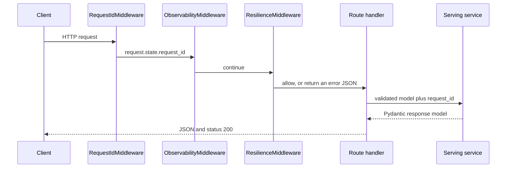

# HTTP routes and error handling

This note explains how a ProductIQ HTTP call enters the backend, how FastAPI checks it, and how failures become JSON. It is written for someone who can read Python and is learning backend engineering.

Retrieval, ranking, database transactions, and the offline catalog pipeline are later documents. They are named here only where a route hands work to a service.

The details below were read from the current source and from the tests that assert status codes and JSON fields. Those tests were not re-run for this document.

## 1. Why this document exists

ProductIQ exposes five HTTP endpoints under `/api/v1`: health, readiness, search, one product, and recommendations. This document covers:

- what an HTTP request and response are
- the exact path, handler, request model, and response model for each endpoint
- how FastAPI validates a body before the handler runs
- how `request_validation_handler`, `productiq_error_handler`, and `unhandled_exception_handler` build error JSON
- how `frontend/lib/api.ts` calls those endpoints

It does not cover how BM25, pgvector, Reciprocal Rank Fusion, or the recommendation generators choose products. Search is followed only until `ProductionSearchServingService.search`.

## 2. HTTP and REST fundamentals

These words are general HTTP ideas. The ProductIQ examples after each one are the parts checked in this repository.

**Client and server.** The client asks. The server answers. In this project the client is the Next.js storefront, or a test using FastAPI's `TestClient`. The server is the FastAPI application built by `create_app` in `src/productiq/api/app.py`.

**Request and response.** A request is the method, the URL, the headers, and sometimes a body. A response is a status code plus a body. ProductIQ success bodies are JSON objects such as `SearchApiResponse`. Failure bodies from the registered handlers are a JSON object with one key, `error`.

**URL, path, endpoint, route, handler.** A URL is the full address, such as `http://localhost:8000/api/v1/search`. The path is the part after the host: `/api/v1/search`. An endpoint is one method plus one path. A route is the FastAPI registration of that endpoint. A handler is the Python function that runs for it. `post_search` is the handler for `POST /api/v1/search`.

**Headers.** Headers are named metadata around the body. ProductIQ reads `X-Request-ID` in `RequestIdMiddleware` and `Content-Type` when the storefront sends JSON. `Content-Length` is read by `ResilienceMiddleware` to reject an oversized body.

**Query parameters and request body.** Query parameters sit in the URL after `?`. ProductIQ's five handlers do not declare query parameters. Search and recommendations take a JSON body. The product id is a path parameter: the `{product_id}` segment in `/api/v1/products/{product_id}`.

**GET and POST.** `GET` asks for a resource and, in this API, sends no JSON body. Health, readiness, and product detail use `GET`. `POST` submits a document for the server to process. Search and recommendations use `POST` because the query, `top_k`, and filters are a JSON document. `test_search_wrong_http_method` in `tests/api/test_api_http_boundary.py` shows that `GET /api/v1/search` returns status `405`.

**JSON.** JSON is text that represents objects, arrays, strings, and numbers. The storefront builds it with `JSON.stringify` in `requestJson`. FastAPI parses it into a Pydantic model. Pydantic is the library that turns that text into a Python object and rejects values that break the model's rules.

**Status codes.** The status code is a number that says how the call ended. ProductIQ's own mapping is `HTTP_STATUS_BY_API_ERROR` in `src/productiq/api/http_status.py`:

| API code | HTTP status | When this code is used |
| --- | --- | --- |
| `INVALID_REQUEST` | 400 | Body or field validation failed, or a domain `ValueError` / `QueryRepresentationError` / `ValidationError` |
| `NOT_FOUND` | 404 | Missing product, missing recommendation seed, or `ApiNotFoundError` |
| `RATE_LIMITED` | 429 | `ResilienceMiddleware` rejects the caller |
| `INTERNAL_ERROR` | 500 | Retrieval, ranking, or recommendation failure, or any unexpected exception |
| `CONFIGURATION_ERROR` | 503 | A route's service was not placed on `app.state` |
| `SERVICE_UNAVAILABLE` | 503 | Database, catalog-load, or other catalog-validation failures, or a serving timeout |
| `OVERLOADED` | 503 | The search or recommendation concurrency gate is full |

A successful handler return uses status `200`. The route decorators do not set another success status. `GET /api/v1/ready` still returns `200` when the JSON field `status` is `not_ready`. That field is application data. It is separate from the HTTP status.

**What REST means here.** REST is a style in which each URL names a resource or an action, the method says what to do, and the body is a representation of that resource. ProductIQ follows that style for these five calls: a product is `GET /api/v1/products/{product_id}`, and search is `POST /api/v1/search` with a JSON query. The code does not implement a general create/update/delete API for products. Those words are not part of this HTTP surface.

General example, not a captured ProductIQ response: a client sends `GET /books/12` and the server answers `200` with `{"title": "Example"}`. The ProductIQ equivalent that is defined by `ProductApiResponse` is `GET /api/v1/products/P1` returning fields such as `product_id`, `brand`, `description`, and `request_id`.

## 3. The five API endpoints

The prefix is built in `src/productiq/serving/versioning.py`:

```python
SERVING_API_MAJOR_VERSION = "v1"
SERVING_API_ROUTE_PREFIX = f"/api/{SERVING_API_MAJOR_VERSION}"
```

`create_app` mounts the aggregator with that prefix:

```python
app.include_router(v1_router, prefix=SERVING_API_ROUTE_PREFIX)
```

`v1_router` in `src/productiq/api/routes/v1_router.py` includes `health_router`, `search_router`, `recommendations_router`, and `products_router` with no extra prefix. Each router declares a path such as `"/search"`. The public path is the prefix plus that path.

`create_app` also publishes schema pages at `/api/v1/openapi.json`, `/api/v1/docs`, and `/api/v1/redoc`. Those are documentation routes, not the five product endpoints.

| Endpoint | Purpose | Handler | Request | Response model | Service | Downstream, at the HTTP boundary | Verified errors | Tests |
| --- | --- | --- | --- | --- | --- | --- | --- | --- |
| `GET /api/v1/health` | Process is up | `get_health` in `src/productiq/api/routes/health.py` | No body, no path parameter | `HealthResponse`: `status` (`"ok"`), `service`, `api_version` | `ComposedHealthServingService.health` | Builds the response from `ServingConfig`. No database call | Success `200`. This route does not require a search or product service | `tests/api/test_fastapi_app.py` |
| `GET /api/v1/ready` | Can the process accept work, using checks already in memory | `get_ready` in the same file | No body | `ReadinessResponse`: `status` (`ready` or `not_ready`), `checks[]` with `name`, `status`, `message` | `ComposedHealthServingService.ready` → `build_readiness_response` | Reads services stored at startup. The function's docstring says it does this without expensive dependency I/O | Success `200` even when the body says `not_ready` | `tests/api/test_production_safety.py` asserts `200` for one ready call |
| `POST /api/v1/search` | Ranked product ids for a text query | `post_search` in `src/productiq/api/routes/search.py` | JSON `SearchApiRequest`: `query`, `top_k`, optional `filters` | `SearchApiResponse`: `query`, `top_k`, `results[{product_id, rank}]`, `request_id`, `returned_count` | `ProductionSearchServingService.search` | `build_query_representation`, then `retrieve_ranked`, then `ranked_search_to_api_response` | `400` missing `query`, `top_k` of `0` or `-1`, malformed JSON. `200` for an empty result list. `405` for `GET`. `503` `CONFIGURATION_ERROR` when search is not configured | `tests/api/test_api_http_boundary.py`, `tests/api/test_api_search_coverage.py`, `tests/api/test_api_errors.py` |
| `GET /api/v1/products/{product_id}` | One catalog record | `get_product` in `src/productiq/api/routes/products.py` | Path parameter `product_id: str` | `ProductApiResponse`: `product_id`, `brand`, `description`, `image_url`, `product_url`, `category_gender`, `product_type`, `request_id` | `ProductionProductServingService.get_product` | Catalog provider `get_product`, then `product_read_model_to_api`. Raises `ProductNotFoundError` when the provider returns `None` | `404` with message `Product not found.` `503` `CONFIGURATION_ERROR` when the product service is missing. `503` `SERVICE_UNAVAILABLE` when the service raises `CatalogLoadError` | `tests/api/test_product_route.py`, `tests/api/test_api_errors.py` |
| `POST /api/v1/recommendations` | Similar products for a seed id | `post_recommendations` in `src/productiq/api/routes/recommendations.py` | JSON `RecommendationApiRequest`: `seed_product_id`, `top_k`, optional `recommendation_type`, optional `filters` | `RecommendationApiResponse`: `seed_product_id`, `recommendation_type`, `top_k`, `recommendations[{product_id, rank, recommendation_score}]`, `request_id`, `returned_count` | `ProductionRecommendationServingService.recommend` | Builds a `RecommendationRequest`, calls `recommend_with_metadata`, then `recommendation_response_to_api` | `400` for `recommendation_type` `personalized` and for `top_k` `101`. `404` message `Seed product not found` when the seed row is missing. `500` when the service raises `RecommendationError`. `503` `CONFIGURATION_ERROR` when the service is missing | `tests/api/test_recommendation_route.py` |

`SearchApiRequest` and `RecommendationApiRequest` set `extra="forbid"`. A JSON field the model does not declare fails validation. The default cap is `top_k` of `100` and a query of `512` characters, from `DEFAULT_API_MAX_TOP_K` and `DEFAULT_API_MAX_QUERY_LENGTH` in `src/productiq/serving/config.py`. Environment variables `PRODUCTIQ_API_MAX_TOP_K` and `PRODUCTIQ_API_MAX_QUERY_LENGTH` can change those caps.

`filters` uses `QueryFilterConstraints` in `src/productiq/representation/query_contract.py`. The fields are `brand`, `brand_normalized`, `category_gender`, `product_type`, list fields `color`, `pattern`, `material`, `fit`, `sleeve`, `neckline`, `product_features`, `style_attributes`, and price bounds `min_discount_price_inr` and `max_discount_price_inr`. The storefront type `SearchFilters` only sends `category_gender`.

`RecommendationType` in `src/productiq/recommendation/contracts.py` lists `similar`, `alternative`, `complementary`, and `personalized`. `RecommendationApiRequest.validate_production_scope` accepts only `similar`. The field's default is `RecommendationType.SIMILAR`, so a body that omits it is still valid.

Illustrative search body, shaped by `SearchApiRequest` and the storefront caller. It is not a recorded live response:

```json
{ "query": "navy cotton shirt", "top_k": 12, "filters": { "category_gender": "Men" } }
```

Illustrative success body, shaped by `SearchApiResponse`. Scores are absent because `ranked_search_to_api_response` copies only `product_id` and `rank`:

```json
{
  "query": "navy cotton shirt",
  "top_k": 12,
  "results": [{ "product_id": "462494766003", "rank": 1 }],
  "request_id": "rec-req-1",
  "returned_count": 1
}
```

The `request_id` value `rec-req-1` is the header used in `test_recommendations_route_success`, not a production id.

## 4. Trace a request through FastAPI

This is the order supported by `create_app`, the route signatures, and FastAPI's rule that a handler body runs after its parameters validate. Framework internals that this repository does not test are marked in section 12.



`create_app` registers middleware in this order: `ResilienceMiddleware`, `ObservabilityMiddleware`, `RequestIdMiddleware`. Starlette treats the last `add_middleware` call as the outer wrapper, so an incoming request enters `RequestIdMiddleware` first. That statement is the framework's registration rule applied to these three lines. This review did not re-run a middleware-order test.

1. **The client sends the request.** `requestJson` in `frontend/lib/api.ts` calls `fetch` with the base URL plus a path such as `/api/v1/search`.
2. **Request id.** `RequestIdMiddleware` copies a safe `X-Request-ID` header onto `request.state.request_id`, or generates a UUID. It also writes that value back on the response header. Unsafe values, including spaces, are replaced. `normalize_request_id` and `test_unsafe_request_id_is_replaced` cover that rule.
3. **Observability.** `ObservabilityMiddleware` classifies the path with `resolve_api_operation` and emits start and completion events. It does not decide the HTTP status.
4. **Resilience, before the route.** Health and ready skip this middleware's checks. For other routes it can return JSON immediately:
   - body larger than `api_max_body_bytes` (default `1_048_576`) → `400` `INVALID_REQUEST`, message `Request body too large`
   - rate limit, only when `PRODUCTIQ_RATE_LIMIT_ENABLED` is true → `429`, message `Rate limit exceeded`, plus a `Retry-After` header
   - search or recommendation concurrency gate full, only when the matching limit is greater than `0` → `503` `OVERLOADED`, message `Service is temporarily overloaded`
   - handler takes longer than `PRODUCTIQ_SERVING_REQUEST_TIMEOUT_SECONDS`, only when that value is greater than `0` → `503` `SERVICE_UNAVAILABLE`, message `Request timed out`

   The defaults leave rate limiting off, both concurrency limits at `0`, and the serving timeout at `0`. With those defaults the gate and the timeout are not applied. `NullRateLimiter` and `NullConcurrencyGate` are what `build_application_resilience` installs in that case.
5. **FastAPI matches the route.** The method and path select one handler. An unknown path such as `/api/v1/does-not-exist` returns status `404` in `test_unknown_api_route_not_found`. The wrong method on a known path returns `405`, as with `GET /api/v1/search`.
6. **Validation and dependencies.** For `post_search`, FastAPI builds `SearchApiRequest` from the JSON body, then resolves `SearchServiceDep` and `RequestIdDep`. Those dependencies call `get_search_service` and `get_request_id` in `src/productiq/api/dependencies.py`. `get_search_service` raises `ConfigurationError` when `app.state.search_service` is missing. The same pattern exists for product and recommendation services. Health always has a service: `get_health_service` reads `app.state.health_service`.
7. **The handler runs.** `post_search` is only this:

```python
return service.search(body, request_id=request_id)
```

`get_product` and `post_recommendations` are the same shape. They do not open a database session themselves. `test_route_does_not_access_storage` in `tests/api/test_product_route.py` inspects the product route source for that boundary.
8. **The service returns a response model.** `ranked_search_to_api_response`, `product_read_model_to_api`, and `recommendation_response_to_api` in `src/productiq/serving/mappers.py` choose the public fields. The route decorator sets `response_model=...`, so FastAPI serializes that Pydantic object to JSON. Tuple fields such as `results` become JSON arrays. `test_rank_ordering_preserved` reads `response.json()["results"]` as a list.
9. **Errors.** If step 6 raises `RequestValidationError`, `request_validation_handler` runs and the handler function is not entered. If the service raises `ProductIQError`, `productiq_error_handler` runs. Any other exception reaches `unhandled_exception_handler`. Registration is `register_exception_handlers` in `src/productiq/api/exception_handlers.py`.

## 5. Request validation

Pydantic validation checks that incoming data matches a model: required fields exist, types match, and extra rules such as `min_length` and `gt=0` hold. FastAPI runs that check while binding the handler's body parameter. A failure becomes `RequestValidationError` before `post_search` or `post_recommendations` executes.

`request_validation_handler` ignores the exception object (`_ = exc`) and always returns the same public message:

```json
{
  "error": {
    "code": "INVALID_REQUEST",
    "message": "Request validation failed",
    "request_id": "err-req-1"
  }
}
```

`http_status_for_api_error` maps that code to `400`. `test_invalid_request_includes_request_id` checks the code, a non-empty message, and the request id `err-req-1` when the client sends that `X-Request-ID`. The exact sentence `Request validation failed` is the string in the handler. The test checks that a message is present.

Cases read from the models and confirmed by tests:

| Input | Why it fails | Test |
| --- | --- | --- |
| Body `{not-json` | JSON cannot be parsed | `test_malformed_json_invalid_request` |
| `{"top_k": 3}` with no `query` | `query` is required | `test_search_missing_required_field` |
| `top_k` of `0` or `-1` | `Field(gt=0)` | `test_top_k_zero_invalid_request`, `test_negative_top_k_invalid_request` |
| `top_k` of `101` with the default cap | `validate_top_k_limit` / `validate_production_scope` | `test_top_k_above_maximum` |
| `recommendation_type` of `personalized` | `validate_production_scope` allows only `SIMILAR` | `test_unsupported_recommendation_type_invalid_request` |
| `top_k` of `100` | Equal to the default maximum, so it is accepted | `test_top_k_at_default_maximum_succeeds` |

A query that is only spaces has length at least 1, so `SearchApiRequest` accepts it. `build_query_representation` later calls `normalize_query_text`, which raises `QueryRepresentationError` with `query_text must not be empty`. `map_exception_to_api_error` maps `QueryRepresentationError` to `INVALID_REQUEST`. That is a service-layer failure, handled by `productiq_error_handler`, not by `request_validation_handler`. This review did not find a test that posts a whitespace-only query.

Validation errors do not include FastAPI's default `detail` list. The handler replaces that shape with `ApiErrorEnvelope`.

## 6. Exception handling

Three handlers are registered. Middleware errors in section 4 are a fourth path: they return `JSONResponse` directly and do not raise.

| Situation | Exception or branch | Handler | Status and body |
| --- | --- | --- | --- |
| Malformed JSON or invalid fields | `RequestValidationError` | `request_validation_handler` | `400`, code `INVALID_REQUEST`, message `Request validation failed` |
| Product id has no catalog row | `ProductNotFoundError` from `ProductionProductServingService.get_product` | `productiq_error_handler` → `map_http_exception_to_api_error` | `404`, message `Product not found.` The mapper uses that fixed sentence |
| Recommendation seed row is missing | `CatalogValidationError` whose text contains `catalog row missing for seed product_id` | same mapper, `is_missing_seed_product_error` | `404`, message `Seed product not found`. `test_missing_seed_product_not_found` also asserts the seed id is absent from the body |
| `ApiNotFoundError` | mapped before the product and seed branches | `productiq_error_handler` | `404`. The message is `safe_client_message(exc)`, so it is the exception text after redaction |
| Search, product, or recommendation service missing | `ConfigurationError` from `get_search_service`, `get_product_service`, or `get_recommendation_service` | `productiq_error_handler` → `map_exception_to_api_error` | `503`, code `CONFIGURATION_ERROR`. The message is the sanitized exception text, for example `Search serving is not configured for this deployment` |
| `RetrievalError`, `RankingError`, `RecommendationError` | domain failure | `map_exception_to_api_error` | `500` `INTERNAL_ERROR`. The client message is the sanitized exception text |
| `DatabaseError`, `CatalogLoadError`, and a `CatalogValidationError` that is not a missing seed | catalog or database failure | `map_exception_to_api_error` | `503` `SERVICE_UNAVAILABLE` |
| `ValueError` or ProductIQ `ValidationError` | bad value that passed the route model | `map_exception_to_api_error` | `400` `INVALID_REQUEST` |
| Any other `Exception`, such as `RuntimeError` | not a `ProductIQError` | `unhandled_exception_handler` | `500`, message exactly `An unexpected error occurred` |

`test_unexpected_exception_handling` raises `RuntimeError("secret internals")` and asserts that `secret` is not in the response. `test_productiq_error_handling` raises `RetrievalError("pipeline contract failed")` and asserts code `INTERNAL_ERROR`. The retrieval test checks the code. It does not assert that the words `pipeline contract failed` are hidden. `safe_client_message` keeps a `ProductIQError` message unless that text looks like a credential URL, a bearer token, a file path, or a traceback. The fixed sentence is reserved for non-`ProductIQError` exceptions and for text that mentions a traceback.

That split is the implementation. The general reason to avoid raw exceptions is separate: a client does not need stack traces, SQL, file paths, or connection strings, and those strings help an attacker understand the server. ProductIQ implements that idea in two places. `unhandled_exception_handler` drops the exception text. `_sanitize_client_text` redacts credential URLs, `Bearer` tokens, and path-like text, and replaces traceback wording with `An unexpected error occurred`. Domain errors can still return their own message after that cleaning. `test_missing_seed_product_not_found` shows one deliberate choice: the public message does not repeat the missing id.

`ApiErrorBody` always has `code`, `message`, and `request_id`. `request_id` may be `null` when the middleware did not set one. The JSON wrapper is always `{"error": { ... }}` for these handlers. Status `404` from an unknown path and status `405` from the wrong method are FastAPI defaults. The tests check the status numbers. They do not assert that those two responses use `ApiErrorEnvelope`.

## 7. Frontend-to-backend connection

`apiBaseUrl` in `frontend/lib/config.ts` reads `NEXT_PUBLIC_PRODUCTIQ_API_URL`. A missing or blank value becomes `http://localhost:8000`. Trailing slashes are removed. `requestJson` then fetches `${apiBaseUrl()}${path}`.

`frontend/tests/api.test.ts` stubs the base URL as `http://api.test/` and expects the search call to hit `http://api.test/api/v1/search`. That confirms the slash trimming and the path. It uses a mocked `fetch`. It is not a live server call.

| Function | Method and path | Body |
| --- | --- | --- |
| `getHealth` | `GET /api/v1/health` | none |
| `getReadiness` | `GET /api/v1/ready` | none |
| `searchProducts` | `POST /api/v1/search` | `query`, `top_k`, and `filters` only when the filter object has keys |
| `getProduct` | `GET /api/v1/products/{id}` | none. The id is passed through `encodeURIComponent` |
| `getRecommendations` | `POST /api/v1/recommendations` | `seed_product_id` and `top_k`. `recommendation_type` is omitted, so the server default `similar` applies |

`REQUEST_TIMEOUT_MS` is `12000`. `requestJson` aborts the browser request at that time and raises `ProductIqApiError` with kind `timeout` and message `The API took too long to respond.` A failed HTTP status becomes kind `http`. The message is `error.message` from the JSON envelope when that field exists. A `404` without that field becomes `Product not found.` Any other status without a message becomes `Request failed (status).` Network failure becomes kind `network`. A success body that is not JSON becomes kind `malformed`.

`SearchExperience` calls `searchProducts` with `SEARCH_TOP_K` (`12`) and, when the page query has `Men` or `Women`, a `category_gender` filter. If `results` is empty it shows an empty state. Otherwise `loadProductCards` calls `getProduct` for each id. A `ProductIqApiError` is shown as its `message`. That is the HTTP portion of search. Ranking stays inside the service.

`ProductDetailView` calls `getProduct`, then `getRecommendations` with `RECOMMENDATION_TOP_K` (`8`). A product `404` sets a missing state. A recommendation failure leaves the product on screen and stores the error message as a note. `StatusIndicator` calls `getHealth` and `getReadiness`.

## 8. Concepts mapped to ProductIQ

| Concept | Beginner-friendly definition | ProductIQ example | Source | Why this design is useful |
| --- | --- | --- | --- | --- |
| Route handler | The function FastAPI calls for one method and path | `post_search` returns `service.search(...)` | `src/productiq/api/routes/search.py` | HTTP details stay in one small function |
| Service | The object that performs one use case | `ProductionSearchServingService.search` | `src/productiq/serving/search_service.py` | The route can be tested with a fake service |
| Request schema | The model that describes allowed input | `SearchApiRequest` | `src/productiq/serving/search_schema.py` | Bad `top_k` fails before retrieval |
| Response schema | The model that describes allowed output | `SearchApiResponse` | same file | Clients see `product_id` and `rank`, not retriever diagnostics |
| Dependency | A value FastAPI loads for the handler | `SearchServiceDep` calls `get_search_service` | `src/productiq/api/dependencies.py` | Production code and tests supply different services through `app.state` or `dependency_overrides` |
| Exception handler | A function that turns an exception into an HTTP response | `unhandled_exception_handler` | `src/productiq/api/exception_handlers.py` | Every unexpected failure shares one JSON shape |
| HTTP status code | The numeric outcome of the call | `404` for `ApiErrorCode.NOT_FOUND` | `src/productiq/api/http_status.py` | Clients can branch on `404` without reading a stack trace |
| JSON serialization | Turning a Python object into JSON text | `response_model=SearchApiResponse` and `envelope.model_dump(mode="json")` | route decorators and `_json_error_response` | The browser receives text it can parse |

A request model is the JSON contract. A database row is the `Product` ORM class in `src/productiq/database/models/product.py`. The product HTTP response is built from `ProductCatalogReadModel`, which does not include `embedding` or the price columns. `product_read_model_to_api` also drops `brand_normalized`.

## 9. Interview preparation

**What is a REST API?** It is an HTTP API that uses URLs and methods to name operations and uses a representation, here JSON, as the body. ProductIQ's public surface is the five routes under `/api/v1` registered by `v1_router` and `create_app`.

**What is the difference between GET and POST?** `GET` retrieves. Product detail is `GET /api/v1/products/{product_id}` and has no JSON body. `POST` submits a document. Search is `POST /api/v1/search` with `query` and `top_k`. Calling search with `GET` returns `405`.

**What is a route handler?** It is the function bound to a route. `post_search` is bound with `@search_router.post("/search")`. Its job is to call the injected service and return a `SearchApiResponse`.

**What is request validation?** It is the check that the body matches the declared model before the handler runs. A missing `query` raises `RequestValidationError`. `request_validation_handler` answers with HTTP `400` and code `INVALID_REQUEST`.

**What is Pydantic's role here?** Pydantic defines `SearchApiRequest`, the response models, and `ApiErrorEnvelope`. Field rules such as `min_length=1` and `gt=0`, plus `validate_production_scope`, are the validation rules FastAPI enforces.

**What is the difference between a route and a service?** The route is the HTTP adapter. The service is the use case. `get_product` does not query the catalog. `ProductionProductServingService.get_product` does, through a `ProductCatalogReadProvider`.

**What happens when a product id does not exist?** The provider returns `None`. The service raises `ProductNotFoundError`. `map_http_exception_to_api_error` returns code `NOT_FOUND` and message `Product not found.` The HTTP status is `404`.

**Why should an API avoid returning raw internal exceptions?** Stack traces, paths, and connection strings describe the server to anyone who can call it. `unhandled_exception_handler` always returns `An unexpected error occurred`. `test_unexpected_exception_handling` shows that `secret internals` from a `RuntimeError` is not in the body. Domain `ProductIQError` messages are returned after `_sanitize_client_text`, so they are cleaned rather than discarded.

**How does the frontend communicate with the backend?** `apiBaseUrl()` supplies the origin, defaulting to `http://localhost:8000`. `searchProducts`, `getProduct`, `getRecommendations`, `getHealth`, and `getReadiness` call `fetch` through `requestJson`. Failures become `ProductIqApiError`.

**What is the difference between a request model and a database model?** `SearchApiRequest` is the JSON the client may send. `Product` is the SQLAlchemy row, including `embedding` and prices. The HTTP product response is `ProductApiResponse`, which is a smaller set of fields.

**What is a dependency in this FastAPI app?** It is a function passed to `Depends`. `get_request_id` reads `request.state.request_id`. `get_search_service` reads `app.state.search_service` and raises `ConfigurationError` when that attribute is missing. Tests can replace a dependency with `app.dependency_overrides`.

**What does a validation failure look like?** HTTP `400` and a body `{"error": {"code": "INVALID_REQUEST", "message": "Request validation failed", "request_id": ...}}`. The handler does not return FastAPI's `detail` array.

**How do health and ready differ?** `get_health` returns `status: "ok"` plus the service name and API version. It does not inspect the catalog. `get_ready` returns `build_readiness_response`, whose `status` is `ready` or `not_ready`, using services and counts already stored on the process. Both are `GET` and both use HTTP `200` on the success path.

**Why is `request_id` on both success and error bodies?** `RequestIdMiddleware` assigns one id per call and echoes it in `X-Request-ID`. Success models require `request_id`. Error models include it so a caller can quote the same id when reporting a failure. `test_recommendations_route_success` shows the header value copied into the JSON.

**What is returned for an empty search?** HTTP `200` with `returned_count` of `0` and an empty `results` array. `test_empty_results_return_200` covers that. An empty result is a successful search, not a `404`.

## 10. Practical exercises

Do not change application code. Read the files and write the answers in your own notes.

**1. Build the five URLs.** Open `versioning.py`, `app.py` where `include_router` is called, and `routes/v1_router.py`. Write the method and full path for each handler. Hint: the router paths do not contain `/api/v1` themselves. Outcome: you can explain where the prefix is added.

**2. Follow a missing product.** Start at `get_product`, then `ProductionProductServingService.get_product`, then the `ProductNotFoundError` branch in `map_http_exception_to_api_error`, then `http_status_for_api_error`. Write the status and the `error.message` string. Hint: `tests/api/test_product_route.py` asserts that message. Outcome: you can separate "no row" from "the server crashed."

**3. Explain a rejected search body.** Read `SearchApiRequest.validate_top_k_limit` and `test_top_k_zero_invalid_request`. State whether `ProductionSearchServingService.search` runs for `top_k: 0`, and which handler builds the JSON. Hint: the failure type is `RequestValidationError`. Outcome: you can point at the line that stops the call before retrieval.

**4. Match one storefront call to one route.** In `frontend/lib/api.ts`, find the URL string inside `searchProducts`. Then find the decorator in `routes/search.py`. List the JSON keys the storefront sends and the keys `SearchApiResponse` returns. Hint: `topK` in TypeScript becomes `top_k` in JSON. Outcome: you can show the naming boundary between the two languages.

**5. Compare two `404` responses.** Read `test_unknown_api_route_not_found` and `test_missing_product_returns_not_found`. Both expect status `404`. Only one asserts `error.message`. Write what is verified for each, and what the unknown-route test leaves unstated. Outcome: you can tell a ProductIQ error envelope from a status code alone.

## 11. Source map

Read in this order.

1. `src/productiq/serving/versioning.py` — defines the `/api/v1` prefix.
2. `src/productiq/api/app.py`, `create_app` — mounts the router, middleware, and exception handlers.
3. `src/productiq/api/routes/v1_router.py` — aggregates the four routers. The file is under `routes/`, not `src/productiq/api/v1_router.py`.
4. `src/productiq/api/routes/health.py` — `get_health` and `get_ready`.
5. `src/productiq/api/routes/search.py` — `post_search`.
6. `src/productiq/api/routes/products.py` — `get_product`.
7. `src/productiq/api/routes/recommendations.py` — `post_recommendations`.
8. `src/productiq/api/dependencies.py` — `Depends` providers and the configuration errors.
9. `src/productiq/serving/search_schema.py`, `product_schema.py`, `recommendation_schema.py`, `health.py` — request and response fields.
10. `src/productiq/serving/mappers.py` — which internal fields become JSON.
11. `src/productiq/api/exception_handlers.py` — the three handlers.
12. `src/productiq/api/error_mapping.py` and `src/productiq/serving/errors.py` — status codes are chosen from exception type, and messages are sanitized.
13. `src/productiq/api/http_status.py` — the number for each `ApiErrorCode`.
14. `src/productiq/api/middleware/request_id.py` and `resilience.py` — id header and the errors returned before a route.
15. `frontend/lib/config.ts` and `frontend/lib/api.ts` — base URL and the five callers.
16. `tests/api/test_api_http_boundary.py`, `test_api_errors.py`, `test_product_route.py`, `test_recommendation_route.py`, `test_fastapi_app.py` — the status codes and messages cited above.

## 12. Accuracy and open questions

Verified by reading code and the named tests. The tests were not executed while writing this document.

- The JSON body of status `404` for an unknown path, and of status `405` for the wrong method, is not asserted. Those tests check the status only. They may be FastAPI's default `detail` body rather than `ApiErrorEnvelope`. That was not confirmed from a ProductIQ assertion.
- `test_recommendations_missing_seed_field` accepts either `400` or `503` when the recommendations body has no `seed_product_id` and no recommendation service is configured. The test does not establish which one wins.
- A whitespace-only search query is a `QueryRepresentationError` path in source. No test that posts that query was found in this review.
- `GET /api/v1/ready` returns the `ReadinessResponse` model and does not set a custom HTTP status. A `not_ready` body is therefore still the handler's success return. This review did not isolate a test whose only assertion is "not_ready still has HTTP 200."
- Starlette's "last `add_middleware` is outermost" rule was applied to the three registration lines. A dedicated order test was not re-read.
- Whether `safe_client_message` leaves `pipeline contract failed` visible is determined by `_sanitize_client_text`. `test_productiq_error_handling` checks the error code, not that sentence.
- The live full-catalog search captured in earlier benchmark notes is outside this document. Examples here are schema-shaped or taken from unit-test fixtures.
