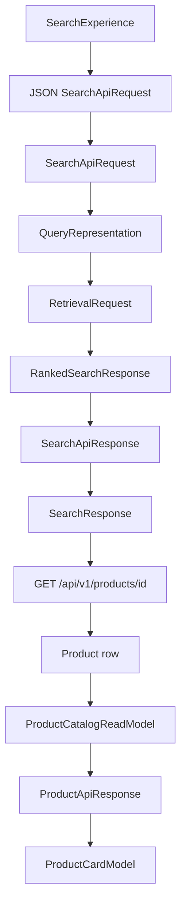
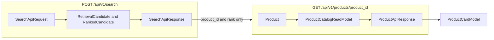

# Data contracts and DTOs

This note explains how ProductIQ represents one piece of product data as it moves from the browser, through the API, through search and recommendation objects, and through a database row.

It assumes the HTTP routes in `docs/engineering/04-http-routes-and-error-handling.md`. It does not repeat status-code handling, and it does not explain BM25, pgvector, or ranking math. Those stay inside the services. What matters here is which object exists at each boundary, and which fields that object is allowed to carry.

The claims below were checked against the current source. The tests named in this note were read. They were not re-run.

## 1. Data contracts in plain English

A paper form is a useful picture. The form lists the boxes, says which boxes are required, and says what kind of answer belongs in each box. Different people in a shop use different forms for the same shirt: the customer sees a card, the warehouse sees a stock sheet, and the search desk sees only an id and a position in a list.

| Term | Plain meaning | ProductIQ |
| --- | --- | --- |
| Data structure | A named group of fields | `SearchResultItem` groups `product_id` and `rank` |
| Schema | The written rules for a structure: names, types, and constraints | `SearchApiRequest` requires `query` with `min_length=1` and `top_k` with `gt=0` |
| Data contract | An agreement about data that crosses a boundary, including who may see it | `SearchApiResponse` is the contract between `post_search` and `searchProducts` |
| DTO | A design name for an object whose job is to carry data across a boundary | `SearchApiRequest` and `ProductApiResponse` are DTOs. `RetrievalCandidate` is an internal pipeline object, so calling it a DTO hides its job |
| Database model | The object that matches a table row | `Product` in `src/productiq/database/models/product.py` matches the `products` table |
| Frontend type | A TypeScript description of a value the UI expects | `SearchResponse` in `frontend/lib/types.ts` |
| Mapper | A function that builds one representation from another, choosing what to copy and what to leave behind | `ranked_search_to_api_response` |

Pydantic is the Python library that implements most of these schemas. A Pydantic `BaseModel` checks fields when it is constructed. That makes it a schema. It is a DTO only when the code uses it to cross a boundary. `ProductCatalogReadModel` sits on the boundary between a catalog provider and the product service. `RankingCandidate` stays inside ranking. Both are Pydantic models. Only the first is a boundary object.

## 2. Follow one product through the application

Search and product detail are two HTTP requests. Search does not return brand, description, image, or price. The storefront takes each `product_id` from the search JSON and calls `GET /api/v1/products/{product_id}`.

### Request A — search

1. `SearchExperience` builds `{ query, topK: 12, filters }`. The filter is present only when the page gender is `Men` or `Women`, and then it is `{ category_gender }` only. `SEARCH_TOP_K` is `12`.
2. `searchProducts` renames `topK` to `top_k` and `fetch`es `POST /api/v1/search`. The TypeScript value is described as `SearchResponse`. That description is not sent to the server.
3. FastAPI builds `SearchApiRequest`. Invalid JSON or fields raise `RequestValidationError` before `post_search` runs. The rules are in section 3.
4. `post_search` passes that model to `ProductionSearchServingService.search`.
5. The service calls `build_query_representation(request.query, constraints=request.filters)`. The result is a `QueryRepresentation`. Its `query_text` is the whitespace-normalized query. The service then calls `retrieve_ranked` with a `RetrievalRequest`. Inside that pipeline, candidates are `RetrievalCandidate` objects, then ranking wraps them as `RankingCandidate` and `RankedCandidate`. The service receives a `RankedSearchResponse`. This note does not open the retrievers.
6. `ranked_search_to_api_response` builds a `SearchApiResponse`. Each result keeps `product_id` and `rank`. It drops `ranking_score`, `bm25_score`, `vector_score`, and `fusion_score`. The echoed `query` is `query.query_text`, the normalized text, not a separate copy of the raw body.
7. FastAPI serializes the response model because the route sets `response_model=SearchApiResponse`. `searchProducts` parses the JSON. `isSearchResponse` checks that `results` is an array and `returned_count` is a number. `SearchExperience` then calls `loadProductCards` with `{ productId, rank }` pairs. A card is not rendered from the search body alone.

### Request B — product detail, once per search hit

8. `loadProductCards` calls `getProduct`, which sends `GET /api/v1/products/{id}`. Up to `PRODUCT_LOOKUP_CONCURRENCY` (`4`) of those calls run at once.
9. `get_product` calls `ProductionProductServingService.get_product`. The production provider is `PostgresProductCatalogReadProvider.get_product`. It runs `select(Product).where(Product.product_id == product_id)` and, when a row exists, constructs a `ProductCatalogReadModel` by copying eight fields. `embedding`, prices, color, fit, and the other catalog columns are not copied.
10. `product_read_model_to_api` builds `ProductApiResponse`. It copies the display fields and adds `request_id`. It does not copy `brand_normalized`. FastAPI serializes that model.
11. `productToCard` renames snake_case fields to camelCase and attaches the rank that came from search. `ProductCard` renders `description` as the title. There is no `title` field on the API model.

`ProductDetailView` repeats request B for the page id, then makes a third call, `POST /api/v1/recommendations`. Recommendation hits are ids, ranks, and `recommendation_score`. The view drops the score and calls `getProduct` again to draw those cards.



The arrow from `searchTs` to `detailJson` is a new HTTP request. It is not a cast of the search JSON into a product.

## 3. Request models

These are the bodies FastAPI accepts. Internal requests built later are in section 5.

### `SearchApiRequest`

File: `src/productiq/serving/search_schema.py`. Used as the body of `post_search`, then as the argument to `ProductionSearchServingService.search`.

| Field | Type | Required | Rules |
| --- | --- | --- | --- |
| `query` | `str` | yes | `min_length=1` |
| `top_k` | `int` | yes | `gt=0`, and `validate_top_k_limit` rejects a value above `ServingConfig.api_max_top_k` |
| `filters` | `QueryFilterConstraints` or `None` | no | default `None` |

`model_config` is frozen and `extra="forbid"`, so an unknown JSON key fails validation. The default cap is `DEFAULT_API_MAX_TOP_K = 100`. The same validator rejects a query longer than `api_max_query_length`, default `512`. Those defaults can be changed with `PRODUCTIQ_API_MAX_TOP_K` and `PRODUCTIQ_API_MAX_QUERY_LENGTH`.

The model does not strip or collapse `query`. A string of spaces passes `min_length=1`. `build_query_representation` later calls `normalize_query_text`, which collapses whitespace and raises `QueryRepresentationError` when the collapsed text is empty. That error is mapped to HTTP `400` by the exception handlers, after the handler has started.

Illustrative valid body, matching the storefront and the schema:

```json
{ "query": "navy cotton shirt", "top_k": 12, "filters": { "category_gender": "Men" } }
```

### `RecommendationApiRequest`

File: `src/productiq/serving/recommendation_schema.py`. Used as the body of `post_recommendations`, then as the argument to `ProductionRecommendationServingService.recommend`.

| Field | Type | Required | Rules |
| --- | --- | --- | --- |
| `seed_product_id` | `str` | yes | `min_length=1`. `validate_production_scope` rejects a value that is empty after `strip`. It does not store the stripped text back onto the model |
| `recommendation_type` | `RecommendationType` | no | default `similar`. Any other enum value fails with `recommendation_type must be SIMILAR for the production API` |
| `top_k` | `int` | yes | `gt=0`, and not above `api_max_top_k` |
| `filters` | `QueryFilterConstraints` or `None` | no | default `None` |

`RecommendationType` also defines `alternative`, `complementary`, and `personalized`. The HTTP validator refuses them. The storefront omits `recommendation_type`, so the default `similar` is used.

The service then builds a `RecommendationRequest`. That internal model strips `seed_product_id` in its own validator. A public value of `" P1 "` can therefore become `"P1"` only after that second model is constructed.

Illustrative valid body:

```json
{ "seed_product_id": "462494766003", "top_k": 8 }
```

### `QueryFilterConstraints`

File: `src/productiq/representation/query_contract.py`. Nested inside both public requests when `filters` is present. It is also stored on `QueryRepresentation.constraints` and on `RecommendationRequest.filters`.

Optional fields, all defaulting to `None`: `brand`, `brand_normalized`, `category_gender`, `product_type`, and lists `color`, `pattern`, `material`, `fit`, `sleeve`, `neckline`, `product_features`, `style_attributes`. Price bounds `min_discount_price_inr` and `max_discount_price_inr` are optional integers with `ge=0`. If both prices are set, the minimum must not exceed the maximum. Scalar strings are stripped. An empty string becomes `None`. List fields reject an empty list, empty strings, and duplicates. Unknown filter keys are forbidden.

`build_query_representation` calls `validate_category_gender` when `category_gender` is set. `is_valid_category_gender` accepts a value whose stripped lowercase form is `men` or `women`. The constraint object keeps the original stripped spelling, so `"Men"` remains `"Men"` after that check. `CATEGORY_GENDER_VALUES` is the set `{"men", "women"}`.

The storefront `SearchFilters` type allows only `category_gender`. The API schema allows the wider set.

Health and readiness have no request body.

## 4. Response models

Public models are the ones named in a route's `response_model`. FastAPI turns them into JSON. Tuple fields become JSON arrays. That is visible in `test_rank_ordering_preserved`, which reads `response.json()["results"]` as a list. Examples below are shaped from the models. They are not a captured live response.

### Search

`SearchResultItem`: required `product_id` (`min_length=1`) and `rank` (`ge=1`).

`SearchApiResponse`: required `query`, `top_k` (`gt=0`), `request_id`, and `returned_count` (`ge=0`). `results` defaults to an empty tuple.

Illustrative success JSON:

```json
{
  "query": "navy cotton shirt",
  "top_k": 12,
  "results": [{ "product_id": "462494766003", "rank": 1 }],
  "request_id": "req-search",
  "returned_count": 1
}
```

`returned_count` is `len(items)` inside the mapper, not a separate database count. An empty `results` list is still this model, with `returned_count` of `0`.

### Product

`ProductApiResponse` fields:

| Field | Type on the model |
| --- | --- |
| `product_id` | required `str`, `min_length=1` |
| `brand`, `description`, `image_url`, `product_url`, `category_gender`, `product_type` | `str` or `None`, default `None` |
| `request_id` | required `str`, `min_length=1` |

There is no price, color, embedding, or `brand_normalized` field. The TypeScript `ProductResponse` uses the same names and marks those six display fields as `string | null`.

### Recommendations

`RecommendationResultItem`: `product_id`, `rank` (`ge=1`), and `recommendation_score` (`float`).

`RecommendationApiResponse`: `seed_product_id`, `recommendation_type`, `top_k`, `recommendations`, `request_id`, `returned_count`.

Illustrative item: `{ "product_id": "P2", "rank": 1, "recommendation_score": 0.77 }`. Those numbers come from `test_recommendation_mapper`, which asserts the score is copied. The UI does not render `recommendation_score`. `ProductDetailView` keeps `product_id` and `rank`, then loads cards.

### Health and readiness

`HealthResponse` requires `status` to be the literal `"ok"`, plus `service` and `api_version`. `ReadinessResponse` has `status` of `ready` or `not_ready`, and `checks` of `ReadinessCheck` (`name`, `status`, optional `message`). These models describe process state, not products.

## 5. Internal models versus public models

| Object | File | Role | What it holds that the browser does not get from that object |
| --- | --- | --- | --- |
| `RetrievalCandidate` | `src/productiq/retrieval/contracts.py` | One retrieved id, with native scores and provenance | `score`, `method`, `bm25_score`, `vector_score`, `fusion_score`, `bm25_rank`, `vector_rank`, `metadata` |
| `RankingCandidate` | `src/productiq/ranking/contracts.py` | The same id plus the retrieval candidate, entering the ranker | the nested `RetrievalCandidate` |
| `RankedCandidate` | same file | Final search order | `ranking_score` and the nested candidate |
| `RankedSearchResponse` | `src/productiq/retrieval/ranked_search.py` | What `retrieve_ranked` returns to the search service | timings, schema versions, pool counts, `ranking_applied` |
| `Product` | `src/productiq/database/models/product.py` | One `products` row | `embedding` as `vector(384)`, both prices, color, fit, pattern, sleeve, neckline, material, features, style, `source` |
| `ProductCatalogReadModel` | `src/productiq/serving/product_schema.py` | The catalog fields the serving layer is willing to read | `brand_normalized`, which the public product mapper then drops |
| `ProductApiResponse` | same file | Public product JSON | nothing beyond the fields in section 4 |
| `ProductCardModel` | `frontend/lib/types.ts` | UI card | camelCase names, optional `rank`, optional `unavailable`. Not sent to the server |
| `RecommendationCandidate` | `src/productiq/recommendation/contracts.py` | A generated neighbor, before final ranking | `sources`, `candidate_generation_score` |
| `RankedRecommendation` | same file | A ranked neighbor | `recommendation_score` plus an optional nested candidate. The public item keeps the score and drops the candidate |
| `RecommendationResponse` | same file | Pipeline result | `config` and the nested candidates |
| `ProductRepresentation` | `src/productiq/representation/schema.py` | Structured attributes for search and recommendation code | list-valued color, material, fit, and related attributes. It is not a table row and not an HTTP body |
| `QueryRepresentation` | `src/productiq/representation/query_contract.py` | Normalized query plus lexical intent, semantic intent, and constraints | intent objects. The public search response echoes only `query_text` |

`product_id` means the catalog primary key in all of these objects. `rank` does not mean one thing. On `RetrievalCandidate`, `bm25_rank` and `vector_rank` are positions inside one retriever's list. On `RankedCandidate` and `SearchResultItem`, `rank` is the final search position. On `RankedRecommendation`, `rank` is the recommendation position. `ProductCardModel.rank` is whichever of those the caller passed into `productToCard`.

`brand` is required and non-null on the `Product` row. On `ProductApiResponse` the same name is `str | None`. The public schema allows absence even though this table definition does not.

General practice is to keep scores, embeddings, and warehouse columns off a public response unless a client needs them. The code does that selectively. Search drops every score. Recommendations publish `recommendation_score` and still hide `candidate_generation_score` and `sources`. Product detail hides `embedding` and prices. `test_ranked_search_mapper_strips_native_scores` asserts that a search result item has no `bm25_score` attribute.

## 6. Mappers and transformations

| Function | Input | Output | Copied | Omitted | Called by |
| --- | --- | --- | --- | --- | --- |
| `ranked_search_to_api_response` | `RankedSearchResponse`, plus `query`, `top_k`, `request_id` | `SearchApiResponse` | `product_id` and `rank` from each `RankedCandidate`. `returned_count` is computed as the number of items | `ranking_score`, retrieval scores, timings, metadata | `ProductionSearchServingService.search` |
| `recommendation_response_to_api` | `RecommendationResponse`, plus `request_id` | `RecommendationApiResponse` | `product_id`, `rank`, `recommendation_score`, seed id, type, and `requested_top_k` as `top_k` | nested `candidate`, `sources`, `candidate_generation_score`, `config` | `ProductionRecommendationServingService.recommend` |
| `product_read_model_to_api` | `ProductCatalogReadModel`, plus `request_id` | `ProductApiResponse` | `product_id`, `brand`, `description`, `image_url`, `product_url`, `category_gender`, `product_type` | `brand_normalized` | `ProductionProductServingService.get_product` |
| Field assignment inside `PostgresProductCatalogReadProvider.get_product` | SQLAlchemy `Product` or `None` | `ProductCatalogReadModel` or `None` | the eight fields listed in that constructor | `embedding`, prices, color, garment attributes, `source` | production product service, wired in `build_production_application_services` |
| `catalog_read_model_from_processed_row` | a dictionary | `ProductCatalogReadModel` | the same eight fields, through `_optional_str` | every other dict key | `ProcessedParquetProductCatalogReadProvider`, not the PostgreSQL provider |
| `productToCard` | `ProductResponse` plus an optional rank | `ProductCardModel` | display fields, renamed to camelCase | `request_id` | `loadProductCards` and `ProductDetailView` |

`build_query_representation` is also a transformation. It takes the public `query` string and optional filters and returns a `QueryRepresentation` with normalized `query_text`, the same constraints, and lexical and semantic intent texts set to that normalized string. `ProductionSearchServingService.search` is the caller on the HTTP path.

`ProductionRecommendationServingService.recommend` constructs `RecommendationRequest` from the public fields. That construction strips the seed id and attaches a default `RecommendationConfig`. The HTTP model does not contain `config`.

Some changes are not mapper functions:

- FastAPI parses JSON into `SearchApiRequest` or `RecommendationApiRequest` and later serializes the response model. Serialization writes the public fields out as JSON. Validation decides whether the input may become a model. They are different steps.
- SQLAlchemy materializes a `Product` from the `SELECT`. The provider, not SQLAlchemy, chooses the eight fields.
- `requestJson` parses JSON and then casts it to the TypeScript type parameter. The cast does not check fields. `isSearchResponse` is the one explicit runtime check, and it only checks two properties.
- `productToCard` is the rename step. `ProductCard` then treats `description` as the visible title. That display choice is not a backend field.

## 7. Frontend types and runtime validation

`frontend/lib/types.ts` describes values the UI wants to hold. `SearchResponse`, `ProductResponse`, `RecommendationResponse`, `HealthResponse`, and `ReadinessResponse` mirror the public JSON names. `ProductCardModel` and `SearchFilters` are UI types. `SearchFilters` is narrower than `QueryFilterConstraints`.

TypeScript checks those annotations when the frontend is compiled. The check disappears from the JavaScript that runs in the browser. A compiled function can still receive JSON that does not match the type. `requestJson` shows that limit: after `JSON.parse`, it returns `payload as T`. The compiler trusts the assertion. The running code does not re-check every field against the backend schema.

`searchProducts` adds `isSearchResponse`, which returns true when `results` is an array and `returned_count` is a number. It does not check `product_id`, `rank`, or `query`. `getProduct` and `getRecommendations` do not have an equivalent check. A product body that is a non-null object is accepted and later read as `product.product_id` by `productToCard`.

`frontend/tests/api.test.ts` mocks `fetch` and checks the URL and the outgoing JSON. That test does not prove that an arbitrary server payload matches `SearchResponse`.

## 8. Data-flow diagram

The diagram in section 2 is the verified search-to-card path. This smaller view names the two HTTP contracts and the row that sits between them.



`internal` stands for several pipeline models. The public search JSON never contains that box.

## 9. Common beginner mistakes

**Treating the database model as the API response.** `Product` includes `embedding`, `discount_price_inr`, and `original_price_inr`. `ProductApiResponse` does not. The provider copies eight columns into `ProductCatalogReadModel`, and the API mapper copies seven of those plus `request_id`.

**Calling every Pydantic model a DTO.** `SearchApiRequest` crosses the HTTP boundary, so the DTO name fits. `RetrievalCandidate` is the object BM25, vector search, and ranking pass among themselves. Its docstring calls it a retrieval result with a native score. Using one name for both hides which fields are public.

**Assuming TypeScript validates the server.** `ProductResponse` requires `request_id: string` at compile time. `getProduct` still returns `payload as ProductResponse` for any JSON object. Only search has a small runtime check, and that check ignores most fields.

**Assuming search returns a full product.** `SearchResultItem` has two fields. `SearchExperience` calls `loadProductCards`, which calls `getProduct`, before it can show a brand or a description.

**Assuming every internal score reaches the browser.** `ranked_search_to_api_response` copies `product_id` and `rank`. `test_ranked_search_mapper_strips_native_scores` builds a candidate with `score` `0.5` and `ranking_score` `0.9` and asserts the API item has no `bm25_score`. Recommendation JSON does include `recommendation_score`. The product card still does not render it, because `ProductDetailView` never passes that number to `productToCard`.

**Confusing serialization with validation.** Validation accepts or rejects `SearchApiRequest` before `post_search` runs. Serialization is FastAPI writing the returned `SearchApiResponse` as JSON. A valid request can still produce an empty `results` array. An invalid request never becomes that response model.

**Assuming a mapper copies every field.** `product_read_model_to_api` leaves out `brand_normalized` even though the read model has it. `recommendation_response_to_api` leaves out `candidate_generation_score` even though `RankedRecommendation.candidate` may hold it.

**Assuming the same field name means the same thing.** `rank` on a retrieval candidate's `bm25_rank` is not `rank` on `SearchResultItem`. `brand` is non-null on `Product` and optional on `ProductApiResponse`. `description` is catalog text in the API and the card title in `ProductCard`. `top_k` on `SearchApiRequest` is the caller's limit. `top_k` on `RetrievalRequest` is described as the candidate limit passed into retrieval, and the service passes the same integer through. The public response then echoes that request value even when `returned_count` is smaller.

## 10. Interview questions and answers

**What is a data contract?** It is the agreed shape of data at a boundary. ProductIQ's search contract is `SearchApiRequest` in and `SearchApiResponse` out. The storefront's `SearchResponse` type mirrors the output.

**What is a DTO?** It is an object used to carry data across a boundary. `ProductApiResponse` carries a product to the client. `RetrievalCandidate` carries a hit between retrievers and should be described as an internal model, not as the API DTO.

**What is a schema?** It is the set of fields, types, and constraints. `SearchApiRequest.top_k` must be greater than 0 and, by default, at most 100. Pydantic enforces that when FastAPI builds the model.

**What is validation?** It is the check that incoming data matches the schema. A missing `query` fails before `ProductionSearchServingService.search`. A later check, `normalize_query_text`, can still reject a query that is only spaces.

**What is serialization?** It is turning an in-memory object into a transferable form, here JSON. The route's `response_model` tells FastAPI to serialize the returned Pydantic object. Error handlers call `model_dump(mode="json")` on `ApiErrorEnvelope`.

**Why not return the database row?** The `Product` row includes a 384-dimension `embedding`, prices, and attributes the card does not render. `PostgresProductCatalogReadProvider` copies eight fields into `ProductCatalogReadModel`. The HTTP model is smaller again.

**Why do internal and public models differ?** Search needs scores to order hits. The public search item only needs an id and a position so the browser can request details. Recommendations are the exception that publishes `recommendation_score` while still hiding generator sources.

**What does the search endpoint return?** `query`, `top_k`, `results` of `{product_id, rank}`, `request_id`, and `returned_count`. Brand and description arrive from `GET /api/v1/products/{product_id}`.

**What is mapping?** It is building one model from another on purpose. `ranked_search_to_api_response` reads `row.candidate.retrieval.product_id` and `row.rank`. It does not copy `ranking_score`.

**How do TypeScript types relate to Pydantic models?** They document the same JSON names for the public responses. TypeScript checks the frontend code at compile time. Pydantic checks the request at runtime. The frontend does not run the Pydantic models.

**What is the difference between `ProductCatalogReadModel` and `ProductApiResponse`?** The read model is the serving layer's view of a catalog lookup and includes `brand_normalized`. The API model is the HTTP body and replaces that field with `request_id`.

**Where can `rank` mean two things?** `bm25_rank` is a position in the lexical list. `SearchResultItem.rank` is the position after ranking. The card prints the search rank. It does not recompute it.

**What happens to `recommendation_score`?** The mapper copies it onto `RecommendationResultItem`. `ProductDetailView` uses `product_id` and `rank` to load cards and does not put the score on `ProductCardModel`.

**Why is `filters` wider on the server than in the storefront?** `QueryFilterConstraints` accepts brand, color, price bounds, and other facets. `SearchFilters` in the frontend allows only `category_gender`. The extra server fields are still part of the API contract.

**What would you rebuild first?** The public request and response models, the three mappers, and the provider that narrows a `Product` row. Retrieval can return ids until those contracts are stable.

## 11. Practical exercises

Do not change application code. Write the answers in your notes.

**1. List the public search fields.** Open `SearchApiRequest`, `SearchApiResponse`, and `SearchResultItem`. Write every field and whether it is required. Hint: `results` has a default. Outcome: you can say what `POST /api/v1/search` accepts and returns without guessing from the UI.

**2. Trace `product_id` across two requests.** Start at `searchProducts`, then `ranked_search_to_api_response`, then `loadProductCards`, then `PostgresProductCatalogReadProvider.get_product`. Write the type that holds the id at each stop. Hint: the second request is a new `GET`. Outcome: you can explain why a search hit is not yet a card.

**3. Find a dropped field.** Compare the `Product` columns with the constructor call in `PostgresProductCatalogReadProvider`. List at least five columns that stop there. Then see which read-model field `product_read_model_to_api` drops. Hint: `brand_normalized` survives the provider and stops at the API mapper. Outcome: you can tell a row, a read model, and a response apart.

**4. Compare two ranks.** Read `RetrievalCandidate.bm25_rank` and `RankedCandidate.rank`. State which one `SearchResultItem` receives. Hint: the search mapper reads `row.rank` from the ranked candidate. Outcome: you can avoid treating every rank as the BM25 position.

**5. Test the TypeScript boundary.** In `frontend/lib/api.ts`, find `payload as T` and `isSearchResponse`. State which endpoints check anything at runtime, and which fields those checks ignore. Hint: product and recommendation calls have no `isSearchResponse` equivalent. Outcome: you can explain why a TypeScript type is not a second Pydantic schema.

## 12. Source-reading order

1. `src/productiq/serving/search_schema.py` — the public search request and response.
2. `src/productiq/serving/product_schema.py` — the read model versus `ProductApiResponse`.
3. `src/productiq/serving/recommendation_schema.py` — the public recommendation contract and the `similar` limit.
4. `src/productiq/representation/query_contract.py` — `QueryFilterConstraints`, `QueryRepresentation`, and `build_query_representation`.
5. `src/productiq/serving/mappers.py` — the three public projections.
6. `src/productiq/serving/search_service.py`, method `search` — where the query string becomes a `QueryRepresentation` and the ranked result becomes JSON fields.
7. `src/productiq/serving/product_service.py`, method `get_product` — where a missing row becomes `ProductNotFoundError`.
8. `src/productiq/serving/postgres_catalog_provider.py` — which `Product` columns enter the read model.
9. `src/productiq/database/models/product.py` — the full row, including `embedding`.
10. `src/productiq/retrieval/contracts.py`, class `RetrievalCandidate` — scores that stay inside retrieval.
11. `src/productiq/ranking/contracts.py`, classes `RankingCandidate` and `RankedCandidate` — the object the search mapper reads.
12. `src/productiq/recommendation/contracts.py` — `RecommendationCandidate`, `RankedRecommendation`, and `RecommendationResponse`.
13. `frontend/lib/types.ts` and `frontend/lib/api.ts` — compile-time types and the limited runtime check.
14. `frontend/lib/catalog.ts`, `SearchExperience`, `ProductDetailView`, and `ProductCard` — renaming, the second request, and the description-as-title display.
15. `tests/serving/test_serving_mappers.py` — assertions that search drops native scores and that recommendations keep `recommendation_score`.

## 13. Verified facts and unresolved questions

Verified from the files above:

- Search JSON items contain `product_id` and `rank` only.
- The production product lookup uses `PostgresProductCatalogReadProvider`, wired from `build_production_application_services`.
- `ProcessedParquetProductCatalogReadProvider` uses `catalog_read_model_from_processed_row`. That provider is not the object constructed for the production stack.
- `category_gender` values `Men` and `Women` match `CATEGORY_GENDER_VALUES` only after `strip().lower()` inside `is_valid_category_gender`. The constraint field itself is not rewritten to lowercase. This was read from the validator. A test that posts `"Men"` was not part of this reading pass.
- `RecommendationApiRequest` rejects a blank seed after `strip` without assigning the stripped value. `RecommendationRequest` strips again when the service builds it.

Not confirmed in this pass:

- The JSON produced for a specific live catalog query. Examples here follow the schemas and unit-test fixtures.
- Every caller of `ProductRepresentation` outside the HTTP path. The class is an internal attribute model. This note does not claim it is built during `get_product`.
- Whether a future client displays `recommendation_score`. The current `ProductCard` and `ProductDetailView` do not render it. Another frontend could still read it, because the field is on `RecommendationApiResponse`.
