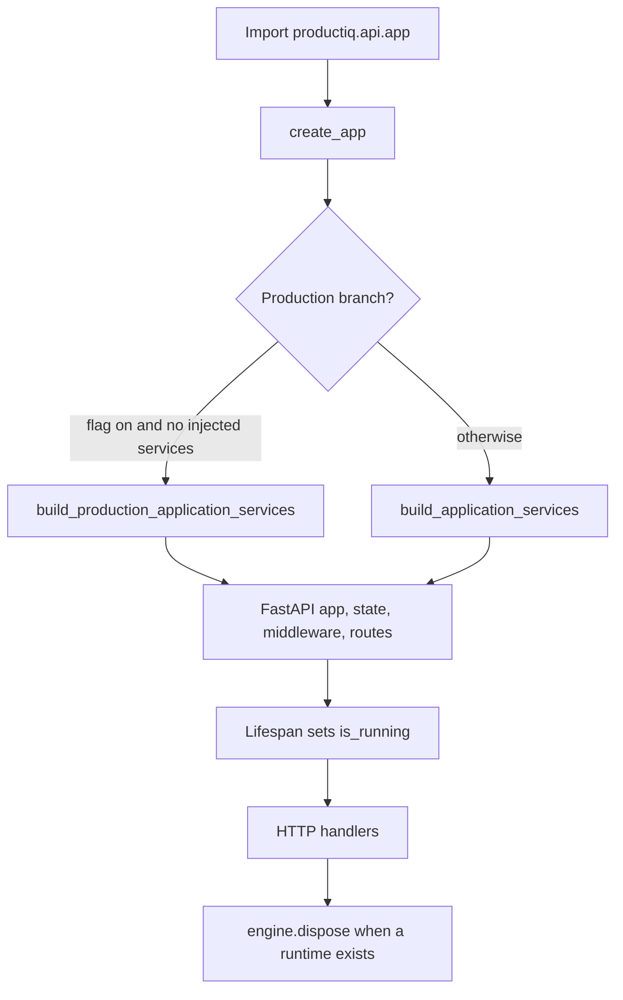
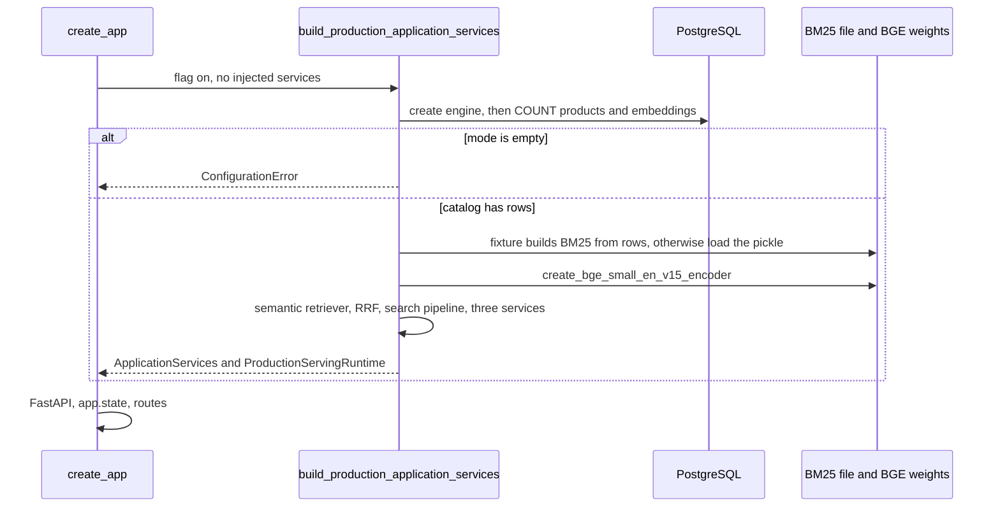
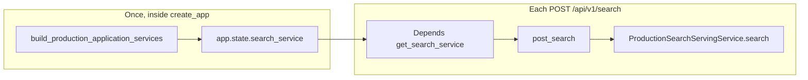
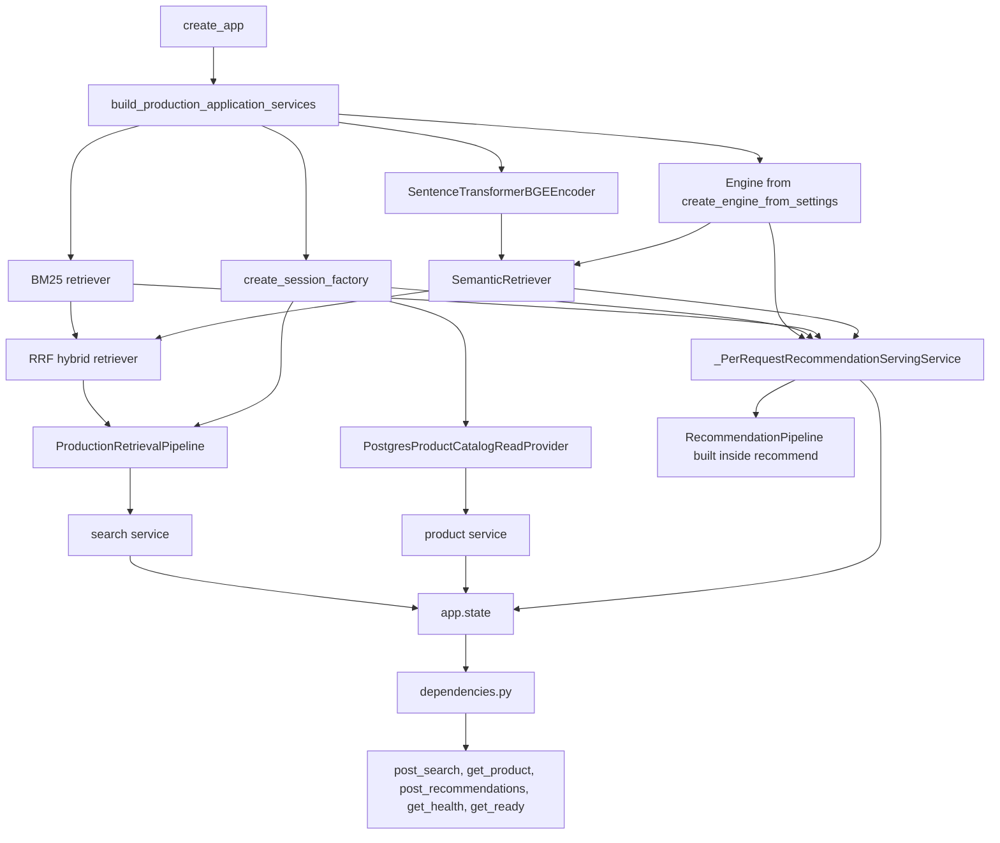

# Application startup and dependency injection

This note explains how one ProductIQ process is built, how a route receives a service that was built earlier, and how the process shuts down.

An application factory is a function that returns a ready application. Dependency injection means a function receives the objects it needs instead of constructing them itself. In ProductIQ, `create_app` is the factory. It builds the services and stores them. FastAPI `Depends` later looks those services up. `Depends` does not construct the BM25 index or the encoder.

The HTTP shapes, the public models, and the SQL transactions are in the earlier engineering notes. This note follows objects, not ranking math.

The order below was read from the call structure. Tests named here were located. They were not executed.

## 1. Big picture

Five different moments are easy to mix together.

| Moment | What runs | What does not run |
| --- | --- | --- |
| Import | Python loads `create_app` and the modules it imports. `src/productiq/api/__init__.py` imports the function | `create_app` is not called, so PostgreSQL is not opened and the encoder is not loaded |
| Factory | Uvicorn, with `--factory`, calls `create_app`. The image command is `uvicorn productiq.api.app:create_app --factory` | The lifespan has not started. `is_running` is set to `False` before the function returns |
| Production init | Only inside `create_app`, and only on the branch in section 6 | The catalog Parquet is not loaded. `load_runtime_catalog` is a different command |
| Requests | Lifespan sets `is_running` to `True`, then yields. Routes call services already stored on `app.state` | Search does not build a new encoder. Recommendations do build a new pipeline object per request, reusing the encoder and BM25 retriever |
| Shutdown | The lifespan `finally` block sets `is_running` to `False` and, when a production runtime exists, calls `engine.dispose()` | Product rows are not deleted. The BM25 file is not unloaded by an explicit call |

The production branch can raise before `FastAPI(...)` runs. In that case the factory never returns an application, and the lifespan never starts.

## 2. Application factory

`create_app` is in `src/productiq/api/app.py`.

A factory is useful in general because tests can build an app with fakes, and the real process can build an app with real resources, without a second copy of the route table. ProductIQ uses that split in a concrete way: tests pass `search_service` or `application_services`, and `tests/conftest.py` sets `PRODUCTIQ_ENABLE_PRODUCTION_SERVING` to `0`. The Compose service sets the same variable with a default of `1`. The Python default on `Settings` is `False`.

### Inputs

Every argument is optional:

| Argument | Role when provided |
| --- | --- |
| `app_settings` | Replaces `get_settings()` |
| `serving_config` | Replaces a new `ServingConfig()` inside the wiring helpers |
| `application_services` | Used as-is. The production branch is skipped |
| `search_service`, `recommendation_service`, `product_service` | Passed into `build_application_services` when the production branch is not taken |
| `health_service` | Replaces the composed health service after the default one is stored |

### What it creates

1. It resolves settings.
2. It chooses services by the branch in section 6.
3. It constructs `FastAPI` with title `ProductIQ API`, `lifespan=build_lifespan`, and docs at `/api/v1/openapi.json`, `/api/v1/docs`, and `/api/v1/redoc`.
4. `_apply_application_services` stores the service bundle and builds `ComposedHealthServingService`.
5. It stores settings, artifact paths, the production runtime or `None`, `is_running=False`, an `InMemoryObservabilityCollector`, and `build_application_resilience(...)`.
6. It may add CORS, then adds resilience, observability, and request-id middleware.
7. It calls `register_exception_handlers` and `app.include_router(v1_router, prefix="/api/v1")`.

`v1_router` includes the health, search, recommendation, and product routers. Those routers declare `/health`, `/ready`, `/search`, `/recommendations`, and `/products/{product_id}`. The prefix is applied here, not inside each route function.

`add_middleware` is called in this order: CORS only when origins exist, then `ResilienceMiddleware`, `ObservabilityMiddleware`, `RequestIdMiddleware`. Starlette treats the last registration as the outer wrapper. This note uses that framework rule. A dedicated order test was not re-run.

### Objects on `app.state`

| Attribute | Contents |
| --- | --- |
| `application_services` | The `ApplicationServices` bundle |
| `serving_config` | `services.serving_config` |
| `health_service` | `ComposedHealthServingService`, unless `health_service=` replaced it |
| `search_service` | The search service, or `None` |
| `recommendation_service` | The recommendation service, or `None` |
| `product_service` | The product service, or `None` |
| `app_settings` | The `Settings` object |
| `runtime_artifact_paths` | Paths from `resolve_runtime_artifact_paths`. This call does not read the files |
| `production_serving_runtime` | `ProductionServingRuntime` or `None` |
| `is_running` | `False` until the lifespan starts |
| `observability_sink` | In-memory collector |
| `application_resilience` | Rate limiter and concurrency gates from `ServingConfig` |

`app.state` is a bag of Python objects on the application instance. It is not a database and it is not request-local. Request-local data, such as the request id, lives on `request.state`.

## 3. Startup lifecycle

Production initialization is the body of `build_production_application_services` in `src/productiq/api/services/production_stack.py`. It runs inside `create_app`, before the `FastAPI` object exists. The lifespan docstring says the lifespan hook does not load retrieval or model resources. That matches the code: the lifespan only flips `is_running` and later disposes the engine.

Verified order on the production branch:

1. `create_engine_from_settings` unless the caller passed an engine.
2. `resolve_runtime_artifact_paths`.
3. `inspect_catalog_runtime_status`, which counts products, non-null embeddings, and `compose-demo-` ids.
4. If `catalog_status.mode` is `empty`, raise `ConfigurationError` with the message that tells you to run `python -m productiq.database.load_runtime_catalog`.
5. `create_session_factory`.
6. BM25. Fixture mode selects every `Product` and builds an in-memory index in `_bm25_from_postgres_descriptions`. Any other mode calls `create_bm25_retriever_from_index_path` when `paths.bm25_index` is a file. If it is not a file, raise `ConfigurationError` that the BM25 artifact is required.
7. `create_bge_small_en_v15_encoder(device="cpu", allow_cpu_fallback=True)` unless an encoder was passed in. That function loads the BGE model weights.
8. `create_semantic_retriever_from_engine`, which keeps that encoder and a pgvector index bound to the engine.
9. `create_rrf_hybrid_retriever` with `RRFConfig(rank_constant=60)`.
10. `create_production_retrieval_pipeline` with the session-factory filter, the session-factory ranking context, and `ProductionRankingStageConfig(enabled=True)`.
11. `create_search_serving_service_from_pipeline`.
12. `create_product_serving_service_from_catalog(PostgresProductCatalogReadProvider(session_factory))`.
13. `_PerRequestRecommendationServingService` holding the engine, session factory, lexical retriever, and semantic retriever. It does not build a `RecommendationPipeline` here.
14. An `ApplicationServices` object copies `catalog_mode`, `catalog_product_count`, and `catalog_embedding_count` from the status object.
15. A `ProductionServingRuntime` holds the engine, the status, and the lexical source label.

Startup can fail before any request is served. The empty-catalog error and the missing-BM25 error are raised in step 4 or step 6, which is before `app = FastAPI(...)`. A failure inside the count query or the encoder load also leaves `create_app` before that assignment. This review did not wrap those calls in a custom error type beyond what those functions already raise. `ConfigurationError` is explicit for the empty catalog and the missing pickle.

Expensive objects are created once on this path and then stored: the engine, the BM25 retriever, and the encoder inside the semantic retriever. Search requests call the stored pipeline. They do not call `create_bge_small_en_v15_encoder` again. Recommendation requests do call `build_production_recommendation_pipeline` on each `recommend`, and that new pipeline reuses the same lexical retriever and semantic retriever. Sessions are not stored for the process lifetime. Each filter, ranking-context load, product read, and recommendation request opens a session from the factory and closes it.

## 4. Application state and dependency injection

A dependency is a value a function needs. A dependency provider is the function that supplies it. Injection means the caller, or the framework, passes that value in.

ProductIQ constructs services manually in `create_app` or in `build_production_application_services`. FastAPI does not invent them. At request time it calls the provider in `src/productiq/api/dependencies.py`, and that provider reads `app.state`.

| Provider | Reads | Returns | If missing |
| --- | --- | --- | --- |
| `get_serving_config` | `app.state.serving_config` | `ServingConfig` | The attribute is always set by `_apply_application_services` |
| `get_health_service` | `app.state.health_service` | `HealthServingService` | Always set, then maybe replaced |
| `get_request_id` | `request.state.request_id` | `str` | Set by `RequestIdMiddleware`, not by `app.state` |
| `get_search_service` | `app.state.search_service` | `SearchServingService` | `ConfigurationError`: `Search serving is not configured for this deployment` |
| `get_recommendation_service` | `app.state.recommendation_service` | `RecommendationServingService` | The matching configuration error |
| `get_product_service` | `app.state.product_service` | `ProductServingService` | The matching configuration error |

`SearchServiceDep` is `Annotated[SearchServingService, Depends(get_search_service)]`. The route parameter `service: SearchServiceDep` tells FastAPI to call `get_search_service` and pass the result in. `post_search` then calls `service.search(body, request_id=request_id)`. The route does not call `build_production_application_services`.

Constructing a service and calling it are different. Construction loads the index and stores the object. A call such as `search` or `get_product` uses that object for one request. Tests can skip construction of the real stack by passing a recorder to `create_app(search_service=...)`, or by assigning `app.dependency_overrides`.

`get_settings` is cached with `lru_cache`. That cache is process-wide. It is separate from `app.state`.

## 5. Object graph

This is wiring, not the retrieval algorithm. Names are the ones in the production branch.

The recommendation pipeline is drawn under the request service because `recommend` calls `build_production_recommendation_pipeline` and then `service.recommend`. The search pipeline is drawn above the service because it is created before the search service is stored.

Health is not in that stack function. `create_app` wraps the bundle with `ComposedHealthServingService` and stores it as `health_service`.

## 6. Configuration and conditional initialization

`Settings.enable_production_serving` is defined in `src/productiq/config/settings.py`. The field default is `False`. The environment name is `PRODUCTIQ_ENABLE_PRODUCTION_SERVING`. Compose sets it to `${PRODUCTIQ_ENABLE_PRODUCTION_SERVING:-1}`, so the API container turns the branch on unless the variable is overridden. Pytest forces `0` in `tests/conftest.py`.

`create_app` takes the production branch only when all of these are true:

- `application_services` was not passed
- `settings.enable_production_serving` is true
- `search_service`, `recommendation_service`, and `product_service` are all `None`

If any service argument is passed, the factory uses `build_application_services` and leaves `production_serving_runtime` as `None`. That helper builds only what it was given. Omitted services stay `None`. It does not open PostgreSQL, load BM25, or load BGE.

When the flag is false and nothing is injected, the same hollow helper runs. The app still has routes, exception handlers, health, and readiness. Search, product, and recommendation dependencies raise `ConfigurationError` on use.

Settings that this flow reads:

| Name | Effect on startup |
| --- | --- |
| `DATABASE_URL`, or the `PRODUCTIQ_DATABASE_*` fields plus `DATABASE_PASSWORD` | The URL `create_engine_from_settings` uses. The production branch needs it. The hollow branch does not create an engine |
| `PRODUCTIQ_BM25_ARTIFACT_PATH` | Resolved by `resolve_bm25_index_path` and required for a non-fixture catalog |
| `PRODUCTIQ_PROCESSED_CATALOG_PATH` | Stored on `runtime_artifact_paths`. The factory does not load that Parquet. A non-`.pkl` BM25 path can fall back to a file beside this catalog |
| `PRODUCTIQ_EMBEDDINGS_ARTIFACT_PATH` | Resolved onto `app.state.runtime_artifact_paths`. The production branch does not read that file. Embeddings used at request time are the `embedding` column |
| `APP_ENV` | Default `development`. With an empty `PRODUCTIQ_CORS_ALLOWED_ORIGINS`, development allows `http://localhost:3000` and `http://127.0.0.1:3000`. Other environments get an empty list, and `_configure_cors` then adds no CORS middleware |
| `PRODUCTIQ_CORS_ALLOWED_ORIGINS` and `PRODUCTIQ_CORS_ALLOW_CREDENTIALS` | Override that CORS list. Credentials with `*` fail validation in `validate_cors_configuration` |

`NEXT_PUBLIC_PRODUCTIQ_API_URL` is read by `frontend/lib/config.ts`. `create_app` does not read it. It changes where the browser sends requests, not how the API process starts.

## 7. Health and readiness

`get_health` calls `ComposedHealthServingService.health`, which returns `HealthResponse(status="ok", service=..., api_version=...)` from `ServingConfig`. It does not query PostgreSQL, the BM25 file, or the encoder.

`get_ready` calls `ComposedHealthServingService.ready`, which calls `build_readiness_response`. The docstring says it aggregates readiness without expensive dependency I/O. The function reads `ApplicationServices` fields already in memory.

| Check | When the service exists | Database query on the ready call |
| --- | --- | --- |
| `search_serving`, `recommendation_serving`, `product_serving` | `configured` if the object is present, otherwise `not_ready` with `not configured` | No |
| `search_retrieval_database`, `search_vector_index`, `search_bm25_index` | `not_checked`, with messages that the probe is not implemented | No |
| `recommendation_catalog`, `recommendation_context`, `product_catalog` | `not_checked`, same pattern | No |
| `catalog_data` | From `catalog_mode` captured at startup: `not_checked` if mode is `None`, `not_ready` if `empty`, `configured` for fixture or partial, `ready` for `full` | No |

The top-level `status` is `not_ready` when no service is configured, or when a check named `search_serving`, `recommendation_serving`, or `product_serving` is `not_ready` while that service is configured. Other `not_checked` probes do not flip that aggregate by themselves. `catalog_data` uses `not_ready` only for mode `empty`, and the production branch never finishes startup in that mode. A hollow app has `catalog_mode` `None`, so `catalog_data` is `not_checked`, and the missing services make the aggregate `not_ready`.

Both routes return HTTP `200` with that JSON. Readiness does not refresh counts. A load that finishes after the process started is invisible until a new process runs `inspect_catalog_runtime_status` again.

What the endpoints can prove is narrow. Health proves the process reached the handler. Readiness proves the in-memory flags and the counts saved at startup. Neither probe reopens PostgreSQL. The explicit `not_checked` messages are the implementation saying those probes were left out.

## 8. Shutdown and resource management

`build_lifespan` is an async context manager passed to `FastAPI(lifespan=...)`.

On entry it sets `app.state.is_running` to `True` and logs the configured service names. It then `yield`s. That yield is the period when requests run.

On exit, including cancellation of the server, the `finally` block:

1. Sets `app.state.is_running` to `False`.
2. Reads `app.state.production_serving_runtime`.
3. If that value is not `None`, calls `runtime.engine.dispose()`.
4. Logs `ProductIQ API shutdown complete`.

`dispose()` releases the engine's connection pool. The hollow branch sets the runtime to `None`, so shutdown does not call `dispose()` for an engine `create_app` never created.

There is no call that unloads the BGE model, closes the BM25 pickle, or clears `get_settings`'s cache. Those objects become unused when the process exits. The source does not show a separate close method for them on this path. `load_runtime_catalog`'s own `main` disposes the engine it created. That is a different process from the API lifespan.

## 9. What happens if something fails

| Failure | Is an app returned? | Do requests run? | What the source does |
| --- | --- | --- | --- |
| Production flag on, catalog mode `empty` | No. `ConfigurationError` is raised before `FastAPI(...)` | No | Message names `load_runtime_catalog` |
| Production flag on, catalog not fixture, BM25 path is not a file | No | No | `ConfigurationError`: BM25 artifact is required |
| Production flag off, or a test passes no services | Yes | Health and ready run. Search, product, and recommendations hit `get_*_service` and return HTTP `503` `CONFIGURATION_ERROR` | Routes stay registered |
| `application_services=` or a service argument is passed | Yes, using that object | Only the injected services succeed | Production stack is not entered when `application_services` is set, or when any of the three service arguments is set |
| Count query or encoder load raises | No app is returned if the exception leaves `build_production_application_services` | No | The factory does not catch that exception |

There is no second code path that serves search with an empty catalog. The raise is the behavior.

A missing product at request time is not a startup failure. The app is up, and `get_product` raises `ProductNotFoundError`, which the HTTP layer turns into `404`.

## 10. Common beginner misunderstandings

**Import is startup.** Importing `productiq.api.app` defines `create_app`. Uvicorn's `--factory` flag is what calls it. The encoder load is inside that call, on one branch.

**`Depends` builds the stack.** `Depends(get_search_service)` reads `app.state.search_service`. The BM25 retriever was built earlier in `build_production_application_services`, or it was never built and the provider raises `ConfigurationError`.

**`app.state` is a database.** It holds Python objects for one process: services, config, the runtime. PostgreSQL is reached through the engine stored on `ProductionServingRuntime` and through sessions the providers open later.

**A service is new on every request.** The search service, product service, encoder, and BM25 retriever are created once and stored. `_PerRequestRecommendationServingService.recommend` builds a new `RecommendationPipeline` per call and reuses those retrievers. A new pipeline object is not a new encoder.

**Health and readiness are the same check.** Health returns `status` `ok` from configuration. Readiness returns `ready` or `not_ready` from the in-memory service flags and the stored catalog mode.

**Readiness queries PostgreSQL every time.** `build_readiness_response` does not call `count_catalog_products`. The counts were copied onto `ApplicationServices` during production startup. Several checks are hard-coded `not_checked`.

**Starting the API reloads the catalog.** `create_app` never calls `load_runtime_catalog`. An empty table aborts production startup. A new Parquet file on disk is not upserted by a restart.

**Unused objects close themselves.** The lifespan disposes the engine only when `production_serving_runtime` is set. It does not dispose an engine for the hollow app, because that app has no runtime. The encoder has no dispose call on this path.

## 11. Interview questions and answers

**What is an application factory?** A function that builds and returns the application. ProductIQ's is `create_app` in `src/productiq/api/app.py`. Uvicorn calls it because the command uses `--factory`.

**What is dependency injection?** Passing an object a function needs instead of making that function build it. `post_search` receives `service`. It does not construct the retrieval pipeline.

**What does FastAPI `Depends` do here?** It calls a provider before the handler. `get_search_service` returns the object already stored on `app.state`, or raises `ConfigurationError` if that object is `None`.

**Why use `app.state`?** So one process can build the encoder and the BM25 retriever once and let every request see the same objects. `request.state` is the separate place for the request id.

**What happens during ProductIQ startup when the flag is on?** `create_app` opens an engine, counts the catalog, loads BM25, loads BGE, wires search and product services, stores a recommendation service that will build a pipeline later, then returns the FastAPI app. The lifespan then marks the process running.

**Why load the encoder and BM25 at startup?** The production function calls `create_bge_small_en_v15_encoder` and the BM25 loader once, then stores the retrievers. Request code uses those objects. Loading them on every search would repeat that work. The source does not reload them when a request arrives.

**What is the difference between health and readiness?** Health is a liveness body with `ok`, the service name, and the API version. Readiness reports whether services were configured and what catalog mode was recorded at startup. Neither call counts the table again.

**What if the catalog is empty?** `build_production_application_services` raises `ConfigurationError` before `FastAPI` is constructed. The process does not start serving. The message points at `load_runtime_catalog`.

**What is the difference between constructing a service and calling it?** Construction is `create_search_serving_service_from_pipeline` during startup. A call is `service.search` inside `post_search`. Tests construct a fake and pass it to `create_app`, then the route calls the fake.

**Why dispose of the database engine at shutdown?** `runtime.engine.dispose()` returns the engine's connections to the operating system when the lifespan exits. The call is skipped when `production_serving_runtime` is `None`.

**When does the recommendation pipeline exist?** Not at startup. `_PerRequestRecommendationServingService.recommend` calls `build_production_recommendation_pipeline` with the stored engine, a new session, and the stored retrievers.

**What does the factory do when the flag is false?** It still builds a FastAPI app, health, routes, and middleware. Search, product, and recommendation stay `None` unless the caller injected them. Those routes then fail in the dependency with `CONFIGURATION_ERROR`.

**Where does the request id come from?** `RequestIdMiddleware` writes `request.state.request_id`. `get_request_id` reads it. It is not loaded at startup.

**Does the frontend URL affect startup?** No. `NEXT_PUBLIC_PRODUCTIQ_API_URL` is a storefront setting. The API process uses `DATABASE_URL`, the artifact paths, CORS, and `PRODUCTIQ_ENABLE_PRODUCTION_SERVING`.

**What does readiness prove after a catalog load in another terminal?** Nothing new. Counts stay at the values copied during `inspect_catalog_runtime_status`. A new process is what reads the counts again.

## 12. Practical exercises

Do not change application code.

**1. Find the branch.** In `create_app`, write the condition that calls `build_production_application_services`. Hint: it requires the flag and three `None` services, and it is skipped when `application_services` is passed. Outcome: you can say when startup will touch PostgreSQL.

**2. Order the production steps.** Number the calls from `create_engine_from_settings` through the BGE encoder. Hint: the empty-catalog raise sits between the count and the session factory. Outcome: you can explain why a missing catalog never loads the model.

**3. Trace one search dependency.** Start at `post_search`'s `service` parameter, open `SearchServiceDep`, then `get_search_service`. Name the `app.state` attribute. Hint: the provider uses `getattr` and raises `ConfigurationError`. Outcome: you can separate construction from lookup.

**4. Compare the two probes.** Read `ComposedHealthServingService.health` and `build_readiness_response`. List one thing health returns and one check that readiness marks `not_checked`. Hint: the vector-index message says the probe is not implemented. Outcome: you can describe what a `200` from `/ready` does not recheck.

**5. Shutdown with and without a runtime.** In `build_lifespan`, find `engine.dispose`. State when it runs. Then see which `create_app` branch sets `production_serving_runtime` to `None`. Hint: the hollow branch assigns `runtime = None`. Outcome: you can explain why a test app does not dispose a production engine.

## 13. Source-reading order

1. `src/productiq/api/app.py`, `create_app` — the factory, state, middleware, and the production branch.
2. `src/productiq/api/lifespan.py`, `build_lifespan` — the running flag and `engine.dispose`.
3. `src/productiq/config/settings.py` — `enable_production_serving` and the artifact and database fields.
4. `src/productiq/api/services/production_stack.py`, `build_production_application_services` — the startup order.
5. `src/productiq/api/services/application_wiring.py`, `build_application_services` — the hollow and test path.
6. `src/productiq/api/services/application_services.py` — the bundle stored on the app, including catalog counts.
7. `src/productiq/api/dependencies.py` — `Depends` providers.
8. `src/productiq/api/routes/v1_router.py` and one route, `post_search` — the handler that receives the service.
9. `src/productiq/serving/protocols.py` — the methods the routes are allowed to call.
10. `src/productiq/api/services/composed_health.py` and `src/productiq/serving/production_safety/readiness.py` — health versus readiness.
11. `src/productiq/database/engine.py` and `src/productiq/database/session.py` — engine and session factory.
12. `src/productiq/retrieval/embedding_encoder.py`, `create_bge_small_en_v15_encoder` — the model load.
13. `src/productiq/retrieval/bm25_retriever.py`, `create_bm25_retriever_from_index_path` — the pickle load.
14. `Dockerfile` command and `docker-compose.yml` `PRODUCTIQ_ENABLE_PRODUCTION_SERVING` — how the real process turns the branch on.
15. `tests/conftest.py` — why tests stay on the hollow path. `tests/api/test_fastapi_app.py` covers factory behavior. Those tests were not run for this note.

## 14. Accuracy and unresolved questions

Verified from the functions above. Nothing was started, and no test was executed.

- Starlette's "last `add_middleware` is outermost" rule was applied to the registration lines. An order test was not re-run.
- A connection error during `inspect_catalog_runtime_status`, or a failure inside `create_bge_small_en_v15_encoder`, propagates out of `create_app` because that function does not catch them. The exact exception class for a refused database port was not traced past the count helpers.
- `resolve_runtime_artifact_paths` records the embeddings path. This review did not find a production-startup read of that Parquet. Request-time vectors come from the `embedding` column.
- The lifespan does not show a close step for the BGE model or the BM25 object. Process exit is what drops them. There is no separate unload call to cite.
- `test_lifecycle_sets_running_flag` in `tests/api/test_fastapi_app.py` was not re-run. The flag changes cited here are the assignments in `create_app` and `build_lifespan`.
