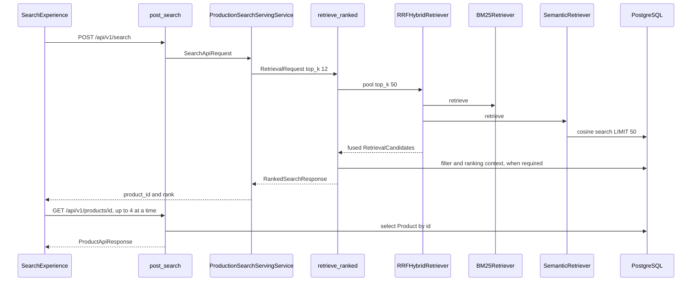

# Search request walkthrough

This note follows one catalog search from the browser to the cards on the page. It uses the production wiring: `ProductionSearchServingService` and `ProductionRetrievalPipeline.retrieve_ranked`.

Retrieval means finding candidate product ids. Fusion means combining two ranked lists. Filtering means dropping candidates that fail a constraint. Ranking means ordering the remaining candidates. Mapping means copying a few fields into the public JSON. Those are separate steps. This note names them where the code does them. It does not re-explain HTTP status codes, the full DTO inventory, SQL transactions, or process startup.

Nothing here was timed again, and no test was executed. One earlier measurement is quoted in section 11 from an existing report.

## 1. What happens when a user searches

The shopper types text, optionally picks Men or Women, and submits. The browser sends that text to `POST /api/v1/search`. The API answers with product ids and ranks. It does not answer with brand, description, or image.

The page then asks for each id with `GET /api/v1/products/{product_id}` and draws a card from that second response. Search and product detail are separate HTTP calls because `SearchResultItem` only has `product_id` and `rank`. `ranked_search_to_api_response` copies those two fields and leaves scores behind. The card needs columns that live on the `products` row, so the browser loads them afterward.

Opening a card is a third step. The link goes to `/products/{id}`, and `ProductDetailView` loads that product again, then asks for recommendations. Recommendations are not part of the search response.

## 2. The complete sequence

`SearchPage` is an async server component: it awaits the URL and renders `SearchExperience`. The search itself runs in the browser. `searchProducts` and `getProduct` are `async` and use `fetch`. The Python handlers `post_search` and `get_product` are ordinary `def` functions. The service, retrievers, fusion, filter, and ranker they call are synchronous.

1. **URL.** `SearchPage` in `frontend/app/search/page.tsx` reads `q` and `gender` and passes them to `SearchExperience`.
2. **Form.** `SearchForm.submit` trims the text and refuses an empty string. `SearchExperience.onSearch` writes `q` and, when set, `gender` onto `/search`.
3. **Effect.** When `query` or `gender` changes, `SearchExperience` calls `searchProducts`. Input: trimmed query, `topK` `12` (`SEARCH_TOP_K`), and `filters` only when gender is `Men` or `Women`. Output: a `SearchResponse`, or a `ProductIqApiError`.
4. **HTTP.** `requestJson` `fetch`es `{apiBaseUrl()}/api/v1/search`. The body is JSON. The next step is the FastAPI app.
5. **Validation.** FastAPI builds `SearchApiRequest` before `post_search` runs. Invalid JSON or fields become `RequestValidationError`.
6. **Dependency.** `get_search_service` returns `app.state.search_service`, stored by `create_app` on the production branch. The handler calls `service.search(body, request_id=request_id)`.
7. **Query object.** `ProductionSearchServingService.search` calls `build_query_representation`. Output: a `QueryRepresentation` with normalized `query_text`. Next: `retrieve_ranked`.
8. **Pool request.** `retrieve_ranked` checks that `candidate_pool_top_k` is at least the requested `top_k`. It then asks the RRF retriever for `candidate_pool_top_k` candidates, default `50`, not for `12`.
9. **BM25.** `BM25Retriever.retrieve` turns lexical text into terms, collects every product id that contains any term, scores them, and keeps `top_k` of that pool request. Output: `RetrievalCandidate` rows with `method` `bm25`.
10. **Vectors.** `SemanticRetriever.retrieve` encodes the semantic text with the BGE encoder and calls `PgVectorProductVectorIndex.search`, which runs `search_products_by_embedding`. Output: `RetrievalCandidate` rows with `method` `vector`. Both retrievers are called. There is no `try` that skips one if the other fails.
11. **Fusion.** `build_rrf_fused_retrieval_response` scores the union by reciprocal rank and keeps `output_top_k` rows. Output: hybrid `RetrievalCandidate` values.
12. **Filter.** If any constraint is non-null, `PostgresCatalogCandidateFilter` loads those ids and keeps the ones that match. With no active constraint, the fused ids pass through and this `SELECT` is skipped.
13. **Rank.** Production sets `ProductionRankingStageConfig(enabled=True)`, so `run_baseline_ranking_stage` loads product context, builds features, normalizes them, and calls `rank_candidates`. Output: `RankedCandidate` rows, trimmed to the original `top_k` (`12` from the storefront).
14. **Public JSON.** `ranked_search_to_api_response` builds `SearchApiResponse`. FastAPI serializes it. `searchProducts` checks that `results` is an array and `returned_count` is a number.
15. **Cards.** If `results` is empty, the page stops. Otherwise `loadProductCards` calls `getProduct` with up to `PRODUCT_LOOKUP_CONCURRENCY` (`4`) workers. Each success becomes a `ProductCardModel` via `productToCard`. `ProductCard` draws it. A per-id HTTP failure other than network or timeout becomes an unavailable card. Network and timeout abort the batch.



## 3. Request construction and HTTP

`SearchForm` keeps the text and the gender in React state. Gender is sent onward only when it is `Men` or `Women`. Submit trims the query and does nothing when the trim is empty, so the browser does not send a blank query.

`searchProducts` builds:

| JSON key | Source |
| --- | --- |
| `query` | The trimmed string |
| `top_k` | `input.topK`, which the search page sets to `12` |
| `filters` | Omitted when there is no gender. Otherwise `{ "category_gender": "Men" }` or `"Women"` |

`apiBaseUrl()` uses `NEXT_PUBLIC_PRODUCTIQ_API_URL` when that value is non-empty, and otherwise `http://localhost:8000`. Trailing slashes are removed. The request is `POST` with `Content-Type: application/json`. The client aborts after `REQUEST_TIMEOUT_MS` (`12000`).

Illustrative body, matching `SearchApiRequest` and the storefront. It is not a captured packet:

```json
{ "query": "navy cotton shirt", "top_k": 12, "filters": { "category_gender": "Men" } }
```

`SearchApiRequest` requires `query` (`min_length=1`) and `top_k` (`gt=0`). `validate_top_k_limit` rejects `top_k` above `api_max_top_k` (default `100`) and a query longer than `api_max_query_length` (default `512`). `filters` is optional. Unknown keys are forbidden. A whitespace-only query can pass this model and then fail in `normalize_query_text`.

## 4. Route, dependency, and service

`post_search` in `src/productiq/api/routes/search.py` is the handler. Its parameters are the body, `SearchServiceDep`, and `RequestIdDep`.

`SearchServiceDep` calls `get_search_service`, which reads `app.state.search_service`. On the production branch, `create_app` stored the object returned by `create_search_serving_service_from_pipeline`. That object is a `ProductionSearchServingService` holding one `ProductionRetrievalPipeline`. The route does not build it.

`search` does three things, in order:

1. `build_query_representation(request.query, constraints=request.filters)`.
2. `self._pipeline.retrieve_ranked(RetrievalRequest(query=query, top_k=request.top_k))`.
3. `ranked_search_to_api_response(..., query=query.query_text, top_k=request.top_k, request_id=request_id)`.

The echoed `query` is the normalized text. The integer `top_k` stays the caller's `12`, even though retrieval asked the retrievers for the pool size.

## 5. Retrieval pipeline

`retrieve_ranked` is the live search entry. `retrieve` on the same class stops after fusion and filtering and is not what `search` calls.

Order inside `_retrieve_filtered_pool`:

1. `query_has_usable_retrieval_intent`. If both lexical and semantic texts are empty after `strip`, the pool is `None` and ranking returns an empty list. `build_query_representation` already rejects an empty normalized query, so this branch is for a representation that arrived empty.
2. Copy the request with `top_k` set to `ProductionRetrievalConfig.candidate_pool_top_k`. The default is `50`. Production startup passes `ProductionRetrievalConfig()` with that default.
3. `self.rrf_retriever.retrieve(pool_request)`.

`RRFHybridRetriever.retrieve` always calls lexical `retrieve`, then semantic `retrieve`, then `build_rrf_fused_retrieval_response`. It does not catch either call.

**BM25.** `BM25Retriever.retrieve` builds a `RetrievalQueryView` and takes `lexical_intent.text`. `unique_lexical_query_terms` decides whether there is anything to score. `retrieve_lexical_candidates` returns the sorted union of product ids whose postings contain any query term. That union is not limited to `50`. `BM25Scorer.score_lexical_query` scores the whole union. `apply_bm25_top_k` keeps `request.top_k`, which here is the pool size `50`. Each kept row is a `RetrievalCandidate` with `product_id`, the BM25 `score`, and `method` `bm25`.

**Semantic.** `SemanticRetriever.retrieve` reads `semantic_intent.text`. `encode_query` uses the BGE encoder loaded at startup. The vector must have dimension `384`. `vector_index.search` calls `search_products_by_embedding`, which selects `product_id` and cosine distance from `products` where `embedding` is not null, orders by that distance, and applies `LIMIT` of the pool `top_k`. Hits become `RetrievalCandidate` rows with `method` `vector` and `score` equal to similarity.

If either retriever raises, the exception leaves `retrieve_ranked`. The other retriever is not used as a fallback. An empty list from one side is allowed: fusion still runs with the other list.

`validate_pool_against_request` raises `ValueError` when the caller's `top_k` is greater than `candidate_pool_top_k`. The storefront's `12` is under `50`. A client that sends `top_k` `51` through `100` passes `SearchApiRequest` and then hits this check. `ValueError` is mapped to HTTP `400`.

## 6. Reciprocal Rank Fusion

RRF combines ranked lists without adding BM25 points to cosine similarity. Those two scores are different units. RRF uses the position in each list. For a product at 1-based rank `r` in a list, that list contributes `1 / (k + r)`. ProductIQ's `k` is `RRFConfig.rank_constant`. Production passes `RRFConfig(rank_constant=60)`, and `DEFAULT_RRF_RANK_CONSTANT` is `60`. A product in both lists gets both contributions. A product in one list gets one. The fused rows are sorted by score descending, then by `product_id` ascending, and cut to `output_top_k`.

Illustrative arithmetic, not a ProductIQ measurement. `k` is `60`.

| Product | BM25 rank | Vector rank | Score |
| --- | --- | --- | --- |
| A | 1 | 2 | `1/61 + 1/62` |
| B | none | 1 | `1/61` |
| C | 2 | none | `1/62` |

A is first because it appears in both lists near the top. B beats C because rank 1 in one list is better than rank 2 in one list. The code does this in `compute_rrf_score` and `fuse_lexical_and_semantic_responses`.

Inputs are the two `RetrievalResponse` lists. Ranks are the positions in those lists (`index + 1`), not a rank stored earlier. Native scores are copied onto the fused candidate as `bm25_score` and `vector_score`. The candidate's own `score` and `fusion_score` are the RRF value. `method` is `hybrid`. A duplicate id inside one source list raises `RetrievalError`. The same id in both lists is one fused candidate, which is the overlap case. `overlap_count` is recorded on the metadata.

## 7. Filtering and baseline ranking

Filtering happens after fusion, in `_retrieve_filtered_pool`. `constraints_are_active` is true when any field on `QueryFilterConstraints` is not `None`. The storefront's `category_gender` makes it true. The filter then calls `PostgresCatalogCandidateFilter.filter_candidate_ids`, which runs `select(Product).where(Product.product_id.in_(...))` and keeps ids whose filtering representation satisfies the constraints. The surviving objects are still the fused `RetrievalCandidate`s, in filtered-id order. A missing catalog row raises `CatalogValidationError`.

With no active constraint, the code assigns `filtered_ids = candidate_ids` and does not query.

Ranking is `run_baseline_ranking_stage` because production sets `enabled=True`. The stage:

1. Loads `RankingProductContext` for every filtered id through `PostgresRankingProductContextProvider.load_contexts` (`select(Product)` by those ids).
2. `extract_features_for_request` builds `RankingFeatures`: retrieval signals (`bm25_score`, `bm25_rank`, `vector_similarity`, `vector_rank`, `rrf_score`, and the retrieved-by flags), matching flags such as `category_gender_match`, and catalog prices when the context has them.
3. `normalize_features_for_query` scales those features for this query.
4. `rank_candidates` calls `compute_baseline_score`, sorts with a deterministic key, and `apply_ranking_top_k` keeps the caller's `top_k`.

Each result is a `RankedCandidate`: `product_id`, `rank`, `ranking_score`, and the nested `RankingCandidate` whose `retrieval` is the fused `RetrievalCandidate`.

`rank_candidates_with_ltr` is not called from `retrieve_ranked`. `ProductionRankingStageConfig` carries `experimental_ltr`, and that field's description says `retrieve_ranked` does not use LTR. `assert_retrieve_ranked_uses_baseline_path` only executes `del stage`. The live choice is the call to `run_baseline_ranking_stage` when `stage.enabled` is true. If `enabled` were false, `retrieval_order_ranking_response` would keep fusion order and copy `fusion_score` into `ranking_score`. Production does not take that branch.

Filtering decides membership. Ranking decides order. Retrieval decided who entered the pool.

## 8. Public response and rendering

`ranked_search_to_api_response` walks `ranked.ranking.ranked_candidates` and builds `SearchResultItem(product_id, rank)`. `returned_count` is the length of that tuple. The HTTP model is `SearchApiResponse`. Scores, prices, and embeddings are not fields on it.

The search response is ids and ranks because the mapper was written that way, and because the card data is loaded by id. One search payload stays small. Each card pays for its own read.

`SearchExperience` maps `results` to `{ productId, rank }` and calls `loadProductCards`. That function starts `min(4, ids.length)` async workers. They share one cursor, so the lookups overlap up to four at a time. They are not a single sequential loop, and they are not all fired at once when there are more than four ids. Each worker calls `getProduct`, then `productToCard`. `ProductCard` uses `description` as the title, then brand, image, product type, and gender. `rank` is the search rank, shown on the card.

`ProductDetailView` is not used on the search results page. A card link goes to `/products/{id}`. That view calls `getProduct` again, then `getRecommendations`, and renders the main product with `productToCard` and the neighbors with `loadProductCards`.

`get_product` uses `PostgresProductCatalogReadProvider.get_product`: one `SELECT` by `product_id`, eight columns into `ProductCatalogReadModel`, then `product_read_model_to_api`.

## 9. One product's data journey

| Stage | Representation | Important fields | Transformation | Function |
| --- | --- | --- | --- | --- |
| Browser form | React state, then URL `q` and `gender` | query text, optional Men/Women | Trim. Empty text is not submitted | `SearchForm.submit` |
| HTTP body | JSON object | `query`, `top_k`, optional `filters.category_gender` | `topK` renamed to `top_k` | `searchProducts` |
| Validated request | `SearchApiRequest` | same fields, constraints enforced | Pydantic validation | `post_search` parameter |
| Query contract | `QueryRepresentation` | `query_text`, `lexical_intent`, `semantic_intent`, `constraints` | Whitespace normalized | `build_query_representation` |
| Retrieval request | `RetrievalRequest` | `query`, `top_k` | First `12`, then copied to pool `50` for the retrievers | `search`, then `_retrieve_filtered_pool` |
| Lexical hit | `RetrievalCandidate` | `product_id`, `score`, `method=bm25` | Union of postings, BM25 score, cut to pool `top_k` | `BM25Retriever.retrieve` |
| Vector hit | `RetrievalCandidate` | `product_id`, `score` as similarity, `method=vector` | Encode, then cosine `SELECT` | `SemanticRetriever.retrieve` |
| Fused hit | `RetrievalCandidate` | `fusion_score`, `bm25_rank`, `vector_rank`, `method=hybrid` | `1/(60+rank)` summed, duplicates collapsed, cut to 50 | `fuse_lexical_and_semantic_responses` |
| Filtered hit | same `RetrievalCandidate` | unchanged fields, fewer ids | Constraint match against the row | `PostgresCatalogCandidateFilter.filter_candidate_ids` |
| Ranked hit | `RankedCandidate` | `rank`, `ranking_score`, nested retrieval candidate | Weighted normalized features, cut to `12` | `rank_candidates` |
| Public search item | `SearchResultItem` | `product_id`, `rank` | Scores omitted | `ranked_search_to_api_response` |
| Database row | `Product` | all columns, including `embedding` and prices | `SELECT` by id | `PostgresProductCatalogReadProvider.get_product` |
| Read model | `ProductCatalogReadModel` | eight display-related fields, including `brand_normalized` | Other columns dropped | same provider |
| Public product | `ProductApiResponse` | brand, description, urls, gender, type, `request_id` | `brand_normalized` dropped | `product_read_model_to_api` |
| Card | `ProductCardModel` | camelCase fields plus search `rank` | Rename. `request_id` dropped | `productToCard` |

## 10. Error handling

| Failure | Where | What the caller sees |
| --- | --- | --- |
| Malformed JSON, missing `query`, `top_k` of `0`, `top_k` above the API cap | `SearchApiRequest`, before `post_search` | HTTP `400`, `INVALID_REQUEST`, message `Request validation failed` |
| Query that normalizes to empty, or an invalid `category_gender` | `build_query_representation` | `QueryRepresentationError` or `ProductRepresentationError`. Both map through `ProductIQError` to `400` `INVALID_REQUEST`. The message is the sanitized exception text, not the fixed validation sentence |
| `top_k` greater than `candidate_pool_top_k` (`50`) | `validate_pool_against_request` | `ValueError`, mapped to `400` `INVALID_REQUEST` |
| BM25 or vector retrieval raises `RetrievalError` | inside `RRFHybridRetriever.retrieve` | HTTP `500` `INTERNAL_ERROR`. The other retriever is not substituted |
| Ranking raises `RankingError`, including a missing context provider when ranking is enabled | `run_baseline_ranking_stage` or `rank_candidates` | HTTP `500` `INTERNAL_ERROR` |
| Filter or ranking context finds no row | `CatalogValidationError` | HTTP `503` `SERVICE_UNAVAILABLE`, unless the message is the missing-seed case, which this search path does not use |
| Database or catalog-load errors | `DatabaseError`, `CatalogLoadError` | HTTP `503` `SERVICE_UNAVAILABLE` |
| Any other `Exception` | `unhandled_exception_handler` | HTTP `500`, message `An unexpected error occurred` |
| Search service missing | `get_search_service` | HTTP `503` `CONFIGURATION_ERROR` |
| Product id missing on a card fetch | `ProductNotFoundError` | HTTP `404`, `Product not found.` `loadProductCards` turns that into an unavailable card unless the error is a network failure or the client timeout |
| Client waits longer than 12 seconds | `requestJson` abort | `ProductIqApiError` kind `timeout`. The server may still be working |

An empty `results` array is HTTP `200`, not an error. `SearchExperience` shows an empty state and does not call `getProduct`.

There is no code path that continues search after a failed retriever. Partial fusion happens only when a retriever returns an empty candidate tuple, which is a successful empty response.

## 11. Performance

This section separates the shape of the code from one recorded timing.

From the code:

- BM25 first materializes every product id that shares a query term, then scores that set, then keeps `50`. A common word can make that set large. The score loop is in the API process, over the in-memory index loaded at startup.
- Semantic search encodes the query once with BGE, then one SQL statement with `LIMIT` of the pool size. That is a different cost: model time plus one indexed vector query.
- Fusion is in memory over the two lists of at most `50`.
- An active filter adds one `SELECT ... WHERE product_id IN (...)` for those fused ids. No filter means that query is skipped.
- Baseline ranking adds another `SELECT` for the filtered ids, then feature and score work in process, then keeps `12`.
- The browser then issues one `GET` per surviving id, with at most four in flight. Twelve results therefore take several round trips after the search response.

Those are extra requests because the search JSON has no card fields. They are bounded by `returned_count`, not by the pool of `50`. Ids dropped by the filter or by `top_k` are not fetched.

Recorded once, in `resources/benchmark/full_catalog_search_verification_2026-10-23.md`, not re-run for this note: `POST /api/v1/search` for `navy cotton shirt` with `top_k` `5` returned HTTP `200` in `13.21` seconds against the `367172`-row catalog. That report says the body has no stage timers, so it does not split BM25, the encoder, and HNSW. It is one sample, not a limit.

## 12. Interview preparation

**What happens when a user searches?** The browser posts the text to `/api/v1/search`. The service builds a query representation, retrieves a pool of `50`, fuses BM25 and vector lists, optionally filters, baseline-ranks, and returns `12` ids and ranks. The page then loads each product.

**What is the difference between retrieval and ranking?** Retrieval proposes ids. `BM25Retriever` and `SemanticRetriever` do that. Ranking orders the ids that remain after fusion and filtering. `rank_candidates` does that.

**Why use both lexical and semantic search?** BM25 matches query terms in the inverted index. The vector path matches the BGE embedding of the query to `products.embedding`. RRF keeps a product that only one of them found, and rewards a product that both found.

**What does RRF do?** It adds `1 / (60 + rank)` for each list that contains the product, sorts by that sum, and keeps the pool size. It does not add the BM25 score to the cosine similarity.

**Why filter candidates?** Fusion does not know about `category_gender`. The filter runs after fusion, and only when a constraint is set, so a Men search can drop rows that are not Men.

**What is a `RetrievalCandidate`?** The object passed between retrievers and ranking. It has `product_id`, a `score`, and a `method`. After fusion the score is the RRF score and the method is `hybrid`.

**What is the role of the service layer?** `ProductionSearchServingService.search` turns `SearchApiRequest` into a `RetrievalRequest` and the ranked result into `SearchApiResponse`. The route only calls it.

**Why does search return ids rather than full records?** `SearchResultItem` has two fields. The mapper does not copy brand or description. The UI loads those with `getProduct`.

**How does the frontend fetch product details?** `loadProductCards` runs up to four `getProduct` calls at a time. Each calls `GET /api/v1/products/{id}`.

**Where does the baseline ranker fit?** After filtering. `run_baseline_ranking_stage` extracts features, normalizes them, and calls `rank_candidates`. Production enables that stage.

**Why is learning-to-rank not on this request?** `retrieve_ranked` never calls `rank_candidates_with_ltr`. The experimental LTR config defaults to disabled, and the production call uses `run_baseline_ranking_stage`.

**Where could latency come from?** Scoring every lexical posting match, encoding the query, the vector `SELECT`, the filter and context `SELECT`s, and then up to four-wide product lookups. The `13.21` second sample is one full-catalog measurement, not a breakdown.

**What is `candidate_pool_top_k`?** The depth passed to both retrievers and to fusion. Default `50`. The HTTP `top_k` is applied later, when ranking keeps the final list.

**What if one retriever returns nothing?** Fusion still runs. Products from the other list get a single reciprocal-rank term. A raised exception does not become an empty list.

**What does the card show as the title?** `ProductCard` uses `description`, not a title field. The search rank is the badge. It is not recomputed in the browser.

## 13. Practical tracing exercises

**1. Follow `top_k`.** Start at `frontend/lib/config.ts` `SEARCH_TOP_K`. Hint: the service passes `request.top_k` into `RetrievalRequest`, and `_retrieve_filtered_pool` replaces it with `candidate_pool_top_k` only for the retriever call. Outcome: you can say why the retrievers see `50` while the JSON says `12`.

**2. See both retrievers.** Open `RRFHybridRetriever.retrieve`. Hint: the two `retrieve` calls are not inside a fallback branch. Outcome: you can explain that a failure in BM25 skips fusion rather than serving vectors alone.

**3. Find the filter query.** Open `_retrieve_filtered_pool` and the `if constraints_are_active` branch, then `PostgresCatalogCandidateFilter.filter_candidate_ids`. Hint: a search with no `filters` does not take that branch. Outcome: you can separate fusion from filtering.

**4. See what the browser is allowed to know.** Open `ranked_search_to_api_response` and `SearchResultItem`. Hint: the loop reads `product_id` and `rank` only. Outcome: you can explain the second HTTP call.

**5. Confirm LTR is off this path.** Search `production_pipeline.py` for `run_baseline_ranking_stage` and for `rank_candidates_with_ltr`. Hint: the second name is absent from that file. Outcome: you can say what production startup enables and what it does not call.

## 14. Source-reading order

Read in this order for one request.

1. `frontend/app/search/page.tsx` — URL `q` and `gender` enter the page.
2. `frontend/components/SearchForm.tsx` — trim and submit.
3. `frontend/components/SearchExperience.tsx` — when the effect calls search and then loads cards.
4. `frontend/lib/api.ts`, `searchProducts` and `getProduct` — the two HTTP calls.
5. `src/productiq/api/routes/search.py`, `post_search` — the handler.
6. `src/productiq/api/dependencies.py`, `get_search_service` — where the stored service comes from.
7. `src/productiq/serving/search_service.py`, `search` — query representation, `retrieve_ranked`, mapper.
8. `src/productiq/retrieval/production_pipeline.py`, `retrieve_ranked` and `_retrieve_filtered_pool` — pool size, fusion, filter, rank.
9. `src/productiq/retrieval/rrf_hybrid_retriever.py`, `retrieve` — both retrievers, no fallback.
10. `src/productiq/retrieval/bm25_retriever.py`, `retrieve` — lexical candidates and BM25 top cut.
11. `src/productiq/retrieval/semantic_retriever.py`, `retrieve` — encode, then vector search.
12. `src/productiq/retrieval/rrf_fusion.py`, `compute_rrf_score` and `fuse_lexical_and_semantic_responses` — the formula and the duplicate rule.
13. `src/productiq/retrieval/catalog_candidate_filter.py`, `PostgresCatalogCandidateFilter.filter_candidate_ids` — the filter `SELECT`.
14. `src/productiq/retrieval/ranking_integration.py`, `run_baseline_ranking_stage` — features, normalization, `rank_candidates`.
15. `src/productiq/serving/mappers.py`, `ranked_search_to_api_response` — public fields.
16. `frontend/lib/catalog.ts`, `loadProductCards` and `productToCard` — concurrency and the card model.
17. `src/productiq/serving/postgres_catalog_provider.py`, `get_product` — the detail row.
18. `frontend/components/ProductCard.tsx` — what is drawn. `ProductDetailView` is the next page, not this response.

## 15. Verified facts and unresolved questions

Verified by reading the functions above. Tests were not executed. `tests/serving/test_serving_mappers.py` and `tests/api/test_api_search_coverage.py` were read in earlier notes for mapper and validation assertions. They were not re-run.

Confirmed from this reading:

- `RRFHybridRetriever.retrieve` calls the lexical retriever and then the semantic retriever on every non-empty-intent search.
- The production pool default is `50`. The storefront final `top_k` is `12`.
- Fusion `k` is `60`.
- Active filters run after fusion. Inactive filters skip the candidate `SELECT`.
- Production ranking is `run_baseline_ranking_stage` because `enabled=True`.
- `retrieve_ranked` does not call `rank_candidates_with_ltr`.
- `assert_retrieve_ranked_uses_baseline_path` does not inspect `experimental_ltr`.
- Card fetches use at most four concurrent `getProduct` calls.

Not established here:

- How large the BM25 posting union is for a particular query. The code scores the whole union, then cuts to the pool. This note does not count those ids.
- How much of the documented `13.21` seconds belongs to BM25, the encoder, or PostgreSQL. The report says the response has no stage timers.
- Whether `hnsw.ef_search` remains on a pooled connection after `search_products_by_embedding` returns it. The statement is executed. The pool reset was not traced.
- The numeric weights inside `BaselineRankingConfig`. The scorer multiplies normalized features by `config.weights`. Those default numbers were not copied into this note.
