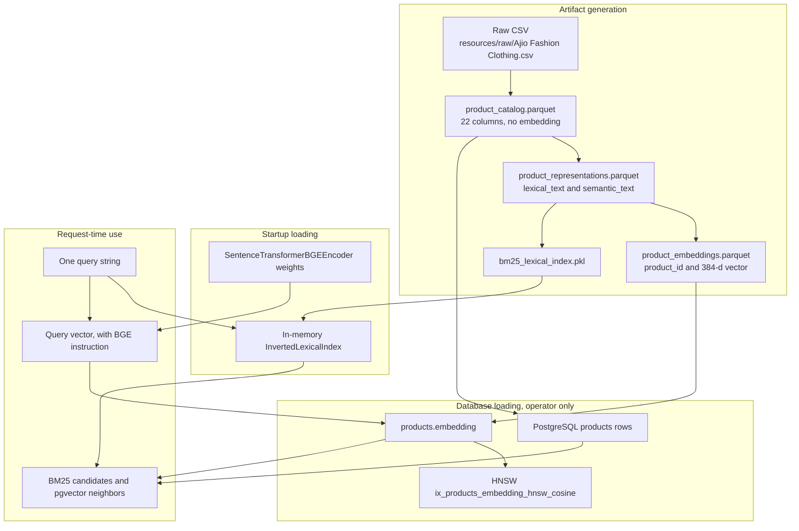

# Offline data and artifact lifecycle

ProductIQ answers a search from data that was prepared earlier. The API process does not clean the AJIO CSV, write Parquet, or build the embedding file. An operator prepares files, then loads some of them into PostgreSQL. Startup reads the BM25 pickle and the BGE model weights. A request encodes one query and reads the database.

This note follows those stages. It does not repeat the full search, database, or startup guides. Nothing in this task was executed: no notebook, loader, embedding job, or index build.

## 1. Offline preparation versus online serving

Five different kinds of work show up in the repository.

| Stage | What it means here | ProductIQ entry |
| --- | --- | --- |
| Offline preparation | Turn the raw CSV into a stable catalog table in a file | `AjioDataLoader` through `ProcessedDatasetWriter` |
| Artifact generation | Build the files search will need later | `generate_representation_dataset`, `generate_product_embeddings_from_representation_dataset`, `build_bm25_lexical_index_from_representation_dataset` |
| Database loading | Copy those files into PostgreSQL | `load_runtime_catalog` |
| Application startup | Open the database, unpickle BM25, load the encoder | `create_app` → `build_production_application_services` |
| Live query execution | Score one query against what is already loaded | `ProductionSearchServingService.search` → `ProductionRetrievalPipeline.retrieve_ranked` |

`src/data/` is the cleaning and export package. The search route does not import it. `create_app` calls `build_production_application_services`. That function calls `inspect_catalog_runtime_status`. It does not call `load_runtime_catalog`. The empty-catalog error text tells the operator to run `python -m productiq.database.load_runtime_catalog` as a separate step.

There is no function in `src/` that calls the cleaner, the representation builder, the embedding builder, and the BM25 builder in one sequence. Each stage is its own function. Notebooks call them separately.

## 2. Source dataset and processed catalog

An embedding is a list of numbers that stands for a piece of text. The catalog file is the table those numbers are later attached to. They are different artifacts.

**Raw file.** Tests and the data-engineering notebooks point at `resources/raw/Ajio Fashion Clothing.csv`. `AjioDataLoader.load` reads that path with `encoding="cp1252"` and `dtype=str`. It does not rename columns. The expected header is the nine names in `AJIO_COLUMNS`: `Product_URL`, `Brand`, `Description`, `Id_Product`, `URL_image`, `Category_by_gender`, the two price columns, and `Color`.

The loader does not hard-code a row count. `AJIO_PROCESSED_ROW_COUNT` in `src/data/export/schema.py` is `367_172`, and that constant is the processed-catalog contract. The earlier preflight report counted the CSV as 367,172 data rows under CP1252 and recorded a UTF-8 decode failure at byte `0xe9`. This task did not open the CSV again.

**Cleaning and the steps after it.** Notebook `09_processed_dataset.ipynb` calls this chain on a DataFrame. The functions themselves do not know about the notebook.

| Step | Code | What the function does |
| --- | --- | --- |
| Load | `AjioDataLoader.load` | Read the CSV as strings |
| Clean | `AjioDataCleaner.clean` | Strip whitespace on the text columns, parse prices to nullable integers, set `price_anomaly` when both prices exist and the discount price is greater than the original. `rows_removed` is always `0` |
| Normalize | `AjioDataNormalizer.normalize` | Add `Brand_Normalized`, `Color_Normalized`, and `Color_Is_Coded` |
| Deduplicate | `AjioDataDeduplicator.deduplicate` | Drop exact duplicate rows, keeping the first. It can also inspect groups that share `Id_Product` |
| Canonical | `AjioCanonicalProductBuilder.build` | Rename fields to the ProductIQ names, set `source` to `ajio`, and refuse null or duplicate `product_id` |
| Attributes | `ProductAttributeExtractor.extract` | Read the canonical `description` and add `product_type`, `fit`, `pattern`, `sleeve`, `neckline`, `material`, `product_features`, and `style_attributes` |
| Write | `ProcessedDatasetWriter.write` | Write Parquet with pyarrow, then a JSON manifest, using a temporary file and `os.replace` |

The published catalog is `resources/processed/product_catalog.parquet`. `Settings.processed_catalog_path` defaults to that relative path (`PRODUCTIQ_PROCESSED_CATALOG_PATH`). The manifest beside it records 367,172 rows, 22 columns, schema `1.0.0`, source `ajio`, and sha256 `ffd36e92793377b2b4eea467e8109ff1e202691624a7dc04abc7a0b2d1177645`. The column list in the manifest matches `PROCESSED_COLUMN_ORDER`. It has no `embedding` column.

Raw data is the vendor CSV, still in the original column names. Processed data is the 22-column Parquet the loader is willing to upsert. Changing the CSV does not change the Parquet until a writer runs.

**Who reads the processed catalog.** `generate_representation_dataset` takes the canonical Parquet path. `ProductCatalogLoader.load_from_parquet` and `load_processed_catalog` read it when an operator loads PostgreSQL. Search does not open this file on a request.

## 3. Product embeddings

`semantic_text` is the sentence the model sees for a product. `build_semantic_text` builds it from labeled fields in `SEMANTIC_FIELD_ORDER` (Brand, Category, Product Type, Color, Pattern, Material, Fit, Sleeve, Neckline, Features, Style) and appends `Description: ...` from the canonical description. `generate_representation_dataset` writes that string, plus `lexical_text` and `product_text`, into `resources/processed/product_representations.parquet`. The representation manifest records 367,172 rows and names `product_catalog.parquet` as its source, checksum matching the catalog manifest.

**Model.** `BGE_PRIMARY_MODEL_ID` is `BAAI/bge-small-en-v1.5`. `PRODUCTIQ_EMBEDDING_DIMENSION` is `384`. Similarity is cosine. Vectors are L2-normalized (`normalize_embeddings=True` in `SentenceTransformerBGEEncoder._encode`). `create_bge_small_en_v15_encoder` loads that model with `sentence_transformers.SentenceTransformer` and refuses a dimension other than the selection file's primary dimension.

The embedding manifest records the same model id, revision `5c38ec7c405ec4b44b94cc5a9bb96e735b38267a`, dimension 384, 367,172 rows, checksum `d97a843f54ca2cc404bcce7955fb86edc066c9f504f66e82fc1d9d6a23316dc6`, and the rule `raw semantic_text without instruction prefix`.

**Offline product vectors.** `generate_product_embeddings_from_representation_dataset` reads the representation Parquet, calls `encode_documents` on `semantic_text`, and publishes `product_embeddings.parquet` plus `product_embeddings.manifest.json` next to the source unless the caller passes other paths. `encode_documents` does not add the query instruction. The default encode batch is `DEFAULT_EMBEDDING_BATCH_SIZE` (`64`). The production script is `scripts/run_product_embedding_generation.py`. Notebook `29_embedding_generation.ipynb` says the batch job uses that script. This task did not run it.

The model checkpoint is the BGE weights. The embedding artifact is the Parquet of 384-float vectors already computed for each `product_id`. Startup can load the weights again to encode a query. It does not read `product_embeddings.parquet` while answering search.

**Database vectors.** `load_product_embeddings_into_catalog` streams the Parquet and runs:

```sql
UPDATE products
SET embedding = CAST(:embedding AS vector)
WHERE product_id = :product_id
```

Each Parquet batch is one `engine.begin()`. The default batch is `DEFAULT_VECTOR_INDEX_LOAD_BATCH_SIZE` (`5000`). A rowcount of `0` raises `SemanticRetrievalError` inside that transaction, so that batch rolls back. Alignment is checked first, in id batches of `_CATALOG_EXISTENCE_BATCH_SIZE` (`10000`), and a missing or duplicate id fails before updates.

**Query vectors.** `SemanticRetriever.retrieve` calls `encoder.encode_query`. That method prefixes the query with `BGE_QUERY_INSTRUCTION` (`Represent this sentence for searching relevant passages: `) and encodes one string. `search_products_by_embedding` orders `products.embedding <=>` that vector, which is pgvector cosine distance under `vector_cosine_ops`, and skips null embeddings. `cosine_distance_to_similarity` returns `1.0 - distance`.

Production startup calls `create_bge_small_en_v15_encoder(device="cpu", allow_cpu_fallback=True)` once, unless a caller passes an encoder. Later searches reuse that object.

## 4. BM25 lexical index

BM25 is a lexical score. It ranks documents that share the query's words, and it gives a word less weight when that word appears in many documents. ProductIQ stores the word lists in an inverted index: for each term, the product ids that contain it and how often.

**Text.** `build_lexical_text` joins structured fields from the `ProductRepresentation` (brand and normalized brand, gender, type, color, pattern, material, fit, sleeve, neckline, features, style) with the canonical description. That string is the `lexical_text` column on the representation Parquet. `build_bm25_lexical_index_from_representation_dataset` reads `product_id` and `lexical_text`, tokenizes with `tokenize_lexical_text`, and builds `InvertedLexicalIndex`.

Tokenization lowercases the text and keeps runs of letters and digits (`[a-z0-9]+`). There is no stemmer in that function. The manifest records tokenizer `productiq.retrieval.lexical.tokenize_lexical_text/v1`.

**File.** The builder pickles the index as `bm25_lexical_index.pkl` (`BM25_LEXICAL_INDEX_FORMAT = "pickle"`) and writes `bm25_lexical_index.manifest.json`. Defaults place both next to the representation file. The manifest in `resources/processed/` records 367,172 documents, `k1` `1.5`, `b` `0.75`, checksum `9d4c393c3535944cd7278165ffa3a9c5ddc9a08eef056f55c08b9012c627a855`, and the same representation checksum as the embedding manifest. `BM25Config` defaults are the same `k1` and `b`. This task did not open the pickle.

`Settings.bm25_artifact_path` defaults to the directory `resources/processed/bm25`. `resolve_bm25_index_path` uses that path when it already ends in `.pkl`. Otherwise it looks for `bm25_lexical_index.pkl` inside the directory, then beside the processed catalog.

**Startup load.** For a catalog mode other than `fixture`, `_resolve_lexical_retriever` calls `create_bm25_retriever_from_index_path`, which unpickles once and builds `BM25Retriever`. A missing file raises `ConfigurationError` before the app exists. Fixture mode does not use the pickle. It builds an index from database `brand`, `product_type`, `description`, and `color_raw`.

**Query.** `BM25Retriever.retrieve` tokenizes `lexical_retrieval_text`, takes the union of postings for those terms, scores them with `BM25Scorer`, and keeps `top_k`. It does not rebuild the index.

**Posting map.** `BM25Scorer._term_frequency` used to scan every posting for a term on every candidate. It now fills `_term_frequency_maps` on the scorer: the first time a term is scored, the postings become a dict from `product_id` to term frequency. `BM25Retriever.__init__` creates one `BM25Scorer` and keeps it. The map is therefore process memory on that scorer. It does not reload the catalog, and it does not change the BM25 formula (`k1` 1.5, `b` 0.75, idf from document frequency).

## 5. PostgreSQL and pgvector loading

`bootstrap_productiq_database` enables the `vector` extension, calls `create_product_catalog_tables(checkfirst=True)`, adds `embedding vector(384)` if the column is missing, and calls `create_product_embedding_hnsw_index` with its default `rebuild=False`.

`load_runtime_catalog` always bootstraps first.

| Mode | What it writes |
| --- | --- |
| `fixture` | `load_compose_integration_demo_catalog`: three `compose-demo-*` rows with a one-hot unit vector of length 384. This is not the AJIO catalog |
| `full` | `load_processed_catalog` with expected count `367_172`, then `build_product_vector_index` when an embeddings path is passed |
| `partial` | The same loaders, with the caller's expected count |

The CLI `python -m productiq.database.load_runtime_catalog` defaults to `fixture`. For `full` or `partial`, `main` passes the settings catalog path and the embeddings path. `--enforce-official-checksums` is off in `load_runtime_catalog` and on inside `build_product_vector_index` unless the caller sets it. The CLI forwards the flag.

**Catalog batches.** `ProductCatalogLoader.load_from_parquet` validates the Parquet, then opens one session (`autoflush=False`, `autocommit=False`, `expire_on_commit=False`) for the file. It reads chunks of `DEFAULT_CATALOG_LOAD_CHUNK_SIZE` (`10000`). Each chunk is split so one statement stays under PostgreSQL's parameter limit: `MAX_UPSERT_ROWS_PER_STATEMENT = 65535 // 22` because there are 22 processed columns. After the statements for a chunk, `session.commit()`. An exception calls `session.rollback()` and raises `CatalogLoadError`. Chunks whose `commit` already succeeded stay written. `load_processed_catalog` runs `validate_product_catalog` only after `load_from_parquet` returns, so a failed load does not reach that validation, and a validation failure does not roll back earlier commits.

The upsert is `INSERT ... ON CONFLICT (product_id) DO UPDATE` for every `Product` column except `product_id`.

**Vectors and HNSW.** `build_product_vector_index` validates the embedding artifact, calls `load_product_embeddings_into_catalog`, then `create_product_embedding_hnsw_index(engine, rebuild=rebuild_hnsw)`. The default `rebuild_hnsw` is `False`. If `ix_products_embedding_hnsw_cosine` already exists, that function returns without `DROP INDEX`. `rebuild=True` drops it first. The index uses `hnsw` and `vector_cosine_ops`, with `m` `16` and `ef_construction` `64`.

**How the API reads it later.** `retrieve_ranked` uses the in-memory BM25 index and `search_products_by_embedding` on `products.embedding`. Filters and ranking context read other `products` columns. `get_product` reads one row by `product_id`. Recommendation generators use the same stored retrievers plus further reads. None of those request paths call `load_runtime_catalog`.

## 6. Artifact dependency graph

The arrows are dependencies read from function inputs and outputs. Notebook numbers are the notebooks whose cells call that stage. They are not one traced `main`.



`09_processed_dataset.ipynb` is the notebook that writes the catalog in one cell sequence: load, clean, normalize, deduplicate, canonical build, attribute extract, `ProcessedDatasetWriter`. `19_representation_dataset_generation.ipynb` calls `generate_representation_dataset`. `24_bm25_index_construction.ipynb` calls `build_bm25_lexical_index_from_representation_dataset`. `29_embedding_generation.ipynb` points at `scripts/run_product_embedding_generation.py` and does not call `generate_product_embeddings_from_representation_dataset` in the cells that were searched. `84_docker_serving_integration.ipynb` documents `load_runtime_catalog` and `build_product_vector_index`. Notebooks between these numbers were not read cell by cell.

## 7. Lifecycle table

"Regeneration required when" is limited to what the code actually checks. The safety column mixes those checks with operational caution. Operational lines are marked as such.

| Artifact | Produced by | Stored at | Loaded by | Used by | Regeneration required when | Safety |
| --- | --- | --- | --- | --- | --- | --- |
| Processed catalog | `ProcessedDatasetWriter.write` | `resources/processed/product_catalog.parquet` and `product_catalog.manifest.json` | `ProductCatalogLoader.load_from_parquet` | Representation generation, then the database load | The writer is a separate run. The loader checks the Parquet against `PROCESSED_COLUMN_ORDER` and the expected row count. It does not watch the CSV | Operational: rewriting this file replaces the published catalog. The raw CSV is a different file |
| Representations | `generate_representation_dataset` | `resources/processed/product_representations.parquet` | Embedding and BM25 builders, which also read the sibling manifest | Not opened by `retrieve_ranked` | Those builders compare row counts and source checksums when a manifest is present | Operational: embeddings and BM25 both record this file's checksum. A new representation file does not update them |
| Product embeddings | `generate_product_embeddings_from_representation_dataset` | `resources/processed/product_embeddings.parquet` and its manifest | `load_product_embeddings_into_catalog` | The database `embedding` column after that load. The API does not read this Parquet per query | `validate_product_embeddings_parquet` checks dimension, row count, and checksum when the vector builder validates the artifact. `enforce_official_checksums` compares the official sha256 constants | Operational: regenerating replaces the Parquet. PostgreSQL stays on the old vectors until a load |
| BM25 pickle | `build_bm25_lexical_index_from_representation_dataset` | `bm25_lexical_index.pkl` beside the representation file, or the path `resolve_bm25_index_path` finds | `create_bm25_retriever_from_index_path` at startup, except fixture mode | `BM25Retriever.retrieve` | A new process must load the new pickle. The running retriever keeps the index it unpickled | Operational: replacing the pickle does not change the running process |
| PostgreSQL product rows | `load_processed_catalog` / the loader upsert | Table `products` | Sessions in search filters, product detail, ranking context, recommendations | Those reads | A new load is an explicit operator call. Startup only counts rows | Operational: a second upsert updates existing ids. See section 8 for the embedding column |
| PostgreSQL vectors and HNSW | `load_product_embeddings_into_catalog`, then `create_product_embedding_hnsw_index` | `products.embedding`, index `ix_products_embedding_hnsw_cosine` | `search_products_by_embedding` and the recommendation embedding providers | Semantic search and vector recommendations | `rebuild=False` leaves an existing HNSW index in place. A vector load still `UPDATE`s the column | Operational: `rebuild=True` drops the index first. This task did not run either path |

## 8. Freshness and consistency

**BM25 pickle replaced while the API is running.** `_resolve_lexical_retriever` unpickles during `build_production_application_services`. `BM25Retriever.retrieve` uses `self.index`. No request path calls `load_inverted_lexical_index` again. The new file is used after a new process starts and passes the same startup path.

**Catalog file replaced while the API is running.** Search does not open `product_catalog.parquet`. The process keeps serving the rows already in PostgreSQL and the BM25 index already in memory.

**Product rows reloaded.** The next `SELECT` sees committed rows. `build_readiness_response` documents itself as aggregating readiness without expensive dependency I/O. `catalog_data` prints `application_services.catalog_product_count` and `catalog_embedding_count`, which were copied once in `build_production_application_services`. Readiness does not call `inspect_catalog_runtime_status` again. The in-memory BM25 index is also unchanged, including in fixture mode, where that index was built from the rows present at startup.

**Embeddings updated in PostgreSQL.** `search_products_by_embedding` reads `products.embedding` on each search. A committed `UPDATE` is visible to the next search. The on-disk Parquet is not reread. The readiness embedding count stays the startup number.

**HNSW already present.** `create_product_embedding_hnsw_index` returns when the index name exists and `rebuild` is false. It does not drop or rebuild. `build_product_vector_index` passes `rebuild_hnsw`, default `False`.

**A catalog batch fails.** The loader has already committed earlier Parquet chunks. `rollback` applies to the open transaction, which is the chunk that has not committed. The exception becomes `CatalogLoadError`. Later chunks in that call do not run.

**A vector batch fails.** Each batch of 5000 is its own `engine.begin()`. A failure, including a missing `product_id`, rolls that batch back. Earlier batches in the same call have already committed.

**Upsert and the embedding column.** This is a static reading of `_upsert_records`, not a reload that was run here.

`_dataframe_chunk_to_records` copies only `PROCESSED_COLUMN_ORDER`. That list has no `embedding`. `_upsert_records` still builds the conflict `SET` from every `Product` column except `product_id`, and `Product.embedding` is a nullable `vector(384)` with no default in the model. The conflict assignment is `embedding = excluded.embedding`. In PostgreSQL, `EXCLUDED` is the row proposed for insert. A proposed row that omits `embedding` gets the column default, which is null. So an upsert of an id that already exists assigns null to `embedding` for that row.

`load_processed_catalog` performs that upsert and does not call the embedding loader. `load_runtime_catalog` in `full` or `partial` mode calls `build_product_vector_index` only when `embeddings_parquet` is not `None`. The CLI passes that path for those modes, so a full CLI invocation is written to upsert first and then `UPDATE` the vectors again. A catalog-only call leaves the nulls in place until some later embedding load. This task did not execute either call, and it did not query the live table. The October verification report is a separate measurement from before this note.

Two vector-index manifests are on disk and do not match each other. `resources/processed/product_vector_index.manifest.json` records `build_timestamp_utc` `2026-09-27T10:16:14Z`, `index_size_bytes` `625590272`, and `index_build_duration_seconds` about `426`. `resources/benchmark/product_vector_index.manifest.loaded-2026-10-22.json` is a different file from the later load. This task did not decide which one matches the database.

## 9. Rebuild order and prerequisites

This is the dependency order for a fresh environment. It is not a command to run.

**Verified from source**

1. `bootstrap_productiq_database` creates the extension, the `products` table, the embedding column, and, by default, the HNSW index if it is missing.
2. `load_processed_catalog` requires `product_catalog.parquet`. The full mode also requires the row count `367172` unless the caller overrides it.
3. `load_product_embeddings_into_catalog` requires that Parquet's `product_id` values to already exist. It updates vectors. It does not insert catalog rows.
4. `build_product_vector_index` runs that update and then ensures the HNSW index. Default `rebuild_hnsw=False`.
5. `generate_product_embeddings_from_representation_dataset` and `build_bm25_lexical_index_from_representation_dataset` both require the representation Parquet. They write different files.
6. `generate_representation_dataset` requires the processed catalog Parquet.
7. Startup requires a non-empty `products` table. Full and partial modes also require the BM25 file. The encoder is loaded from the model id, not from `product_embeddings.parquet`.

**Inferred from inputs and outputs**

The CSV becomes the processed Parquet only by running cleaner, normalizer, deduplicator, canonical builder, attribute extractor, and `ProcessedDatasetWriter`. Notebook 09 contains that sequence. No `src/` function wraps it. Embeddings and BM25 both sit downstream of the representation file, and they do not depend on each other. The database catalog load sits downstream of the processed Parquet. The vector load sits downstream of both the catalog rows and the embedding Parquet.

**Still requiring investigation**

The notebooks between 10 and 18, and between 25 and 28, were not read cell by cell, so a complete notebook syllabus is not established. Whether a published run of notebook 09 removed any duplicate rows is not in the writer itself. The cleaner cannot remove rows. The deduplicator can. The catalog manifest and the earlier CSV count are both 367,172, which is consistent with no dropped rows, and it was not rechecked by reading the CSV.

## 10. Common beginner misunderstandings

**The model checkpoint is the embedding file.** `BAAI/bge-small-en-v1.5` is the weight id `SentenceTransformer` loads. `product_embeddings.parquet` is the already computed 384-d column for each product. Search loads the weights to encode the query. It looks up neighbors in PostgreSQL.

**The embedding Parquet is the database column.** The Parquet is an offline file. `products.embedding` is filled by `UPDATE ... CAST(:embedding AS vector)`. Until that load runs, the column stays null. Search uses the column.

**Startup builds the catalog.** `create_app` counts rows and, when the mode is not fixture, unpickles BM25. The loader is a separate module and a separate command.

**Every search builds BM25.** `BM25Retriever.retrieve` tokenizes the query and scores postings already in `self.index`. The index was built by `build_bm25_lexical_index_from_representation_dataset` or, in fixture mode, once at startup from the demo rows.

**Editing the CSV updates PostgreSQL.** `AjioDataLoader` only returns a DataFrame. The table changes when `load_processed_catalog` or the fixture loader commits.

**Updating PostgreSQL refreshes BM25.** The pickle is read in `_resolve_lexical_retriever`. Later `UPDATE`s of `products` do not call that function. Fixture mode is the same: its in-memory index is the one built at startup.

**A row count proves the vectors are valid.** `count_catalog_products` and `count_products_with_embeddings` are different queries. The embedding column is nullable. A catalog upsert can assign it null, as section 8 describes. Readiness can still report the startup counts after the table changes.

**An existing HNSW index is rebuilt on load.** `create_product_embedding_hnsw_index` returns immediately when the index exists and `rebuild` is false. The default vector build uses that default.

## 11. Interview questions and answers

**What is offline work in ProductIQ?** Work that writes files or database rows before a user searches. Cleaning, Parquet export, representation text, the embedding Parquet, the BM25 pickle, and `load_runtime_catalog` are offline. `retrieve_ranked` is online.

**What is online work?** Encoding the one query, reading the in-memory BM25 index, and reading `products` for vectors, filters, and product detail.

**Why embed products ahead of time?** `encode_documents` runs over the whole representation file and stores 384 floats per id. Search encodes only the query string.

**Which text is embedded?** `semantic_text`, built by `build_semantic_text` from labeled attributes plus the description. Product documents do not get the BGE query prefix. Queries do.

**What model and size does ProductIQ use?** `BAAI/bge-small-en-v1.5`, dimension 384, cosine, L2-normalized. The embedding manifest records revision `5c38ec7c405ec4b44b94cc5a9bb96e735b38267a`.

**What is BM25 here?** A score over an inverted index of `lexical_text`. Terms are lowercase alphanumeric tokens. The published manifest uses `k1` 1.5 and `b` 0.75, matching `BM25Config`.

**What is Parquet used for?** Columnar files for the 22-column catalog, the representation dataset, and the embedding matrix. PostgreSQL is the online store. Search does not open the catalog Parquet.

**What is pgvector doing?** The `embedding` column is `vector(384)`. Search uses the `<=>` operator and `vector_cosine_ops`. Similarity is `1 - distance`.

**What is HNSW?** The index type in `CREATE INDEX ... USING hnsw (embedding vector_cosine_ops)` with `m` 16 and `ef_construction` 64. The name is `ix_products_embedding_hnsw_cosine`. It is how the database finds nearest vectors without a full sort of every row on each query. The SQL still orders by the same distance.

**Where do artifacts live?** Under `resources/processed/` for the catalog, representations, embeddings, and BM25 manifest. The pickle name is `bm25_lexical_index.pkl`. Settings can point the API at other relative paths.

**How does a load commit?** Catalog: one session, `commit` once per 10,000-row Parquet chunk. Embeddings: one transaction per 5,000-row batch. A failure rolls back only the open transaction.

**What stays stale after a file change?** The BM25 object in the running process, and the readiness counts stored on `ApplicationServices`. Database reads see new commits. The BM25 pickle and the embedding Parquet do not.

**How do you rebuild safely?** Produce files first, then load. The embedding `UPDATE` requires the `product_id` to exist. Leave `rebuild_hnsw` false unless you intend to drop the index. Do not point the fixture loader at the full catalog. The full CLI path upserts metadata and then loads vectors. A catalog-only upsert can null `embedding` on existing ids.

**What if batch 30 of the catalog load fails?** Batches 1–29 stay committed if each of those `commit` calls returned. Batch 30 is rolled back. The function raises `CatalogLoadError` and does not continue the file.

**What makes a run reproducible?** The manifests store sha256 checksums and source checksums. The vector builder can require `OFFICIAL_EMBEDDING_ARTIFACT_CHECKSUM` and `OFFICIAL_SOURCE_REPRESENTATION_CHECKSUM`. The model id and dimension are constants. This task did not recompute the hashes.

## 12. Practical exercises

**1. Separate the CSV from the Parquet.** Open `AjioDataLoader.load` and `PROCESSED_COLUMN_ORDER`. Hint: the loader keeps the nine vendor names, and the Parquet contract has 22 names, with `source` added by the canonical builder. Outcome: you can say which file a column belongs to.

**2. Find the embedded string.** Read `build_semantic_text` and `encode_documents`. Hint: the query prefix is added only in `format_bge_query_text`. Outcome: you can explain why a product vector and a query vector are not prepared the same way.

**3. Find where BM25 is built and where it is queried.** Read `build_inverted_lexical_index_from_lexical_rows` and `BM25Retriever.retrieve`. Hint: retrieve calls `retrieve_lexical_candidates` on `self.index`. Outcome: you can show that a search does not tokenize the catalog again.

**4. Trace one catalog commit.** Read `load_from_parquet` from the session open through `commit` and the `except` block. Hint: `commit` is inside the chunk loop, and `rollback` is in the handler. Outcome: you can say which rows survive a failure mid-file.

**5. Explain the embedding column on upsert.** Read `_upsert_records` and the `embedding` field on `Product`. Hint: the record dict uses `PROCESSED_COLUMN_ORDER`, and the conflict `SET` walks every other table column. Outcome: you can explain when a catalog reload can clear vectors, and why the embedding `UPDATE` is a later step.

## 13. Source-reading order

1. `src/data/ingestion/ajio.py` — `AjioDataLoader.load` and `AJIO_COLUMNS`.
2. `src/data/preprocessing/cleaning.py` — `AjioDataCleaner.clean`.
3. `src/data/preprocessing/normalization.py` — `AjioDataNormalizer.normalize`.
4. `src/data/deduplication/deduplicator.py` — `AjioDataDeduplicator.deduplicate`.
5. `src/data/catalog/canonical.py` — `AjioCanonicalProductBuilder.build`.
6. `src/data/attributes/extractor.py` — `ProductAttributeExtractor.extract`.
7. `src/data/export/schema.py` and `src/data/export/processed.py` — the 22 columns and `ProcessedDatasetWriter.write`.
8. `notebooks/data_engineering/09_processed_dataset.ipynb` — the cell order that calls those classes. Read it. Do not run it.
9. `src/productiq/representation/semantic.py` — `build_semantic_text`.
10. `src/productiq/representation/lexical.py` — `build_lexical_text`.
11. `src/productiq/representation/dataset.py` — `generate_representation_dataset`.
12. `src/productiq/retrieval/embedding_schema.py` and `embedding_encoder.py` — model id, dimension, `encode_documents`, `encode_query`.
13. `src/productiq/retrieval/embedding_builder.py` — `generate_product_embeddings_from_representation_dataset`.
14. `src/productiq/retrieval/lexical.py` — `tokenize_lexical_text`.
15. `src/productiq/retrieval/index_builder.py` — `build_bm25_lexical_index_from_representation_dataset`.
16. `src/productiq/database/bootstrap_compose.py` — `bootstrap_productiq_database`.
17. `src/productiq/database/loaders/catalog_loader.py` — `load_from_parquet` and `_upsert_records`.
18. `src/productiq/database/load_runtime_catalog.py` — `load_runtime_catalog`.
19. `src/productiq/retrieval/vector_index_loader.py` — `load_product_embeddings_into_catalog`.
20. `src/productiq/database/vector_catalog.py` — `create_product_embedding_hnsw_index`.
21. `src/productiq/retrieval/vector_index_builder.py` — `build_product_vector_index`.
22. `src/productiq/api/services/production_stack.py` — `_resolve_lexical_retriever` and the encoder construction.
23. `src/productiq/retrieval/bm25_retriever.py` and `semantic_retriever.py` — request-time use.
24. `src/productiq/retrieval/pgvector_search.py` — the `<=>` query.

## 14. Verified facts and unresolved questions

**Confirmed from source**

- The CSV loader uses CP1252 and does not transform columns.
- The processed contract is 22 columns and `AJIO_PROCESSED_ROW_COUNT` of 367,172. The catalog manifest matches that count and checksum.
- Cleaning strips text, parses prices, and flags price anomalies. It does not drop rows.
- Representation text is the input to both the embedding job and the BM25 build.
- Documents are embedded without the BGE instruction. Queries are embedded with it. Dimension 384. Model id `BAAI/bge-small-en-v1.5`.
- BM25 is an in-memory inverted index loaded at startup from pickle, except fixture mode, which builds a smaller index from four database fields.
- `create_app` does not call `load_runtime_catalog`.
- Catalog commits once per 10,000-row chunk on one session. Embedding updates commit once per 5,000-row batch.
- HNSW create with `rebuild=False` returns when the index already exists.
- Readiness catalog counts come from the `ApplicationServices` object filled at startup.
- `_upsert_records` conflict-updates every table column except `product_id`, while the inserted dicts contain only the 22 processed columns.

**Supported by existing metadata or earlier reports, not remeasured here**

- Preflight count of the CSV: 367,172 rows, CP1252, UTF-8 failure at byte `0xe9`.
- Embedding manifest: 367,172 vectors, revision `5c38ec7c405ec4b44b94cc5a9bb96e735b38267a`, the checksum above.
- BM25 manifest: 367,172 documents, `k1` 1.5, `b` 0.75, the checksum above.
- Representation manifest: 367,172 rows, source checksum equal to the catalog manifest.
- `resources/processed/product_vector_index.manifest.json` is timestamped 2026-09-27. The October benchmark manifest is a different file. The live index was not queried.

**Notebook order**

Notebook 09 calls the catalog chain in one sequence. Notebooks 19, 24, and 29 cover representations, BM25, and the embedding script. Notebook 84 names the database load. That order matches the function inputs. It is not a single orchestrator, and the notebooks that were not opened can contain other entry points.

**Open questions**

- Whether SQLAlchemy emits `embedding` as an omitted column or an explicit null in the multi-row `INSERT`. Either way the proposed row's embedding is null. The conflict assignment was not executed.
- Which on-disk vector manifest corresponds to the current HNSW index.
- The exact duplicate-removal count from the run that wrote the published Parquet.
- A cell-by-cell order for the notebooks that were only located, not read.
- Whether `resources/processed/bm25/bm25_lexical_index.pkl` or `resources/processed/bm25_lexical_index.pkl` is the file the current settings resolve. The resolver's rules are in source. The pickle was not opened.

**Tests**

No test was run. Paths in `tests/data/ingestion/test_ajio.py` and sibling data tests were seen in search results as `resources/raw/Ajio Fashion Clothing.csv`. `tests/database/test_catalog_loader.py`, `tests/retrieval/test_vector_index_loader.py`, `tests/retrieval/test_bm25.py`, and `tests/retrieval/test_embedding_generation.py` were not opened for assertions in this pass.
