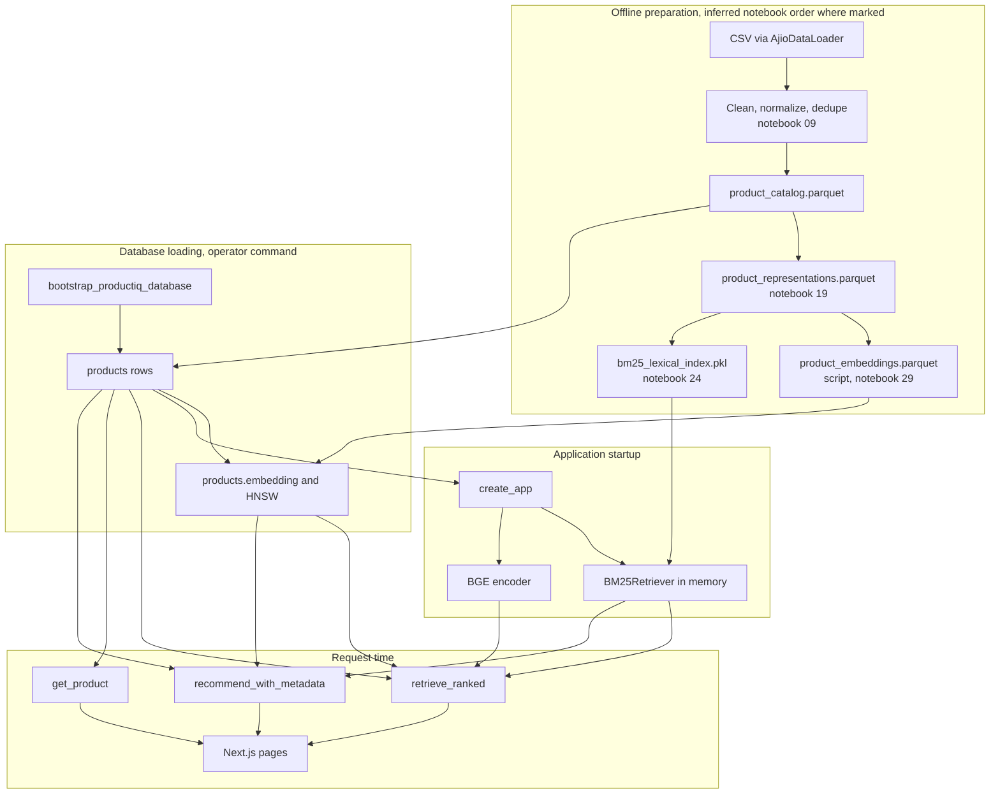

# Rebuilding ProductIQ from scratch

This is a plan for reconstructing the system that already exists in this repository. It is not a request to create a second repo, rerun the data jobs, or reload PostgreSQL.

The order below follows function inputs. A stage that reads a file cannot be the stage that creates that file. Where a notebook number is the only evidence that two stages were run in sequence, the step is marked inferred.

## 1. Purpose and scope

"Rebuilding ProductIQ from scratch" means you could start from an empty directory and, using this repository as the reference, produce the same behavior: a processed catalog, embeddings, a BM25 index, a PostgreSQL database, a FastAPI process, and a Next.js storefront.

Five activities are easy to mix together.

| Activity | What it is | What this guide does with it |
| --- | --- | --- |
| Reconstruct the application | Write the Python packages, the API, and the frontend again | The numbered phases in section 4 |
| Recreate the data artifacts | Run cleaning, Parquet export, representation text, embeddings, and BM25 | Described as operator steps. Not run here |
| Populate a fresh database | `bootstrap_productiq_database` and `load_runtime_catalog` against an empty database | Described for a disposable database. The existing database is left alone |
| Start the existing application | `create_app` with production serving enabled | Startup reads what is already loaded. It does not build the catalog |
| Deploy the finished application | A public host, CORS, and a public API URL | Out of scope. This plan stops at a local system you can explain |

Nothing in this document authorizes a command against `resources/` or the current Postgres volume.

## 2. What the finished system contains

**Live serving.** A request can use these pieces today.

- FastAPI `create_app` and the five HTTP routes: health, readiness, search, product detail, recommendations.
- `ProductionSearchServingService.search` → `ProductionRetrievalPipeline.retrieve_ranked`.
- `BM25Retriever` over an in-memory inverted index, and `SemanticRetriever` over `products.embedding`.
- Reciprocal rank fusion in `RRFHybridRetriever`, then `PostgresCatalogCandidateFilter`, then `run_baseline_ranking_stage`.
- `ProductionProductServingService.get_product` through `PostgresProductCatalogReadProvider`.
- `RecommendationPipeline.recommend_with_metadata` with the vector, attribute, and BM25 generators, then `rank_recommendations`.
- The Next.js app under `frontend/`: home search, `/search`, and `/products/[id]`.

**Offline preparation.** These write files or database rows before a user arrives.

- Raw CSV at `resources/raw/Ajio Fashion Clothing.csv`, read by `AjioDataLoader` as CP1252 text.
- `AjioDataCleaner`, `AjioDataNormalizer`, `AjioDataDeduplicator`, `AjioCanonicalProductBuilder`, `ProductAttributeExtractor`, `ProcessedDatasetWriter`.
- `generate_representation_dataset` → `product_representations.parquet`.
- `generate_product_embeddings_from_representation_dataset` → `product_embeddings.parquet`.
- `build_bm25_lexical_index_from_representation_dataset` → `bm25_lexical_index.pkl`.
- `load_runtime_catalog` → table `products`, then embedding `UPDATE`s and the HNSW index.

**Present in the repo, off the live search path.** `rank_candidates_with_ltr` lives under `src/productiq/ranking/ltr/`. `retrieve_ranked` calls `run_baseline_ranking_stage`. A search of `src/` shows the LTR function used from evaluation modules, not from `production_pipeline.py`. `lightgbm` is a project dependency. `assert_retrieve_ranked_uses_baseline_path` only discards its argument. It does not reject an LTR model. Redis is not imported by `create_app` or `build_production_application_services`.

## 3. Prerequisites and engineering foundations

Versions below are the constraints in `pyproject.toml`, `frontend/package.json`, the `Dockerfile`, and `docker-compose.yml`. They are ranges, not the exact versions installed on a machine. This task did not run `pip freeze` or `npm ls`.

| Need | What the repo declares |
| --- | --- |
| Language | Python `>=3.13,<3.14`. Image `python:3.13-slim-bookworm`. Ruff and mypy target 3.13 |
| API | FastAPI `>=0.115,<1`, Uvicorn `>=0.30,<1`, Pydantic v2, pydantic-settings |
| Database | SQLAlchemy `>=2,<3`, psycopg 3, `pgvector==0.5.0`. Compose image `pgvector/pgvector:pg16` |
| Tabular files | pandas `>=2.2,<3`, pyarrow `>=18,<21` |
| Encoder | `sentence-transformers>=3,<4`. Model id in code: `BAAI/bge-small-en-v1.5`, dimension 384 |
| Other Python deps | `numpy>=2,<3`, `lightgbm>=4.5,<5` |
| Dev tools | pytest, ruff, mypy (strict), declared under optional `dev` |
| Frontend | Next.js `^15.5.4`, React `^19.1.1`, TypeScript `^5.9.2`, Vitest `^3.2.4` |
| Process | `uvicorn productiq.api.app:create_app --factory`. Compose sets `PRODUCTIQ_ENABLE_PRODUCTION_SERVING` defaulting to `1` |

Concepts to have before the matching phase: a primary key and a transaction, a Pydantic model versus a SQLAlchemy row, a Parquet file versus a database table, an inverted index, a vector and cosine distance, dependency injection through `app.state`, and an HTTP status that is chosen by an exception mapper rather than by the route.

No memory or disk budget is declared in `pyproject.toml` or Compose. Do not invent one. The published manifests record 367,172 products. That size is why the loaders batch their writes.

## 4. Ordered implementation plan

Each phase names the existing files to copy from. Implement them in a new tree only when you are deliberately reconstructing. This task does not do that.

### Phase 1 — Repository and project configuration

- **Objective.** A package layout that can import `productiq` and `data` without installing the data jobs.
- **Concepts.** `src` layout, settings from the environment, a factory app.
- **Implement.** `pyproject.toml`, `src/productiq/`, `src/data/`, `Dockerfile`, `docker-compose.yml`.
- **Existing files.** `pyproject.toml`, `src/productiq/config/settings.py`, `src/productiq/config/artifacts.py`.
- **Inputs.** None.
- **Outputs.** An importable package and path defaults: `resources/processed/product_catalog.parquet`, `resources/processed/product_embeddings.parquet`, BM25 under `resources/processed/bm25` or the sibling pickle the resolver finds.
- **Depends on.** Nothing.
- **Verify.** The package imports. Settings load without printing secrets.
- **Failure.** A Windows drive-letter artifact path. `normalize_artifact_path` rejects it.
- **Not yet.** Do not load a catalog or start Uvicorn against a database.

### Phase 2 — Domain models and data contracts

- **Objective.** Name the rows and the public JSON before any loader runs.
- **Concepts.** A contract is the set of fields a boundary promises. The ORM row is wider than the HTTP product.
- **Implement.** Canonical columns, the 22 processed columns, `Product`, `ProductCatalogReadModel`, `ProductApiResponse`, search and recommendation request models.
- **Existing files.** `src/data/catalog/schema.py`, `src/data/export/schema.py`, `src/productiq/database/models/product.py`, `src/productiq/serving/product_schema.py`, `src/productiq/serving/mappers.py`.
- **Inputs.** The field list you intend to store.
- **Outputs.** `PROCESSED_COLUMN_ORDER` of length 22, `Product.embedding` as nullable `vector(384)`, API models that omit the embedding.
- **Depends on.** Phase 1.
- **Verify.** `PROCESSED_COLUMN_COUNT == 22`. The API mapper drops `brand_normalized` and never copies `embedding`.
- **Failure.** Treating every ORM column as a public field.
- **Not yet.** Do not write Parquet.

HTTP DTOs can be stubbed here and finished in phase 15. The catalog contract cannot wait, because the Parquet writer and the loader both import it.

### Phase 3 — Raw-data inspection and cleaning

- **Objective.** Read the vendor file without changing it, then clean a copy.
- **Concepts.** Encoding, a DataFrame, a transformation that returns a new frame.
- **Implement.** `AjioDataLoader`, `AjioDataCleaner`.
- **Existing files.** `src/data/ingestion/ajio.py`, `src/data/preprocessing/cleaning.py`.
- **Inputs.** `resources/raw/Ajio Fashion Clothing.csv`.
- **Outputs.** A DataFrame with stripped text, integer prices, and `price_anomaly`. Row count unchanged. `rows_removed` is always 0.
- **Depends on.** Phase 1. The CSV is an input, not something the app generates.
- **Verify.** Nine columns named in `AJIO_COLUMNS`. Encoding `cp1252`. A UTF-8 read of this file fails. That was observed in the preflight report, not rechecked here.
- **Failure.** Decoding as UTF-8. Dropping rows inside the cleaner. The cleaner does not drop rows.
- **Not yet.** Do not normalize, dedupe, or write Parquet.

### Phase 4 — Canonical catalog and Parquet generation

- **Objective.** One 22-column Parquet with unique `product_id`s.
- **Concepts.** Canonical names, idempotent publish via a temp file and `os.replace`.
- **Implement.** `AjioDataNormalizer`, `AjioDataDeduplicator`, `AjioCanonicalProductBuilder`, `ProductAttributeExtractor`, `ProcessedDatasetWriter`.
- **Existing files.** `src/data/preprocessing/normalization.py`, `src/data/deduplication/deduplicator.py`, `src/data/catalog/canonical.py`, `src/data/attributes/extractor.py`, `src/data/export/processed.py`. Notebook `notebooks/data_engineering/09_processed_dataset.ipynb` calls them in that order. Inferred as the publish sequence. No `src/` function wraps them.
- **Inputs.** The cleaned frame.
- **Outputs.** `resources/processed/product_catalog.parquet` and `product_catalog.manifest.json`. The published manifest records 367,172 rows and sha256 `ffd36e92793377b2b4eea467e8109ff1e202691624a7dc04abc7a0b2d1177645`.
- **Depends on.** Phase 3.
- **Verify.** Columns equal `PROCESSED_COLUMN_ORDER`. `source` is `ajio`. `product_id` is unique and non-empty. The canonical builder raises `DataCatalogError` otherwise.
- **Failure.** Writing embeddings into this file. The processed schema has no embedding column.
- **Not yet.** Do not embed, and do not upsert into Postgres.

### Phase 5 — Product representation construction

- **Objective.** Turn each catalog row into the text later stages embed and index.
- **Concepts.** `lexical_text` is for BM25. `semantic_text` is for the encoder. They are built by different functions.
- **Implement.** `build_lexical_text`, `build_semantic_text`, `generate_representation_dataset`.
- **Existing files.** `src/productiq/representation/lexical.py`, `semantic.py`, `dataset.py`. Notebook 19 calls the dataset function.
- **Inputs.** The processed Parquet.
- **Outputs.** `product_representations.parquet`. Its manifest records 367,172 rows and the catalog checksum as `source_catalog_checksum`.
- **Depends on.** Phase 4.
- **Verify.** Row count matches the catalog. `semantic_text` and `lexical_text` are present.
- **Failure.** Embedding the raw CSV description and skipping the labeled semantic document.
- **Not yet.** Do not load the model into the API.

### Phase 6 — Product embedding generation

- **Objective.** A 384-float vector per product, stored in Parquet.
- **Concepts.** A model checkpoint is the weights. An embedding artifact is the matrix those weights already produced. Cosine similarity needs a fixed dimension and L2-normalized vectors.
- **Implement.** `SentenceTransformerBGEEncoder.encode_documents`, `generate_product_embeddings_from_representation_dataset`.
- **Existing files.** `src/productiq/retrieval/embedding_schema.py`, `embedding_encoder.py`, `embedding_builder.py`, `scripts/run_product_embedding_generation.py`. Notebook 29 points at the script. It does not call the generator in the cells that were searched.
- **Inputs.** Representation Parquet. Model id `BAAI/bge-small-en-v1.5`.
- **Outputs.** `product_embeddings.parquet`. Manifest: dimension 384, 367,172 rows, revision `5c38ec7c405ec4b44b94cc5a9bb96e735b38267a`, checksum `d97a843f54ca2cc404bcce7955fb86edc066c9f504f66e82fc1d9d6a23316dc6`, rule `raw semantic_text without instruction prefix`.
- **Depends on.** Phase 5. It does not depend on BM25 or Postgres.
- **Verify.** Dimension 384, unique `product_id`s, checksum when you choose to enforce it.
- **Failure.** Prefixing product text with `BGE_QUERY_INSTRUCTION`. That prefix belongs only in `encode_query`.
- **Not yet.** Do not `UPDATE` Postgres.

### Phase 7 — BM25 index construction

- **Objective.** An inverted index of `lexical_text`, pickled once.
- **Concepts.** Token, posting, document frequency. BM25 uses `k1` 1.5 and `b` 0.75 in `BM25Config` and in the published manifest.
- **Implement.** `tokenize_lexical_text`, `build_bm25_lexical_index_from_representation_dataset`.
- **Existing files.** `src/productiq/retrieval/lexical.py`, `index_builder.py`, `bm25.py`. Notebook 24 calls the builder.
- **Inputs.** The same representation Parquet as phase 6.
- **Outputs.** `bm25_lexical_index.pkl` and `bm25_lexical_index.manifest.json` (367,172 documents, checksum `9d4c393c3535944cd7278165ffa3a9c5ddc9a08eef056f55c08b9012c627a855`).
- **Depends on.** Phase 5. It can run beside phase 6. It does not read the embedding Parquet.
- **Verify.** Tokenizer id `productiq.retrieval.lexical.tokenize_lexical_text/v1`. Document count matches the representation row count.
- **Failure.** Building this index inside `BM25Retriever.retrieve`. Retrieve only scores the index it already holds.
- **Not yet.** Do not start the API. A running process will not notice a new pickle.

### Phase 8 — PostgreSQL schema and pgvector setup

- **Objective.** An empty `products` table that can store a 384-d vector.
- **Concepts.** An extension, a nullable column, an index that can be created later.
- **Implement.** `ensure_pgvector_extension`, `create_product_catalog_tables`, `ensure_product_embedding_column`, `bootstrap_productiq_database`.
- **Existing files.** `src/productiq/database/bootstrap_compose.py`, `catalog_ddl.py`, `vector_catalog.py`, `models/product.py`.
- **Inputs.** A database URL for a disposable database. Compose uses image `pgvector/pgvector:pg16`. Port 5432 is not published in the Compose file that was read.
- **Outputs.** Extension `vector`, table `products`, column `embedding vector(384)`, and, by default, HNSW index `ix_products_embedding_hnsw_cosine` if it is missing (`m` 16, `ef_construction` 64, `vector_cosine_ops`).
- **Depends on.** Phase 2 for the model. It does not require the Parquet files.
- **Verify.** `verify_compose_database_contract`. The HNSW helper returns without `DROP` when the index exists and `rebuild` is false.
- **Failure.** Pointing `DATABASE_URL` at the database that already holds the catalog.
- **Not yet.** Do not upsert the 367,172 rows.

### Phase 9 — Catalog loading

- **Objective.** Copy the 22 Parquet columns into `products`.
- **Concepts.** Upsert, chunked commit, a transaction that ends at `commit`.
- **Implement.** `ProductCatalogLoader.load_from_parquet`, `load_processed_catalog`, the `full` branch of `load_runtime_catalog`.
- **Existing files.** `src/productiq/database/loaders/catalog_loader.py`, `catalog_pipeline.py`, `load_runtime_catalog.py`.
- **Inputs.** The processed Parquet. Full mode expects `367_172` rows unless the caller overrides the count.
- **Outputs.** Rows in `products`. One session for the file. `commit` after each 10,000-row chunk. Statements are split at `65535 // 22` rows.
- **Depends on.** Phases 4 and 8.
- **Verify.** `validate_product_catalog` after the load returns. `classify_catalog_mode` returns `full` only when the count is exactly 367,172.
- **Failure.** Assuming a failed chunk rolls back the whole file. Earlier commits remain. Also see section 6: the conflict update includes `embedding`.
- **Not yet.** Do not call this from `create_app`.

`load_processed_catalog` does not load vectors. The CLI `main` of `load_runtime_catalog` does, when the mode is `full` or `partial`, because it passes the embeddings path.

### Phase 10 — Embedding loading and vector index

- **Objective.** Fill `products.embedding` and ensure the HNSW index.
- **Concepts.** `UPDATE` by primary key, one transaction per batch, an index that is skipped when it already exists.
- **Implement.** `load_product_embeddings_into_catalog`, `create_product_embedding_hnsw_index`, `build_product_vector_index`.
- **Existing files.** `src/productiq/retrieval/vector_index_loader.py`, `vector_index_builder.py`, `src/productiq/database/vector_catalog.py`.
- **Inputs.** The embedding Parquet and a `products` table that already contains those ids.
- **Outputs.** Non-null embeddings. Default batch 5,000 inside `engine.begin()`. Alignment is checked in id batches of 10,000 before updates. A missing id raises inside the batch transaction.
- **Depends on.** Phases 6 and 9.
- **Verify.** `count_products_with_embeddings` equals the catalog count you expect. Operator class `vector_cosine_ops`. Leave `rebuild_hnsw` false unless you mean to drop the index.
- **Failure.** Loading vectors before the catalog rows exist. Creating a second HNSW index under the same name. The function returns when the name exists.
- **Not yet.** Do not encode the catalog again inside the API.

### Phase 11 — Retrieval components

- **Objective.** Two retrievers that each return a `RetrievalResponse` of `product_id`, `score`, and `method`.
- **Concepts.** Lexical overlap versus nearest vectors. Query embedding versus document embedding.
- **Implement.** `BM25Retriever.retrieve`, `SemanticRetriever.retrieve`, `search_products_by_embedding`.
- **Existing files.** `src/productiq/retrieval/bm25_retriever.py`, `bm25.py`, `semantic_retriever.py`, `pgvector_search.py`, `embedding_encoder.py`.
- **Inputs.** A query string, the pickled index, the encoder, and `products.embedding`.
- **Outputs.** Two candidate lists. BM25 keeps the request `top_k` after scoring the posting union. Semantic search `LIMIT`s in SQL. The production pipeline later asks each side for the pool size, default 50, not the storefront's 12. That pool is applied in `retrieve_ranked`, which is phase 13's caller.
- **Depends on.** Phases 7 and 10 for a real catalog. The classes can be unit-tested with a tiny index before that.
- **Verify.** `encode_query` adds `Represent this sentence for searching relevant passages: `. Distance `<=>` becomes similarity `1 - distance`.
- **Failure.** Rebuilding the inverted index on each query. Encoding `semantic_text` for every product on each query.
- **Not yet.** Do not fuse the lists inside either retriever.

### Phase 12 — Reciprocal Rank Fusion

- **Objective.** One list from the two retrievers.
- **Concepts.** Rank fusion. A document in both lists is one candidate. Its fusion score is the sum of `1 / (k + rank)`.
- **Implement.** `RRFHybridRetriever.retrieve`, `build_rrf_fused_retrieval_response`.
- **Existing files.** `src/productiq/retrieval/rrf_hybrid_retriever.py`, `rrf_fusion.py`. Production passes `RRFConfig(rank_constant=60)`.
- **Inputs.** The same `RetrievalRequest` to both retrievers, lexical first, then semantic.
- **Outputs.** Candidates sorted by fusion score descending, then `product_id` ascending, truncated to the requested output size.
- **Depends on.** Phase 11.
- **Verify.** An exception from either retriever propagates. An empty list from one side still fuses. Duplicate ids inside one source list raise `RetrievalError`.
- **Failure.** Adding BM25 and cosine scores together. Fusion uses ranks.
- **Not yet.** Do not filter inside the fusion function. Filtering is the next phase.

### Phase 13 — Filtering and baseline ranking

- **Objective.** Apply catalog constraints after fusion, then order the pool with the search baseline ranker.
- **Concepts.** A filter is a predicate on metadata. A ranker is a score on features. They are different functions.
- **Implement.** `PostgresCatalogCandidateFilter`, `run_baseline_ranking_stage`, `ProductionRetrievalPipeline.retrieve_ranked`.
- **Existing files.** `src/productiq/retrieval/catalog_candidate_filter.py`, `src/productiq/ranking/ranking_integration.py`, `src/productiq/retrieval/production_pipeline.py`, `production_config.py`.
- **Inputs.** Fused candidates. `QueryFilterConstraints`. The storefront sends `Men` or `Women`, which makes the filter active.
- **Outputs.** A ranked list cut to the original `top_k`. Pool default is 50. If the request `top_k` is greater than the pool, `validate_pool_against_request` raises `ValueError`.
- **Depends on.** Phase 12, and phase 9 for the rows the filter reads.
- **Verify.** `retrieve_ranked` calls `run_baseline_ranking_stage` when ranking is enabled. Production sets `ProductionRankingStageConfig(enabled=True)`. `rank_candidates_with_ltr` is not called from this method.
- **Failure.** Filtering before fusion, or calling the recommendation ranker `rank_recommendations` on search candidates.
- **Not yet.** Do not expose `bm25_score` on `SearchResultItem`. The search mapper keeps `product_id` and `rank`.

### Phase 14 — Recommendation candidate generation and ranking

- **Objective.** Given a seed product id, return other ids.
- **Concepts.** A seed is the product the neighbors are about. Candidate generation proposes ids. Ranking orders them.
- **Implement.** The three generators, `generate_recommendation_candidates`, `exclude_seed_product`, `rank_recommendations`, `select_recommendations_for_request`.
- **Existing files.** `src/productiq/recommendation/generators/`, `candidate_generation.py`, `baseline_ranker.py`, `recommendation_pipeline.py`, `serving/performance/recommendation_production_wiring.py`.
- **Inputs.** `seed_product_id` and `top_k`. The storefront sends `top_k` 8 and omits type, so the default is `similar`. Only `SIMILAR` passes the production guard.
- **Outputs.** Up to `top_k` items with `recommendation_score`. Generators each keep the pool, default 50. The pipeline ranks with `top_k` equal to the pool, then selection cuts to the request `top_k`.
- **Depends on.** Phases 9 and 10, and the BM25 retriever from phase 11. The attribute generator runs `select(Product)` with no `WHERE`.
- **Verify.** Generator order is vector, attribute, BM25. `continue_on_generator_failure` defaults to false, and production rejects true. A missing seed becomes HTTP 404 `Seed product not found`. An empty candidate list is HTTP 200 with an empty list.
- **Failure.** Using `run_baseline_ranking_stage` here. Recommendations call `rank_recommendations`.
- **Not yet.** Do not build this pipeline at process start. `_PerRequestRecommendationServingService.recommend` builds it inside one request session.

### Phase 15 — API schemas and mappers

- **Objective.** The JSON at the boundary, and nothing past it.
- **Concepts.** A DTO is the object a route is allowed to return. Internal scores can exist without being copied.
- **Implement.** Search, product, and recommendation API models and the three mappers.
- **Existing files.** `src/productiq/serving/mappers.py` and the schema modules those mappers import.
- **Inputs.** Internal retrieval and recommendation results, and `ProductCatalogReadModel`.
- **Outputs.** Search items of `product_id` and `rank`. Product JSON of the eight read fields minus `brand_normalized`, plus `request_id`. Recommendation items of `product_id`, `rank`, and `recommendation_score`.
- **Depends on.** Phases 2, 13, and 14 for the objects being mapped. The models themselves can be written earlier.
- **Verify.** A mapper test, if you add one, that a BM25 score does not appear on the search item and that `recommendation_score` does appear on the recommendation item. `tests/serving/test_serving_mappers.py` exists. It was not run for this note.
- **Failure.** Returning a SQLAlchemy `Product`.
- **Not yet.** Do not put FastAPI decorators on the mappers.

### Phase 16 — API routes and exception handling

- **Objective.** Five routes and one error envelope.
- **Concepts.** Validation errors versus domain errors. A status code chosen in one mapper.
- **Implement.** `v1_router`, `post_search`, `get_product`, `post_recommendations`, health, readiness, `register_exception_handlers`.
- **Existing files.** `src/productiq/api/routes/`, `src/productiq/api/errors/` (the handlers and `map_http_exception_to_api_error`).
- **Inputs.** Public models from phase 15. Services from phase 17. You can stub the services first.
- **Outputs.** `{"error": {"code", "message", "request_id"}}` on failure. Product missing is 404 `Product not found.` Seed missing is 404 `Seed product not found`. `RecommendationError` and retrieval failures are 500 `INTERNAL_ERROR`.
- **Depends on.** Phase 15. Handler bodies need the services, so finish the wiring in phase 17 before calling this done.
- **Verify.** Route tests under `tests/api/` exist, including `test_product_route.py` and `test_recommendation_route.py`. They were not run here.
- **Failure.** Catching `ProductNotFoundError` inside the route and inventing a second JSON shape.
- **Not yet.** Do not open a database session in the route. The service does that.

### Phase 17 — Service and pipeline wiring

- **Objective.** One place that constructs the objects a request will call.
- **Concepts.** Dependency injection: the route asks for an interface, and startup stored the concrete object on `app.state`.
- **Implement.** `build_production_application_services`, search and product service factories, `_PerRequestRecommendationServingService`.
- **Existing files.** `src/productiq/api/services/production_stack.py`, `search_wiring.py`, `product_wiring.py`, `recommendation_wiring.py`.
- **Inputs.** An engine, the BM25 path, an encoder.
- **Outputs.** `ApplicationServices` holding search, product, and recommendation services, plus the catalog counts taken at this moment.
- **Depends on.** Phases 11–16.
- **Verify.** Fixture mode builds BM25 from database text (`brand`, `product_type`, `description`, `color_raw`). Any other non-empty mode loads the pickle or raises `ConfigurationError` if the file is missing. An empty catalog raises before the app exists.
- **Failure.** Constructing a new encoder or a new BM25 index inside `post_search`.
- **Not yet.** Do not call `load_runtime_catalog` from this function. It only inspects counts.

### Phase 18 — Startup lifecycle and configuration

- **Objective.** A process that becomes ready only when the flag and the services exist, and that closes the engine on shutdown.
- **Concepts.** An application factory. A lifespan. A readiness body that can say not-ready while HTTP still returns 200.
- **Implement.** `create_app`, `build_lifespan`, readiness checks.
- **Existing files.** `src/productiq/api/app.py`, `src/productiq/serving/production_safety/readiness.py`.
- **Inputs.** `PRODUCTIQ_ENABLE_PRODUCTION_SERVING`. Settings default this to false. Compose defaults it to `1`. Tests force `0` in `tests/conftest.py`.
- **Outputs.** A FastAPI app. Production wiring runs inside `create_app` before `FastAPI(...)` when the flag is on and no services were injected. Lifespan sets `is_running` and disposes `runtime.engine` on shutdown. It does not load the BGE model. The encoder was loaded in phase 17.
- **Depends on.** Phase 17.
- **Verify.** Importing the app module does not open Postgres. Readiness `catalog_data` uses the counts stored on `ApplicationServices`, not a fresh count.
- **Failure.** Loading Parquet in the lifespan. Refreshing BM25 on `/ready`.
- **Not yet.** Do not point the storefront at this process until the routes answer.

### Phase 19 — Frontend integration

- **Objective.** A browser that calls the three product routes and renders cards.
- **Concepts.** A base URL, a typed response that is only checked at compile time, a page that can show a product when recommendations fail.
- **Implement.** `apiBaseUrl`, `searchProducts`, `getProduct`, `getRecommendations`, `SearchExperience`, `ProductDetailView`, `ProductCard`.
- **Existing files.** `frontend/lib/api.ts`, `config.ts`, `types.ts`, `catalog.ts`, `frontend/app/page.tsx`, `app/search/page.tsx`, `app/products/[id]/page.tsx`, `frontend/components/`.
- **Inputs.** `NEXT_PUBLIC_PRODUCTIQ_API_URL`, default `http://localhost:8000`. `SEARCH_TOP_K` is 12. `RECOMMENDATION_TOP_K` is 8.
- **Outputs.** Search cards, then a detail page that fetches the product and then recommendations. `recommendation_score` is not passed into `ProductCard`.
- **Depends on.** Phase 16's JSON. It can be built against recorded examples before the database is full.
- **Verify.** `npm run typecheck` and `npm run test` are proposed gates. They were not run for this note. Vitest files exist under `frontend/tests/`.
- **Failure.** Treating `ProductResponse` as a runtime validator. `getProduct` casts the JSON.
- **Not yet.** Do not add a score badge unless you decide the card should show a field the API already returns.

### Phase 20 — Testing and end-to-end verification

- **Objective.** Prove each boundary before you trust a full search.
- **Concepts.** A unit test substitutes neighbors. An integration test needs Postgres. A smoke test is one request against a running process.
- **Implement.** The tests that already exist, plus a disposable-database load if you are populating a new database.
- **Existing files.** `tests/` for pytest, `frontend/tests/` for Vitest. `tests/conftest.py` sets `PRODUCTIQ_ENABLE_PRODUCTION_SERVING=0`.
- **Inputs.** The phases above.
- **Outputs.** A checklist you can run later. This task ran none of it.
- **Depends on.** The phase you are checking. Do not save every test for the end. A Parquet contract test belongs with phase 4.
- **Verify.** Section 7.
- **Failure.** A full-catalog search as the first test, against the database you use for development.
- **Not yet.** Do not treat a green unit suite as proof the 367,172-row index is loaded.

## 5. Dependency graph

Solid arrows are calls or file inputs read in source. The notebook labels are inferred from the notebooks that were opened or searched. There is no single orchestrator.

Embeddings and BM25 both read the representation file. Neither reads the other's output. The vector `UPDATE` reads catalog rows that must already exist. Startup reads the pickle and the model weights. A request reads memory and Postgres.

## 6. Critical data-integrity checks

Use these before trusting a load. Run them against a disposable database when the check writes.

| Check | What the code does |
| --- | --- |
| Product id uniqueness | `AjioCanonicalProductBuilder.build` raises on null, blank, or duplicate `product_id`. The table primary key is `product_id` |
| Parquet row count | The loader raises `CatalogLoadError` when `expected_row_count` does not match. Full mode passes `367_172` |
| Embedding dimension | `PRODUCTIQ_EMBEDDING_DIMENSION` is 384. `validate_embedding_vectors` and the encoder both reject a different width |
| Missing embeddings | Search SQL requires `embedding IS NOT NULL`. `count_products_with_embeddings` is a different count from `count_catalog_products`. A null vector is invisible to semantic search |
| BM25 compatibility | The manifest records the representation checksum, tokenizer id, and `k1`/`b`. Startup unpickles the file. It does not compare the checksum on each request |
| Database row count | `full` means the count equals `367_172` exactly. A smaller non-fixture count is `partial` |
| Vector index | Name `ix_products_embedding_hnsw_cosine`, operator class `vector_cosine_ops`. `rebuild=False` does not drop an existing index |
| Upsert | `ON CONFLICT (product_id) DO UPDATE` of every column except `product_id` |
| Transactions | Catalog: commit per 10,000-row chunk. Vectors: commit per 5,000-row batch. `rollback` covers the open transaction |
| Artifact freshness | A new Parquet or pickle is unused until the loader or a new process reads it |
| Startup freshness | Readiness prints the counts copied onto `ApplicationServices` at startup |

**Upsert and embeddings.** `_dataframe_chunk_to_records` copies only the 22 processed columns. `_upsert_records` still assigns `excluded.embedding` on conflict. `Product.embedding` is nullable and has no default in the model. The row proposed for insert therefore carries a null embedding, and an existing id is updated to that null. This follows from the statement and from PostgreSQL `EXCLUDED`. It was not executed in this task.

`load_processed_catalog` stops after that upsert. `load_runtime_catalog` calls `build_product_vector_index` afterward only when an embeddings path is provided. The CLI passes that path for `full` and `partial`. A catalog-only reload can clear vectors until a later embedding load restores them.

**A safe trial load.** Create a new Postgres database or a new Compose project with a new volume and a new `DATABASE_URL`. Point `--catalog-parquet` and `--embeddings-parquet` at copies or at the existing files in read-only fashion. Run `bootstrap` and `load_runtime_catalog` there. Compare counts with `count_catalog_products` and `count_products_with_embeddings`. Leave `rebuild_hnsw` false. Do not pass the URL of the database that already contains the catalog. This paragraph is a plan. It was not run.

## 7. Verification gates

"Exists" means the file is in the tree. "Proposed" means you would run it when you implement. Nothing here was executed for this document.

| Phase | Gate before the next phase |
| --- | --- |
| 1 | Proposed: `python -c` import of `productiq` and settings load. Package metadata is in `pyproject.toml` |
| 2 | Proposed: import `Product` and assert 22 processed columns. The `assert` statements in `src/data/export/schema.py` already run at import |
| 3 | Proposed: loader and cleaner tests. `tests/data/ingestion/test_ajio.py` and `tests/data/preprocessing/test_cleaning.py` exist |
| 4 | Proposed: manifest row count, column list, and checksum. `tests/data/export/test_processed.py` exists. Writer validation is inside `ProcessedDatasetWriter.validate` |
| 5 | Proposed: representation row count equals the catalog count. `validate_representation_dataset` is the function |
| 6 | Proposed: dimension, row count, checksum. `tests/retrieval/test_embedding_generation.py` exists. Official checksums live in `vector_index_schema.py` |
| 7 | Proposed: document count and tokenizer id. `tests/retrieval/test_bm25.py` exists |
| 8 | Proposed: extension and column type. `tests/database/test_pgvector.py` exists. Integration tests need a database and are marked `integration` |
| 9 | Proposed: row count after commit, and a deliberate failed chunk on a disposable database to see that earlier chunks remain. `tests/database/test_catalog_loader.py` exists |
| 10 | Proposed: embedding count equals product count. `tests/retrieval/test_vector_index_loader.py` exists. Confirm the index name before any `rebuild=True` |
| 11 | Proposed: one lexical query and one vector query on a tiny fixture. Fixture mode in `bootstrap_compose.py` inserts three `compose-demo-*` rows |
| 12 | Proposed: a product in both lists becomes one fused candidate. RRF tests live under `tests/retrieval/` |
| 13 | Proposed: an active gender constraint removes ids, and the public item has no BM25 score |
| 14 | Proposed: a missing seed is 404, an empty pool is 200, a generator exception is 500. `tests/api/test_recommendation_route.py` exists |
| 15 | Proposed: mapper tests. `tests/serving/test_serving_mappers.py` exists |
| 16 | Proposed: status and envelope tests. `tests/api/test_product_route.py` exists |
| 17 | Proposed: empty catalog raises `ConfigurationError`. A missing BM25 file does the same outside fixture mode |
| 18 | Proposed: `/api/v1/health` returns without querying the catalog load. Readiness catalog text uses the startup counts |
| 19 | Proposed: `npm run typecheck`, `npm run lint`, `npm run test` in `frontend/`. Scripts are declared in `frontend/package.json` |
| 20 | Proposed: one search and one product page against the disposable database. The October verification report is a historical measurement of one search. It is not a gate you have re-run |

## 8. Common reconstruction mistakes

**One script for the whole pipeline.** Cleaning, representations, embeddings, BM25, and `load_runtime_catalog` are different functions. Notebooks call them separately. A single script would hide which file is the input of the next step.

**Artifacts treated as runtime caches.** `product_embeddings.parquet` is the offline matrix. `products.embedding` is what `search_products_by_embedding` reads. The pickle is what startup unpickles. Replacing a file does not update the other side.

**Embeddings before the catalog is finished.** The generator encodes `semantic_text` from the representation file, which is built from the processed Parquet. A later column change invalidates both the representation checksum and the embedding checksum recorded in the manifests.

**Metadata loaded, vectors assumed.** The catalog upsert does not copy an embedding. Semantic search skips nulls. Count the two populations separately.

**Rebuilding HNSW because a load ran.** `create_product_embedding_hnsw_index` returns when the index exists and `rebuild` is false. `build_product_vector_index` defaults `rebuild_hnsw` to false.

**ORM models as API models.** `get_product` maps `ProductCatalogReadModel` through `product_read_model_to_api`. The route's response model is `ProductApiResponse`. `embedding` stays on the row.

**Routes that contain the pipeline.** `post_search` obtains `SearchServiceDep` and calls the service. Fusion and ranking live in `retrieve_ranked`.

**Expensive objects per request.** The encoder and the BM25 index are built in `build_production_application_services`. The recommendation pipeline is the exception: it is built inside `recommend` so that one request gets one session. It reuses the stored lexical retriever and semantic retriever.

**A class used because it exists.** `rank_candidates_with_ltr` is real and is called from evaluation code. `retrieve_ranked` does not call it. `ProductRepository.get_by_id` is not the HTTP product read. That path uses `PostgresProductCatalogReadProvider`.

**The loader running at startup.** `create_app` calls `build_production_application_services`, which calls `inspect_catalog_runtime_status`. The import of `load_runtime_catalog` in that module is for the status types and `inspect_catalog_runtime_status`. The error string tells the operator to run the module as a separate command.

## 9. Rebuild-versus-existing-project comparison

| Phase | Existing implementation | Main entry point | Output | Verification |
| --- | --- | --- | --- | --- |
| 1 | Package and settings | `pyproject.toml`, `Settings` | Import paths and artifact defaults | Proposed import |
| 2 | Contracts | `PROCESSED_COLUMN_ORDER`, `class Product` | 22 columns plus nullable `embedding` | Import asserts |
| 3 | CSV ingest and clean | `AjioDataLoader.load`, `AjioDataCleaner.clean` | Cleaned frame, 0 rows removed | Tests exist, not run |
| 4 | Canonical Parquet | `ProcessedDatasetWriter.write` | `product_catalog.parquet` | Manifest 367,172 rows |
| 5 | Representation text | `generate_representation_dataset` | `product_representations.parquet` | Manifest links the catalog checksum |
| 6 | Product vectors | `generate_product_embeddings_from_representation_dataset` | `product_embeddings.parquet` | Manifest dimension 384 |
| 7 | Lexical index | `build_bm25_lexical_index_from_representation_dataset` | `bm25_lexical_index.pkl` | Manifest 367,172 documents |
| 8 | Schema | `bootstrap_productiq_database` | `products`, `vector(384)`, HNSW if missing | `verify_compose_database_contract` |
| 9 | Catalog upsert | `load_from_parquet` via `load_runtime_catalog` | Rows, commit per 10,000 | `validate_product_catalog` after success |
| 10 | Vector update | `load_product_embeddings_into_catalog` | `products.embedding`, HNSW ensured | Embedding count |
| 11 | Retrievers | `BM25Retriever.retrieve`, `SemanticRetriever.retrieve` | Two `RetrievalResponse`s | Proposed fixture query |
| 12 | Fusion | `RRFHybridRetriever.retrieve` | One ranked-by-fusion list, `k` 60 | Proposed dual-list case |
| 13 | Filter and rank | `retrieve_ranked` | Public ranks after baseline ranking | LTR not called here |
| 14 | Recommendations | `recommend_with_metadata` | Seed-excluded neighbors | 404 on a missing seed |
| 15 | Mappers | `product_read_model_to_api`, `ranked_search_to_api_response`, `recommendation_response_to_api` | JSON fields listed in section 4 | Mapper tests exist |
| 16 | HTTP | `src/productiq/api/routes/v1_router.py` | Five routes, one error envelope | API tests exist |
| 17 | Wiring | `build_production_application_services` | Services on `app.state` | Empty catalog raises |
| 18 | Process | `create_app` | Uvicorn factory app | Health without a catalog load |
| 19 | Storefront | `frontend/lib/api.ts`, `ProductDetailView` | Cards and a detail page | `npm` scripts proposed |
| 20 | Suite | `tests/`, `frontend/tests/` | Evidence you choose to collect later | Not run for this plan |

## 10. Interview preparation

**What is ProductIQ's request path for search?** The storefront posts the query. `post_search` calls the search service. `retrieve_ranked` runs BM25 and semantic retrieval, fuses with RRF at `k` 60, filters when constraints are active, then `run_baseline_ranking_stage`. The JSON items are `product_id` and `rank`. The browser then loads product details.

**What is offline versus online?** Offline functions write the Parquet files, the pickle, and the database. Online functions encode one query and read the index already in memory and the rows already in Postgres. `create_app` does not call `load_runtime_catalog`.

**Why are there so many product shapes?** `Product` is the row. `ProductCatalogReadModel` is the eight fields the provider copies. `ProductApiResponse` drops `brand_normalized` and adds `request_id`. The card uses `description` as the title. Each boundary keeps the fields it needs.

**How does dependency injection work?** `build_production_application_services` constructs the services. `create_app` stores them on `app.state`. Route dependencies read that state. Tests can pass services in and leave production serving off.

**How do catalog transactions work?** One session loads the Parquet. Each 10,000-row chunk commits. A later exception rolls back only the open chunk. Embedding updates use a new transaction per 5,000-row batch.

**What does BM25 do here?** It scores `lexical_text` tokens against an inverted index built once from the representation file. `k1` is 1.5 and `b` is 0.75. The running process keeps that index until it exits.

**What does the vector search do?** `encode_query` prefixes the query and produces 384 floats. Postgres orders `products.embedding` by cosine distance and the code converts distance to `1 - distance`. Product vectors were computed without that prefix.

**What is RRF?** Both retrievers run. Each candidate contributes `1 / (60 + rank)` from each list it appears in. Scores from BM25 and cosine are not added. The fused list is sorted by that sum, then by `product_id`.

**Where is filtering?** After fusion, and only when a constraint is non-null. The storefront gender values make it active. Inactive constraints skip the filter query.

**Why is ranking separate from retrieval?** Retrieval proposes a pool of 50. `run_baseline_ranking_stage` reorders that pool. The response is then cut to the caller's `top_k`, 12 in the storefront. Learning-to-rank code exists and is not what `retrieve_ranked` calls.

**How are recommendations different?** They start from a seed id, run three generators, drop the seed, and call `rank_recommendations`. The public item includes `recommendation_score`. The card does not render it. One SQLAlchemy session is opened per recommendation request.

**What goes stale?** The BM25 object and the readiness counts. Database reads see new commits. A replaced pickle is loaded on the next process start.

**How are errors shaped?** Handlers map exceptions to `{"error": {code, message, request_id}}`. Unknown product and unknown seed are both 404 with different fixed messages. Unhandled exceptions become 500 with the text `An unexpected error occurred`.

**What makes a rebuild reproducible?** Manifests store sha256 checksums and the source checksum they were built from. The model id, dimension, RRF `k`, BM25 `k1` and `b`, and HNSW `m` and `ef_construction` are constants. Matching those constants is the reproducibility target. This plan did not recompute hashes.

**How do you load data safely?** Use a new database URL. Load the catalog, then the embeddings. Keep `rebuild_hnsw` false unless you intend to drop the index. Remember that a catalog-only upsert can null `embedding` on ids that already exist. Do not point that command at the database that already holds the catalog.

**What would you refuse to call production-ready without checking?** CORS and the public API URL, a readiness count that is still the startup snapshot, the difference between product count and embedding count, and a search that returns real ids from the database you think is loaded. Those checks are operational. They are not implied by the unit tests existing.

**Why is the recommendation service built per request while search is not?** Search holds the index and the encoder for the process. Recommendations need a database session for the seed, the attribute scan, and context. The code opens that session in `recommend` and closes it in `finally`, and it reuses the process-wide retrievers.

**What does fixture mode change?** Three `compose-demo-*` rows and a BM25 index built from four columns of those rows. `classify_catalog_mode` will not call that `full`. It is a smoke path, not the AJIO catalog.

## 11. Hands-on learning sequence

Stay inside the existing tree. Read, trace, and write notes or pseudocode. Do not replace files, and do not run the loaders.

1. Pick the phase you are on. Read the entry point named in section 9 and write, in your own words, the inputs and outputs.
2. Find one caller and one callee. For a route, that is the dependency and the service method. For a file builder, that is the function that reads its output.
3. Write pseudocode of about fifteen lines that only sequences those calls. If you cannot name the next function, you do not yet know the dependency.
4. Name the failure the function actually raises. Example: `ProductNotFoundError`, `CatalogLoadError`, `RecommendationError`.
5. Open the test file section 7 lists for that phase. Read one test and say which behavior it locks. Do not run the suite as part of this reading unless you have decided to.
6. Explain the phase aloud in three sentences: what is built, what it must not do yet, and which later phase consumes it.
7. Move forward only when you can point at the file the next phase reads.

A useful first loop is phases 4, 5, 11, and 13: catalog file, text, retrievers, fused search. Add phase 9 only on paper until you have a disposable database.

## 12. Open questions and unresolved risks

These remain unresolved. They are not filled in by assumption.

- The catalog upsert assigns `excluded.embedding` for every existing `product_id`. Whether SQLAlchemy omits the column or sends an explicit null was not executed. In both readings the proposed embedding is null, and a catalog-only reload can clear vectors. The live table was not queried for this note.
- `resources/processed/product_vector_index.manifest.json` is timestamped 2026-09-27. A different manifest from 2026-10-22 sits under `resources/benchmark/`. Which file matches the index in the current database was not checked.
- The published catalog has 367,172 rows, and an earlier CSV count matched that number. The deduplicator can drop rows. How many it dropped in the run that wrote the Parquet was not recomputed.
- Notebooks other than 09, 19, 24, 29, and 84 were not read cell by cell. Extra entry points may exist.
- `resolve_bm25_index_path` can select `resources/processed/bm25/bm25_lexical_index.pkl` or the pickle beside the catalog. The pickle was not opened, so the path a running process would resolve was not confirmed.
- `assert_retrieve_ranked_uses_baseline_path` does not reject LTR. The live method simply never calls `rank_candidates_with_ltr`. A future edit could call it without that helper stopping the process.
- Default numeric weights inside `BaselineRecommendationRankerConfig` were not copied into this plan. The ranker uses them. Search baseline weights were also left in their own modules.
- `enable_vector_generator` and the sibling flags are defaults on the recommendation config. The production generator tuple does not read them. Whether any caller outside `src/productiq/recommendation` reads them was not searched again for this note.
- Stage timings on `RecommendationPipelineResult.execution` are not copied onto the HTTP response.
- No test was run while writing this guide. Historical pass counts from earlier work are not restated as current results.
